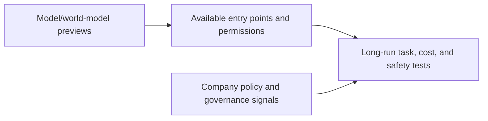

# AI Industry Briefing · 2026-11-02 (late catch-up)

[English (current)](2026-11-02.md) · [中文](../../../daily/2026-11/2026-11-02.md)

- **Cutoff:** 2026-11-02 13:30 Asia/Shanghai. This is a late catch-up for October 28–November 2, not a sequence of on-time daily publications; original dates are retained.
- **Edition type:** Seven high-signal items. We did not pad the usual 20–30 with weak claims, and do not present the missing October 28–31 runs as on-time editions.
- **Navigation:** [Archive index](../../INDEX.md) · [Trend tracker](../../../TRACKERS.md).

## Key conclusions

1. **World models are entering interactive previews but remain research prototypes.** Google Genie 4 supports real-time text steering, native audio, and short-session continuity; Google explicitly reports long-run drift, object-persistence, and complex-physics limits.
2. **Enterprise agent competition is moving into workflow connections and permissions.** OpenAI and ServiceNow expanded integration so users can query and update ServiceNow records in ChatGPT; customer-defined permissions and deployment boundaries matter more than the demo.
3. **Specialized models are being gated by approval and isolation.** GPT-6 Rosalind Research targets approved life-sciences customers, not broad ChatGPT access; model scope, access, and biological-safety evaluation should remain separate.
4. **Model specifications and content governance are becoming product surfaces.** OpenAI updated its Model Spec, announced a shared robots.txt training-preference signal, and published a community-safety report. These are company policies and implementation commitments, not cross-industry standards or court rulings.
5. **Open-weight vendors continue filling out the agent engineering stack.** Mistral listed Le Chonk weights for coding and cybersecurity; weights, licenses, independent benchmarks, and production safety remain separate checks.

## Developments

### 1. Google DeepMind releases the Genie 4 world-model research preview

- **What happened:** Genie 4 is previewed to trusted testers with keyboard and real-time text control, native ambient audio, and interactive dialogue; Gemini can guide multistep tasks. Google explicitly says long runs can drift in visual detail and object persistence, while complex physics, spatial accuracy, readable text, and long-term consistency remain research problems.
- **Why it matters / lens:** Product decisions; editorial planning; technical context. It is an entry point for game prototypes and robot-training environments, not a stable game runtime or production world-generation platform.
- **Publication / type / primary source:** October 27, 2026; [Google DeepMind](https://deepmind.google/blog/genie-4-a-new-generation-of-world-simulation/).
- **Cross-check / confidence:** Single first-party research preview; high for release and stated limits, pending external-device, long-session, and cost tests.
- **Trend:** T02/T05 first appearance; from isolated video demos toward real-time interactive previews.

### 2. OpenAI and ServiceNow expand enterprise workflow partnership

- **What happened:** OpenAI says ServiceNow will bring models and agents into development, security, and IT workflows. A new ChatGPT integration can find similar incidents, assess change risk, and update a ServiceNow record in the same conversation.
- **Why it matters / lens:** Product decisions; investment monitoring. Connectors move agents from answer generation toward executable systems; test authorization, audit, rollback, and human approval rather than the integration demo alone.
- **Publication / type / primary source:** October 28, 2026; [OpenAI announcement](https://openai.com/index/openai-servicenow-partnership-expansion/).
- **Cross-check / confidence:** Partner announcement is inspectable; production outcomes were not independently audited. High for the partnership, pending deployment scope and ROI.
- **Trend:** T01/T08 continuing rise.

### 3. GPT-6 Rosalind Research enters a limited life-sciences preview

- **What happened:** OpenAI released GPT-6 Rosalind Research for approved research customers in Work, Codex, and the API. Enterprise workspaces start with a two-week admin preview, off by default; it is unavailable in Chat, while Discovery remains on GPT-5.5 Rosalind Research.
- **Why it matters / lens:** Product decisions; industry context. Approval, tool permissions, and biological-safety controls are product boundaries; a limited preview is not broad availability.
- **Publication / type / primary source:** October 30, 2026; [OpenAI model release notes](https://help.openai.com/en/articles/9624314-model-release-notes).
- **Cross-check / confidence:** The official model and Enterprise notes align. High for access scope; task quality and safety effects pending.
- **Trend:** T01/T07 first tracked instance.

### 4. OpenAI updates Model Spec, training-preference signals, and safety reporting

- **What happened:** OpenAI reorganized its Model Spec around faithfulness to intent, harm minimization, honesty and transparency, human agency, and care. It also announced support for a shared robots.txt training-preference signal and released a community-safety report; implementation is planned over coming months.
- **Why it matters / lens:** Technical context; editorial planning; investment monitoring. Behavior policy, website training choices, and safety disclosure are different layers; a company policy is not a cross-provider standard, and a planned signal is not completed enforcement.
- **Publication / type / primary sources:** October 29–30; [Model Spec notes](https://help.openai.com/en/articles/9624314-model-release-notes) · [training-preference signal](https://openai.com/index/helping-websites-express-ai-training-preferences/) · [community-safety report](https://openai.com/index/community-safety-report-and-new-protections-for-teens/).
- **Cross-check / confidence:** Multiple first-party materials from one company; high for policy publication, pending adoption and governance effects.
- **Trend:** T07 continuing rise.

### 5. Mistral lists Le Chonk open weights

- **What happened:** Mistral's October 29 news listing identifies Le Chonk weights for agentic coding and cybersecurity. Exact license, hardware requirements, and independent tests should be checked in the model card and repository; “open model” should not be silently rewritten as OSI open source.
- **Why it matters / lens:** Product decisions; technical context; investment monitoring. Weights expand self-hosting options, while production security responsibility, prompt injection, and tool permissions still need independent tests.
- **Publication / type / primary source:** October 29, 2026; [Mistral news](https://mistral.ai/news/).
- **Cross-check / confidence:** The official news listing confirms the release title; this run did not obtain the full model-card license and benchmark detail. Medium-high for the announcement, pending asset and performance validation.
- **Trend:** T03/T06 continuing rise.

### 6. Hub and platform infrastructure continues to fill in

- **What happened:** Hugging Face recently updated shared caching, Job retries/reruns, and storage-bucket tasks. Palantir says GPT-6.1 Terra is available as an experimental AIP model for eligible commercial customers. Platform access does not imply identical regions, plans, or data boundaries.
- **Why it matters / lens:** Product decisions. Cache, job orchestration, and multi-model procurement affect task economics; measure them on your own network, permissions, and SLA.
- **Publication / type / primary sources:** October 26–29; [Hugging Face update](https://huggingface.co/blog/huggingface/whats-new-in-the-hf-cli-and-huggingface-hub-librar) · [Palantir announcement](https://www.palantir.com/docs/foundry/announcements).
- **Cross-check / confidence:** First-party platform materials; high for feature announcements, pending actual cost and coverage tests.
- **Trend:** T03/T06 continuing rise.

### 7. Preview, announcement, and availability remain different states

- **What happened:** This review includes a world-model research preview, an enterprise integration announcement, a limited specialist-model preview, and company governance documents. Each has a traceable entry point; none alone proves broad production ROI or long-term stability.
- **Why it matters / lens:** All lenses. Separate entry point, demo, weights, general availability, independent testing, and commercial results to avoid treating attention as maturity.
- **Publication / type / primary sources:** October 27–30; see the primary links above.
- **Cross-check / confidence:** Synthesis, not a single event; high for the evidence boundary, pending end-to-end results.
- **Trend:** Shared validation requirement across T01/T02/T07/T08.

## Continuing signals and limits

- **First appearance:** Genie 4, GPT-6 Rosalind Research, and the ServiceNow workflow expansion.
- **Intensifying:** Agent connectors, specialist-model approval, open-weight safety, and interactive world-model previews.
- **Pending:** Genie 4 long-run consistency and cost; ServiceNow task success; Rosalind research and safety outcomes; Le Chonk license, benchmarks, and tool isolation.
- **Coverage note:** This late catch-up combines high-signal material from October 28 through November 2. The missing October 28–31 daily runs are explicitly recorded as a gap, not represented as on-time briefs.

> Industry information only, not investment, medical, or legal advice. Check primary sources and applicable conditions before consequential decisions.
