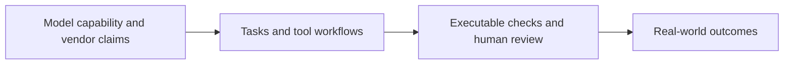

# AI Industry Briefing · 2026-11-04

[English (current)](2026-11-04.md) · [中文](../../../daily/2026-11/2026-11-04.md)

- **Cutoff:** November 4, 2026, 11:00 Asia/Shanghai. Some U.S. sources give only a November 3 publication date; their exact release time relative to the cutoff cannot be established.
- **Edition type:** Six high-signal items. Meituan's November 2 release is a catch-up missed by the previous edition, not a November 3 launch.
- **Navigation:** [Archive index](../../INDEX.md) · [Trend tracker](../../../TRACKERS.md).

## Key conclusions

1. **AI is entering engineering-design workflows, but manufacturability still needs human review.** OpenAI shows a process spanning CAD, PCB and prototypes, and acknowledges that models do not consistently account for tolerances and assembly constraints.
2. **World models have a more concrete closed-loop simulation use case.** Baidu's Apollo World models road users as interactive actors; public evidence does not independently establish simulation fidelity or real-road safety gains.
3. **An agent's task performance can vary substantially with its harness, even with the same model.** IBM's in-house AppWorld comparison reports a 30%–81% completion range; fair configurations and outside replication remain essential.
4. **Verifiable outputs are becoming an AI product differentiator.** CWE-bench v2 publishes executable security-repair tasks; IBM Palette checks slide rendering, overflow and factual traceability.
5. **China's natively multimodal models continue to target long-running agent work.** Meituan reports LongCat-2.5's scale and training on domestic accelerators; performance still needs third-party testing in consistent settings.

## Developments

### 1. OpenAI demonstrates an engineering workflow for physical products

- **What happened:** OpenAI describes a prototype project in which GPT-6 Astra helped design an enclosure, PCB, firmware and software integration. It reports internal hardware teams using Codex and ChatGPT for CAD, drawings and simulation, alongside collaboration with Mazda and others. The company also acknowledges that several human review rounds were needed before manufacturing and that the model did not consistently meet tolerance and assembly requirements.
- **Why it matters / lens:** Product decisions; editorial planning. Engineering agents should be assessed from design through manufacturability; a prototype demonstration does not establish production efficiency.
- **Publication / type / primary source:** November 3, 2026, official research and case study; [OpenAI article](https://openai.com/index/accelerating-engineering-for-the-physical-world/).
- **Cross-check / confidence:** Vendor case study with partner perspectives in the article; no independent replication in this edition. High for publication and collaboration disclosures; broader engineering benefit awaits validation.
- **Trend:** T01/T06 intensifying; agentic coding extends into physical design.

### 2. Baidu unveils the Apollo World autonomous-driving simulation model

- **What happened:** At an Apollo event, Baidu described Apollo World as allowing vehicles and pedestrians to respond to an autonomous-driving system's actions in simulation, while generating camera and lidar observations. It is positioned for closed-loop training and validation, not as a general-purpose game-creation tool.
- **Why it matters / lens:** Product decisions; industry context. Interactive, responsive scenes may fit autonomous-driving validation better than fixed videos. Watch simulation-to-road fidelity and external safety assessment.
- **Publication / type / primary source:** November 3, 2026, company event reported by media; [36Kr reporting Baidu's disclosure](https://www.36kr.com/newsflashes/4054026915189896); [Reuters report](https://www.marketscreener.com/news/china-s-baidu-launches-ai-model-simulating-road-environment-for-robotaxis-ce785fded98bff24).
- **Cross-check / confidence:** Two outlets corroborate the launch and positioning; technical metrics mostly originate with Baidu and lack independent verification. High for launch, pending fidelity and safety outcomes.
- **Trend:** T04 intensifying; world models enter a specific industrial setting.

### 3. CWE-bench v2 publishes 100 security-repair tasks

- **What happened:** Collinear AI released CWE-bench v2 on Hugging Face, with 100 public tasks spanning 91 CWE categories. Agents must fix weaknesses in real open-source repositories without breaking existing behavior. The team provides programmatic grading and a held-out set.
- **Why it matters / lens:** Product decisions; industry context. Security-agent evaluation now covers executable repairs alongside vulnerability discovery. Public tasks may be contaminated by training, so held-out replication matters.
- **Publication / type / primary source:** November 3, 2026, research-team technical article; [Hugging Face post](https://huggingface.co/blog/cwe-bench).
- **Cross-check / confidence:** Public tasks are inspectable; this edition did not rerun evaluations. High for release, model rankings and real repair capability pending validation.
- **Trend:** T07 intensifying; paired with the previous edition's disclosure ledger, this outlines a discovery–repair–verification chain.

### 4. IBM compares agent harnesses with the same model

- **What happened:** IBM Research compared CUGA, Hermes and Deep Agents on 90 AppWorld tasks using the same open-weight model, reporting completion rates from 30% to 81%. The authors note that CUGA had a different configuration and invite outside submissions for stronger configurations and reruns.
- **Why it matters / lens:** Product decisions; editorial planning. Tool interfaces, state management and policy enforcement affect outcomes beyond model choice. These results are not a fair cross-harness ranking by themselves.
- **Publication / type / primary source:** November 3, 2026, IBM Research community article; [Hugging Face post](https://huggingface.co/blog/ibm-research/cuga-harness).
- **Cross-check / confidence:** Team-run comparison with a reproduction entry point; not rerun in this edition. High for experimental disclosure, fair comparison and enterprise outcomes pending.
- **Trend:** T01 intensifying; agent evaluation moves from model scores to the complete system.

### 5. IBM Palette applies verifiable checks to slide generation

- **What happened:** IBM Research introduces Palette, a 20B open-weight model, and a repair harness that checks rendering, overlap, overflow and factual traceability, retaining rewrites only after they pass. Its authors report second place on average across three PresentBench domains, while acknowledging that the benchmark does not measure fidelity to a user's own design language.
- **Why it matters / lens:** Product decisions; editorial planning. Deterministic checks can stabilize structured-content delivery. Humans still need to judge hierarchy, visual quality and business usefulness.
- **Publication / type / primary source:** November 3, 2026, IBM Research technical article; [Hugging Face post](https://huggingface.co/blog/ibm-research/palette-deck-building).
- **Cross-check / confidence:** Method is public; scores are team-reported and were not independently rerun here. High for method disclosure, external-template and user-workflow results pending.
- **Trend:** T08 first appearance; post-generation verification enters office-content tools.

### 6. Catch-up: Meituan releases the natively multimodal LongCat-2.5

- **What happened:** On November 2, Meituan announced LongCat-2.5, claiming 1.6 trillion total parameters and approximately 48 billion active parameters per token. It targets long-running agents, visual understanding and coding, and the company says it trained on domestic accelerators. This was missed by the previous edition.
- **Why it matters / lens:** Product decisions; investment monitoring. Chinese model developers continue combining multimodality, coding agents and domestic compute. Parameter counts and vendor benchmarks are not application outcomes.
- **Publication / type / primary source:** November 2, 2026, official technical post and announcement; [Meituan engineering](https://tech.meituan.com/2026/11/02/Meituan-LongCat-2.5.html); [Meituan announcement](https://www.meituan.com/news/NN261102280001343).
- **Cross-check / confidence:** Two materials from the same company corroborate publication but do not independently validate performance. High for release and stated specifications; benchmarks, training details and transferable effects pending.
- **Trend:** T02/T03 intensifying; catch-up, not a November 3 launch.

## Continuing signals and limits

- **Intensifying:** Complete agent execution systems, industry-specific world-model deployments, verifiable generation and security repair.
- **Pending:** Manufacturability of engineering designs, Apollo World simulation fidelity, fair agent-harness configurations, independent model testing.
- **Coverage limit:** This is a high-signal short edition; no verifiable major AI-game release was identified. Some sources provide a publication date without a precise time; their date does not establish publication before the cutoff.

> Industry information only. Check primary sources and applicable conditions before consequential decisions.
