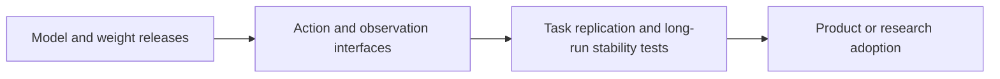

# AI Industry Briefing · 2026-11-06

[English (current)](2026-11-06.md) · [中文](../../../daily/2026-11/2026-11-06.md)

- **Cutoff:** November 6, 2026, 11:00 Asia/Shanghai. Some pages provide only a publication date, not an exact release time.
- **Edition type:** Four high-signal items: two dated November 5 and two earlier catch-ups. Unverified rumors were not added to reach the usual 20–30.
- **Navigation:** [Archive index](../../INDEX.md) · [Trend tracker](../../../TRACKERS.md).

## Key conclusions

1. **World models are gaining clearer action-to-observation interfaces.** NVIDIA released four open-weight Cosmos 3 checkpoints for multi-sensor driving simulation, simulator controls and robot-action prediction. Model availability does not establish independently validated simulation fidelity.
2. **Tencent Hy4's product capabilities and weight release are separate milestones.** Tencent announced Hy4 on November 4 with visual understanding, computer use and game-development task optimization. It says weights and a system card will follow; the weights should not yet be described as released.
3. **Robotics-model competition extends to data and training infrastructure.** LeRobot v0.7.0 adds language interaction, streamed dataset access and distributed training for large models. These are embodied-AI infrastructure advances, not independent proof of any robot task outcome.
4. **Playing games and generating games are distinct AI directions.** The earlier GameScaling research released weights and inference code for an agent that predicts keyboard and mouse actions from game frames. It is neither a game-content generator nor a playable world model.

## Developments

### 1. NVIDIA releases four Cosmos 3 checkpoints for interactive world simulation

- **What happened:** NVIDIA published four post-trained open-weight Cosmos3-Nano models on Hugging Face. Transfer-Auto generates multi-view driving data; Sim-Auto streams synchronized camera and LiDAR observations; Sim-Transfer converts simulator controls and text into video; Sim-Bimanual predicts video from robot or camera actions. Each has 16 billion trainable parameters. OpenMDW1.1 permits commercial and noncommercial use under its terms.
- **Why it matters / lens:** Product decisions; editorial planning; technical context. World-model value is moving beyond isolated clips toward controllable, sequential observation interfaces. Fidelity for driving-policy training and robot evaluation still needs independent measurement. This is not a ready-made game engine.
- **Publication / type / primary source:** November 5, 2026, official NVIDIA team technical post on Hugging Face; [announcement and checkpoint links](https://huggingface.co/blog/nvidia/cosmos-interactive-world-simulation).
- **Cross-check / confidence:** The post links to checkpoints and a technical report, making delivery inspectable. Simulation quality, long-run consistency and downstream benefit were not independently replicated here. High for release and weights; application results pending.
- **Trend:** T02/T05 intensifying. Compare this robotics/driving simulation path separately from Hy-Nomas and Matrix-Game's playable-world direction.

### 2. Tencent Hy4 adds vision, computer use and game-development capabilities (November 4 catch-up)

- **What happened:** Tencent announced Hy4 on November 4 with visual understanding and Computer Use, including training for Blender, CAD and tasks spanning applications. Its game-development work covers UE, Unity and Godot. Tencent reports GameDev and GameLogic evaluation improvements of 19.1% and 9.8% over the preview. The company says weights and a system card will be released soon; a plan to release weights is not a completed weight release.
- **Why it matters / lens:** Product decisions; editorial planning; AI games. The model targets real software and game-development workflows. Game-development task capability is not a world model, and vendor scores do not establish reliability on actual projects.
- **Publication / type / primary source:** November 4, 2026, company announcement; [Tencent post](https://www.tencent.com/zh-cn/tencent-launches-hy4-joining-the-ranks-of-the-worlds-leading-open-source-ai-models/).
- **Cross-check / confidence:** Release status comes from Tencent's primary page. No independent task replication was found in this pass; weights remain pending. High for the announcement; weight delivery and performance claims pending.
- **Trend:** T01/T05 first catch-up entry, pending verification. Follow weights, license and game-development tests.

### 3. Hugging Face releases LeRobot v0.7.0

- **What happened:** LeRobot v0.7.0 supports changing robot goals through language during a run, using an external vision-language model for planning, streaming training data from the Hub or storage buckets, and distributed training for large world-action models. The team says the Hub holds nearly 300 TB of open Physical AI data in LeRobot format.
- **Why it matters / lens:** Product decisions; technical context. Data access, training and remote-inference costs shape iteration speed for embodied models. Dataset volume and toolkit features do not prove safe completion of real-world tasks.
- **Publication / type / primary source:** November 5, 2026, Hugging Face project-team technical post; [LeRobot release notes](https://huggingface.co/blog/lerobot/lerobot-release-v070).
- **Cross-check / confidence:** Features are documented first-hand. The nearly 300 TB figure is the team's count, not independently audited here; physical robot outcomes were not rerun. High for release; scale and task benefit pending.
- **Trend:** T02 intensifying; embodied AI extends from model releases to data and training infrastructure.

### 4. GameScaling studies a game-playing agent (October 20 paper catch-up)

- **What happened:** The GameScaling project, involving Tsinghua researchers, provides weights and inference code for a visual-language agent trained further across varied game environments to predict keyboard and mouse actions from frames. Its project page does not provide complete training code.
- **Why it matters / lens:** AI games; editorial planning; technical context. The work makes games a setting for training and evaluating agents. It does not show automatic game creation, stable long-running playable-world generation or proven general game-playing ability.
- **Publication / type / primary source:** Paper submitted October 20, 2026; exact code and weight release dates were not established in this pass. [Paper](https://arxiv.org/abs/2610.28698); [GameScaling project](https://github.com/THUSI-Lab/GameScaling); [model weights](https://huggingface.co/THUSI-Lab/GameScaling). This was found late and is not a new release today.
- **Cross-check / confidence:** Code and weight links are inspectable. Cross-game generalization and play success are research-team results, not independently reproduced here. High for material availability; generalization and cost pending.
- **Trend:** T05 first catch-up entry, pending verification. Track separately from game-generation tools and interactive world models.

## Continuing trends and limits

- **Intensifying:** Controllable world simulation, robotics data and training infrastructure, and agent operation of real software.
- **Pending verification:** Cosmos 3 long-run consistency and policy-learning value; Hy4 weights, system card and third-party game-development testing; LeRobot's dataset volume and real-robot benefit; GameScaling cross-game generalization.
- **Coverage limits:** Two of the four items are catch-ups. This pass did not find enough high-signal primary-source developments verifiable before cutoff to fill a standard edition. Date-only pages do not establish precise publication times. News released after the cutoff was excluded.

> Industry research information; check primary sources, licenses and applicability before consequential decisions.
