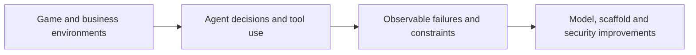

# AI Industry Briefing · 2026-11-08

[English (current)](2026-11-08.md) · [中文](../../../daily/2026-11/2026-11-08.md)

- **Cutoff:** November 8, 2026, 11:00 Asia/Shanghai; this edition was checked after 12:48. Items are included by the dates on their source pages; exact release times are not inferred.
- **Edition type:** Three high-signal items for Sunday. Reposts and unverified launches were not added to reach the usual 20–30.
- **Navigation:** [Archive index](../../INDEX.md) · [Trend tracker](../../../TRACKERS.md). This week's review will be produced after November 8 ends.

## Key conclusions

1. **Persistent game worlds can test agent economic decisions and team trust, but game profits cannot be extrapolated to real investing.** Anthropic observed in-game earnings on historical EVE Online order replays. In live EVE Frontier team tasks, agents needed custom scaffolding for fast actions and did not finish the hardest warship objective.
2. **Some multimodal-agent steps can use a specialized model that returns structured judgments.** Kakao released Kanana-2-v-decide weights. It takes text and images and outputs option probabilities, yes/no probabilities or scores. It does not generate natural language and is not an agent that executes a whole task.
3. **Cyber-model deployment increasingly involves collaborative testing by vendors and outside researchers.** OpenAI announced joint testing of its systems and third-party connections with Hacktron, expanding the team's Daybreak Red access. The collaboration is announced; its repair outcomes remain undisclosed.

## Developments

### 1. Anthropic tests game-market trading and multi-agent teamwork in EVE

- **What happened:** Anthropic describes Project EVE. In a replay of historical EVE Online orders, newer Claude models earned in-game currency, mainly through low-risk spread capture. This was not live trading: the market could not react to the agents' orders. In live EVE Frontier, four Claude agents worked on long-running team tasks. A scaffold written by Fable 5 handled subsecond combat actions. Teams could complete the simpler tutorial, but the furthest any team got was roughly halfway through the warship objective. When a teammate secretly worked against the mission, the others rarely detected it.
- **Why it matters / lens:** AI games; product decisions; investment monitoring; technical context. Games provide observable settings for long-horizon coordination, competition and economic behavior. A replay market is not a financial market; custom scaffolding is not evidence that the base model can act in real time; none of this proves automatic game generation.
- **Publication / type / primary source:** November 6, 2026, Anthropic research post; [Project EVE report](https://www.anthropic.com/research/project-eve-claude-plays-mmorpgs) · [EVE AI Lab partner page](https://lab.eve.com/).
- **Cross-check / confidence:** Both parties' pages confirm the collaboration. Earnings, task completion and saboteur-detection results mainly come from Anthropic's experiment and were not independently rerun. High for research and partnership disclosure; generalization and real-business predictive value pending.
- **Trend:** T01/T05 intensifying; track separately from GameScaling's game-playing agent and world models that generate environments.

### 2. Kakao releases Kanana-2-v-decide multimodal decision-model weights

- **What happened:** Kakao released a decision model based on Kanana-2-v-3b. It accepts text, JSON, chat history and images, returning probability distributions for choices, yes/no judgments or ratings rather than free-form text. Its model card includes weights and examples. Kakao reports an advantage on the public benchmarks and in-house Korean benchmark it compared; those performance figures were not independently reproduced. Weights use the Kanana Open License, whose commercial terms need review.
- **Why it matters / lens:** Product decisions; editorial planning; technical context. Customer-service routing, product-image judgments and agent tool selection might avoid a generation-then-extraction step. Calibration, latency and error cost still need testing on real business samples.
- **Publication / type / primary source:** November 6, 2026, Kakao company announcement and model card; [Kakao announcement](https://www.kakaocorp.com/page/detail/12193) · [Hugging Face weights and model card](https://huggingface.co/kakaocorp/kanana-2-v-decide-3b-2611).
- **Cross-check / confidence:** Both pages are from Kakao, so they are not independent corroboration. Weight availability is inspectable. High for delivery; benchmark replicability and product benefit pending.
- **Trend:** T01/T02 first appearance, pending verification; small multimodal decision components make agent workflows more specialized.

### 3. OpenAI and Hacktron partner to test OpenAI's own systems

- **What happened:** OpenAI announced joint prioritization of security tests with Hacktron, focusing on connections between its systems and third-party services. It is expanding Hacktron's Daybreak Red access. The announcement provides no new count of vulnerabilities, fixes or independent audit results from this collaboration.
- **Why it matters / lens:** Product decisions; editorial planning. As agents connect to external tools, identity, permissions and service boundaries become concrete attack surfaces. A research partnership is a testing arrangement, not evidence that security problems are solved.
- **Publication / type / primary source:** November 6, 2026, OpenAI company announcement; [OpenAI post](https://openai.com/index/partnering-with-hacktron/).
- **Cross-check / confidence:** One official announcement. Delivery and repair outcomes have not been independently disclosed. High for the announced partnership; fixes and defensive benefit pending.
- **Trend:** T07 intensifying; follows GPT-6 Cyber's restricted distribution and earlier vulnerability research.

## Continuing trends and limits

- **Intensifying:** Games as multi-agent evaluation environments; structured multimodal decisions in agent workflows; restricted cyber-model access with outside research partnerships.
- **Pending verification:** Project EVE's predictive value for real businesses and performance without custom scaffolds; Kanana calibration and cost on Chinese and real-world image data; disclosed fixes following the Hacktron collaboration.
- **Coverage limits:** All three source pages are dated November 6. No comparably verifiable new model or world-model release dated November 7 was found in this weekend pass. EVE market replay, live game tasks and game generation are distinct.

> Industry research information; check primary sources, licenses and applicability before consequential decisions.
