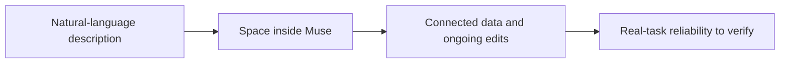

# AI Industry Briefing · 2026-11-09 (late catch-up)

[English (current)](2026-11-09.md) · [中文](../../../daily/2026-11/2026-11-09.md)

- **Cutoff:** November 9, 2026, 11:00 Asia/Shanghai; compiled on November 10. It includes one model API released that day and one missed AI-application update from November 6. LG's own page gives only a date; a media report has an earlier timestamp. The official API go-live time is not disclosed.
- **Edition type:** Two high-signal catch-up items; reposts were not added to increase the count.
- **Navigation:** [Archive index](../../INDEX.md) · [W45 review](../../weekly/2026-W45.md) · [Trend tracker](../../../TRACKERS.md).

## Key conclusions

1. **Meta has put natural-language-created personal spaces inside the Muse app.** These are app experiences users can keep adjusting and connect to other app data. The announcement does not establish reliability on complex workflows or amount to an independently publishable game.
2. **LG offers the K-EXAONE 2.5 text-model API for free.** A free endpoint does not mean open weights or unlimited commercial use indefinitely; vendor benchmark scores need independent replication.

## Developments

### 1. Meta introduces Muse Spaces for describing and editing personal in-app experiences

- **What happened:** On November 6, Meta introduced Muse Spaces. Users can describe a gift list, planner, trivia game or content workspace, and Muse builds a space inside the app. A space can sit in the sidebar or a main tab and be revised through further conversation. Meta says spaces can connect to other apps and update in the background; sharing is still being explored.
- **Why it matters / lens:** Product decisions; editorial planning; AI games. Persistent interfaces created through natural language may lower the effort of building lightweight tools and games. This remains a feature within Muse; it does not establish a publishable game engine or reliable execution across connected apps.
- **Publication / type / primary source:** November 6, 2026, Meta product announcement; [Meta announcement](https://about.fb.com/news/2026/11/introducing-spaces-customize-muse-app/).
- **Cross-check / confidence:** One official announcement. High for the feature announcement; cross-app reliability, actual use and retention await independent verification.
- **Trend:** T01/T05 first included, pending verification. This is a November 6 catch-up, not a new November 9 release.

### 2. LG AI Research makes the K-EXAONE 2.5 text-model API free

- **What happened:** LG AI Research announced free K-EXAONE 2.5 API access after obtaining an API key. Official documentation lists an OpenAI-compatible chat endpoint, text-only input and a maximum context of 524,288 tokens. LG reports results on AutomationBench-Openset, SWE-Bench Pro and other benchmarks from its internal runs of public datasets. The release provides an API for a proprietary model; it does not publish 2.5 weights.
- **Why it matters / lens:** Product decisions; investment monitoring; technical context. The Korean model adds an option to test coding and tool-use tasks. Free access does not establish long-term pricing, service levels or open weights. Terms, rate limits, multilingual quality and end-to-end cost need checking.
- **Publication / type / primary source:** November 9, 2026, LG AI Research announcement and API documentation; [LG announcement](https://www.lgresearch.ai/news/view?seq=755) · [official API documentation](https://docs.exaone.ai/en/docs/k-exaone-2.5).
- **Cross-check / confidence:** The announcement and docs are both LG sources. A [MoneyToday report marked published at 10:00 KST](https://www.mt.co.kr/en/industry/2026/11/09/2026110909413580792), or 09:00 Beijing time, independently indicates an announcement before the cutoff, but does not prove the API was already callable then. High for the announcement; benchmark results, service reliability and commercial terms pending verification.
- **Trend:** T01/T04 first included, pending verification; record API delivery separately from open weights.

## Continuing trends and limits

- **Watch:** Permission boundaries, data synchronization, state persistence after edits and whether simple games can be shared.
- **Time boundary:** The Anthropic and OpenAI items dated November 9 appear in the [November 10 brief](2026-11-10.md) because their publication before this edition's 11:00 cutoff could not be established.
- **Coverage limit:** This is not a comprehensive market scan. LG did not publish the exact time its API became usable.

> Industry research information; check primary sources, licenses and applicability before consequential decisions.
