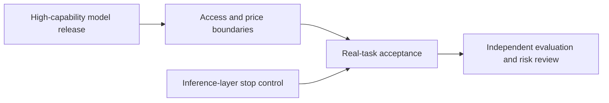

# AI Industry Briefing · 2026-11-10

[English (current)](2026-11-10.md) · [中文](../../../daily/2026-11/2026-11-10.md)

- **Cutoff:** November 10, 2026, 11:00 Asia/Shanghai. The source pages below are dated November 9; exact publication times cannot be inferred.
- **Edition type:** Two high-signal items: a major model release and a research-control system. LG's API is in the [November 9 catch-up](2026-11-09.md) based on an earlier timestamped report.
- **Navigation:** [Archive index](../../INDEX.md) · [W45 review](../../weekly/2026-W45.md) · [Trend tracker](../../../TRACKERS.md).

## Key conclusions

1. **Anthropic released two access forms of the same underlying model.** Claude Fable 5.2 is broadly available with cybersecurity and biology safeguards; Claude Mythos 5.2 requires verified organizational access. Standard pricing is $8/$40 per million input/output tokens. Vendor task scores need independent replication.
2. **Agent safety controls are moving into the inference layer.** OpenAI says Control Room is deployed in its research infrastructure and uses job IDs to deny further generation at the inference engine. Its stated 35-second maximum stopping delay must not be generalized to all external products.

## Developments

### 1. Anthropic releases Claude Fable 5.2 and Mythos 5.2

- **What happened:** Anthropic says Fable and Mythos 5.2 share the same underlying model. Fable adds cybersecurity and biology safeguards and is available through Claude and cloud platforms; Mythos requires an application to a life-sciences or cyber verification program. Both have standard prices of $8 per million input tokens and $40 per million output tokens; optional fast mode doubles those rates. Anthropic reports gains on FrontierCode 2.0 and other tasks, and describes a prototype operating system built by roughly 1,000 cooperating subagents, electronics prototypes and robotics tests.
- **Why it matters / lens:** Product decisions; editorial planning; investment monitoring; technical context. Capability tiers and verified access may become a distribution pattern in high-risk fields. Multi-agent demonstrations rely on particular scaffolds, budgets and human guidance; they do not establish ordinary product success rates or investment returns. Compare task completion, total cost and erroneous safety blocks.
- **Publication / type / primary source:** November 9, 2026, Anthropic product and research announcement; [main announcement](https://www.anthropic.com/claude-fable-and-mythos-5-2) · [electronics experiment](https://www.anthropic.com/research/claude-electronics-design).
- **Cross-check / confidence:** Both pages come from Anthropic and are not independent corroboration. High for release and listed prices; benchmark, scientific and hardware generalization claims await independent review. A partner participated in the electronics experiment, which remains a case within this release.
- **Trend:** T01/T07 intensifying; track access, price and measured quality separately.

### 2. OpenAI describes Control Room for stopping research workloads

- **What happened:** OpenAI says Control Room is deployed across its research inference workloads. Each job has an ID; inference engines check authorization with a central service before generating, and deny output after a stop decision. The company states a maximum of 35 seconds from a stop instruction to preventing further output. The service is designed to fail closed. The mechanism covers research infrastructure; fail-closed handling was still being rolled out to the remaining research workloads.
- **Why it matters / lens:** Product decisions; technical context; editorial planning. A stop point in comparatively centralized inference engines reduces reliance on frequently changing agent workload code. Coverage, bypass resistance and the 35-second figure need independent audit and cannot be assumed to describe every external API.
- **Publication / type / primary source:** November 9, 2026, OpenAI engineering and safety post; [Control Room](https://openai.com/index/control-room/).
- **Cross-check / confidence:** One official disclosure. High for the described architecture and deployment claim; measured performance and complete coverage await independent verification.
- **Trend:** T07 intensifying; distinct from GPT-6 Cyber's restricted distribution and the Hacktron testing partnership.

## Continuing trends and limits

- **Intensifying:** Access tiers for high-capability models and inference-layer operational controls.
- **Pending verification:** Fable 5.2 total cost and success on real multi-agent workflows; Mythos verification-program reach; independent Control Room audit.
- **Coverage limit:** Both source pages are dated November 9, without reliable exact release times. No world-model or Chinese-model delivery of similar verifiability was found in this window, so older releases were not used as filler.

> Industry research information; check primary sources, licenses and applicability before consequential decisions.
