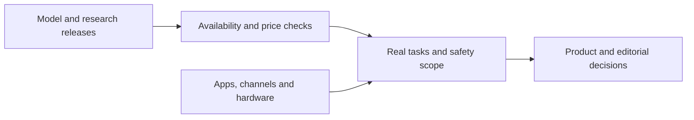

# AI Industry Briefing · 2026-11-11

[English (current)](2026-11-11.md) · [中文](../../../daily/2026-11/2026-11-11.md)

- **Cutoff:** November 11, 2026, 11:00 Asia/Shanghai. Source dates without times do not establish exact launch times. Missed November 9 items are marked as catch-ups.
- **Edition type:** Twelve distinct high-signal events. Vendor evaluations, actual delivery and future plans are labeled separately.
- **Navigation:** [Archive index](../../INDEX.md) · [Trend tracker](../../../TRACKERS.md).

## Key conclusions

1. **High-capability models are being sold in tiers.** Gemini 4 Carbon expands to paid APIs with introductory pricing scheduled to change in December; Muse Ember targets frequent agent subtasks. Compare task success and the full bill.
2. **AI workspaces are absorbing editable artifacts and business entry points.** Claude adds sheets, whiteboards and a data workspace; ChatGPT adds business profiles and clearly labeled Business Agents. Availability and geography differ.
3. **Embodied and security research provide inspectable deliverables.** Gemini Robotics 2.5 enters partner testing, NVIDIA presents GR00T 2 and training tools, and AlphaProof Code releases formal-verification artifacts. Factory success rates and proof scope have limits.
4. **Multimodal evaluation and labor research move closer to deliverables.** MKA tests complex visual files while the Upwork study tracks changing skill bundles. Sampling and causal claims need care.
5. **Infrastructure and distribution continue to shift.** TPU 8tx/8i Max target confidential inference and memory demand; AWS Marketplace and the Adobe partnership change procurement and creative entry points, with adoption still to test.

## Developments

### 1. Google expands Gemini 4 Carbon to paid APIs and Ultra

- **What happened:** Google says Carbon targets difficult long-horizon agent, cybersecurity and science work. Its API is available to paying AI Studio and Gemini for business users, with rollout to Ultra in Antigravity, the Gemini app and Search AI Mode. Introductory input/output prices are $2/$10 per million tokens, scheduled to become $4/$20 on December 1.
- **Why it matters / lens:** Product decisions, investment monitoring and technical context. Carbon is positioned above Argon; compare real task success and total cost. Vendor leaderboard claims are not independent production validation.
- **Publication / type / primary source:** November 10, 2026, Google product announcement; [official release](https://blog.google/innovation-and-ai/models-and-research/gemini-models/gemini-4-carbon-now-available/).
- **Cross-check / confidence:** High confidence in official availability and listed price; capability and cost-benefit claims are vendor reported and need independent reruns.
- **Trend:** T01 intensifying; follows October's limited preview.

### 2. Google DeepMind introduces Gemini Robotics 2.5 to partners

- **What happened:** DeepMind introduced the Robotics 2.5 vision-language-action model and says it tested more than 200 tasks. In an Apptronik and Mercedes-Benz production-line proof of concept, the company reports 96% success for Apollo 2 sorting automotive parts. Access is rolling out to robotics partners.
- **Why it matters / lens:** Product decisions, technical context and investment monitoring. Production-line manipulation differs from world-model simulation. Check sample mix, recovery, runtime and unit cost; a proof of concept is not broad deployment.
- **Publication / type / primary source:** November 10, 2026, DeepMind model announcement; [official release](https://deepmind.google/blog/gemini-robotics-2-5-accelerates-real-world-physical-intelligence/).
- **Cross-check / confidence:** One official disclosure names partners, but their trial data were not independently checked here. High confidence in the announcement; the 96% result and generalization need verification.
- **Trend:** T02 intensifying; track embodied control separately from AI games.

### 3. DeepMind uses AlphaProof Code to verify Signal protocol properties

- **What happened:** DeepMind says researchers defined and reviewed specifications while Gemini Carbon agents produced Lean proofs of key security properties in the Signal protocol implementation. They reintroduced two previously fixed bugs into an isolated version as negative tests. Formal-verification artifacts are available for review.
- **Why it matters / lens:** Product decisions, editorial planning and technical context. Machine checking applies to specified properties and code scope; it does not prove all of Signal or every cryptographic implementation bug-free. The human specification, machine proof and negative-test workflow is instructive.
- **Publication / type / primary source:** November 10, 2026, DeepMind research post; [official research](https://deepmind.google/blog/introducing-alphaproof-code/).
- **Cross-check / confidence:** Signal's CTO comments in the research post, but scope and cost still largely rely on the research team; released artifacts enable outside review.
- **Trend:** T07 first included; distinct from bug finding and access controls.

### 4. Anthropic launches Claude Whiteboards, Sheets and Data

- **What happened:** Anthropic launched Whiteboards and Sheets in beta, renamed Dashboards as generally available Claude Data, and enabled interactive connectors that open partner apps inside Claude. The announcement still describes Claude Meetings as coming soon. Enterprise admins can restrict connector read and write actions.
- **Why it matters / lens:** Product decisions and editorial planning. AI workspaces now retain editable collaborative artifacts. Test version history, permissions, export and team adoption; do not describe Meetings as launched.
- **Publication / type / primary source:** November 10, 2026, Anthropic product announcement; [feature details](https://claude.com/resources/articles/sheets-whiteboards-data) · [connectors and permissions](https://claude.com/resources/articles/more-ways-to-work-with-claude-sheets-whiteboards-and-interactive-connectors).
- **Cross-check / confidence:** Both posts share one publisher. High confidence in feature status; workflow benefits need independent validation.
- **Trend:** T01/T03 intensifying; structured collaboration extends one-off chat output.

### 5. OpenAI launches Businesses in ChatGPT beta

- **What happened:** Eligible organizations can claim a profile, update product data and see aggregated mentions and clicks in Business Hub. Eligible US ecommerce and online-service firms can create a Business Agent. Agent conversations are labeled separately from ChatGPT's own answer, and sponsorship is separately marked.
- **Why it matters / lens:** Product decisions, investment monitoring and editorial planning. AI discovery gains a business-data entry point and in-product conversion path. Track attribution, ad boundaries and non-US access; beta is not global availability.
- **Publication / type / primary source:** November 10, 2026, OpenAI product announcement; [official release](https://openai.com/index/introducing-businesses-chatgpt/) · [business-profile policy](https://openai.com/policies/businesses-in-chatgpt/).
- **Cross-check / confidence:** Company announcement and policy share a publisher. High confidence in feature launch; traffic and commercial impact are unverified.
- **Trend:** T01/T08 first included; agents meet business-data distribution.

### 6. Meta releases Muse Ember for repeatable agent tasks (November 9 catch-up)

- **What happened:** Meta released Muse Ember on November 9 for tool calls, routing, extraction and coding subtasks. It is available in Muse Code and the Meta Model API at $0.10/$0.50 per million input/output tokens, with a one-million-token context window. Meta presents Artificial Analysis scores alongside estimated cost per task.
- **Why it matters / lens:** Product decisions and investment monitoring. An option for high-volume agent subtasks. API availability is not open weights; measure quality, latency and billed cost on the team's own tool tasks.
- **Publication / type / primary source:** November 9, 2026, Meta model announcement; [official release](https://research.meta.ai/blog/muse-ember).
- **Cross-check / confidence:** Official delivery and price are verifiable. Scores cite outside data but model task costs are estimates; practical gains need independent reruns.
- **Trend:** T01/T04 first included, pending verification; a missed prior-day release.

### 7. NVIDIA presents GR00T 2 and Isaac Lab 3.0 at CoRL (November 9 catch-up)

- **What happened:** NVIDIA described the GR00T 2 world-action model, Isaac Lab 3.0 and robotics evaluation tools. It reports that 40 of 50 tasks succeeded at least once; a separate few-shot test averaged 71% success with one demonstration. Isaac Lab 3.0 adds physics-solver and training-environment options.
- **Why it matters / lens:** Technical context and investment monitoring. Joint video/action prediction may support robot manipulation training but is not a playable game world model. At-least-once success differs from reliable completion.
- **Publication / type / primary source:** November 9, 2026, NVIDIA product and research announcement; [official release](https://blogs.nvidia.com/blog/robotics-simulation-advancements-corl/) · [research page](https://research.nvidia.com/labs/gear/gr00t-2/).
- **Cross-check / confidence:** NVIDIA research and blog pages share a publisher. Separate delivery from vendor metrics; factory performance needs independent validation.
- **Trend:** T02 intensifying; distinct from Cosmos 3 simulation checkpoints.

### 8. Google and Artificial Analysis release MKA multimodal work benchmark

- **What happened:** MKA contains 200 multi-step visual-file tasks across 10 sectors and 83 occupations, using a shared Stirrup agent harness, tools and turn budget. Artificial Analysis runs the private full set, while 10 example tasks are public. Google says Carbon ranks second in quality at roughly one-sixth the average task cost of the top-scoring model.
- **Why it matters / lens:** Product decisions and technical context. Closer to accepting outputs such as plans, sheets and decks. A private set helps reduce contamination but limits item-level outside inspection. Vendor ranking still needs methodology and task-transfer review.
- **Publication / type / primary source:** November 10, 2026, Google and evaluator joint announcement; [benchmark overview](https://blog.google/innovation-and-ai/models-and-research/gemini-models/multimodal-knowledge-agent-benchmark/).
- **Cross-check / confidence:** Artificial Analysis operates the evaluation, but a joint announcement is not wholly independent replication. Public examples expose the format; full rankings depend on its method.
- **Trend:** T01/T03 first included; moves from text QA to multimodal deliverables.

### 9. OpenAI and Upwork report changing freelance task bundles

- **What happened:** The two organizations analyze Upwork job postings and ChatGPT usage. They report that task-mix diversity in AI-related postings rose about 45% from early 2023 to late 2025. Some familiar services lost share, while AI projects often bundled more skills and carried larger budgets and hours.
- **Why it matters / lens:** Editorial planning, product decisions and investment monitoring. Demand may be shifting from single outputs to integrated delivery. The sample is platform-specific and includes ChatGPT behavior; descriptive correlations do not prove AI caused earnings or employment changes.
- **Publication / type / primary source:** November 10, 2026, OpenAI/Upwork joint report; [study overview](https://openai.com/index/ai-effect-on-freelance-work/) · [full report](https://cdn.openai.com/pdf/openai-upwork-full-report.pdf).
- **Cross-check / confidence:** Joint data do not constitute independent corroboration; the report itself limits substitution inferences.
- **Trend:** T06 first included, pending verification; watch bundled creative services.

### 10. Google and Adobe expand creative-tool and AI partnership

- **What happened:** Google says it will add Acrobat entry points in Drive and Gmail, expand Adobe tool connections in Gemini and Search AI Mode, and explore a near-real-time Photoshop image-editing model. Several capabilities are described as forthcoming or exploratory.
- **Why it matters / lens:** Product decisions and editorial planning. Model value increasingly reaches users through established creative software. Distinguish existing connections, planned integrations and research exploration; track delivery dates and editing quality.
- **Publication / type / primary source:** November 10, 2026, Google partnership announcement; [official release](https://blog.google/company-news/inside-google/company-announcements/adobe-google-partnership-integration/).
- **Cross-check / confidence:** One official announcement. High confidence in stated plans; future feature delivery and benefit remain unverified.
- **Trend:** T03 intensifying; some components pending delivery.

### 11. Google introduces TPU 8tx and 8i Max (November 9 catch-up)

- **What happened:** On November 9 Google introduced 8tx for confidential inference and smaller-scale training, and dual-chip 8i Max for greater compute and memory bandwidth. The post also describes TPU Sync and Cloud Pathways; delivery status differs by component and needs separate checking.
- **Why it matters / lens:** Investment monitoring and technical context. Long contexts and sensitive-data deployment drive joint chip, memory and network design. Vendor performance claims do not establish broad shipment or customer-measured results.
- **Publication / type / primary source:** November 9, 2026, Google infrastructure announcement; [official release](https://blog.google/innovation-and-ai/infrastructure-and-cloud/global-network/tpu-8i-max-and-8tx/).
- **Cross-check / confidence:** One official source. High confidence in the introduction; hardware availability and comparative metrics need independent checking.
- **Trend:** T08/T09 first included, pending verification.

### 12. ChatGPT Enterprise becomes available in AWS Marketplace (November 9 catch-up)

- **What happened:** On November 9 OpenAI said enterprises can purchase ChatGPT Enterprise via AWS Marketplace using existing AWS procurement and billing, with eligible spend counting toward AWS commitments. It says models and feature updates match direct purchases.
- **Why it matters / lens:** Product decisions and investment monitoring. Marketplace procurement differs from model APIs in Bedrock. Reduced procurement friction does not establish adoption or return on investment.
- **Publication / type / primary source:** November 9, 2026, OpenAI product announcement; [official release](https://openai.com/index/chatgpt-enterprise-aws-marketplace/).
- **Cross-check / confidence:** The OpenAI post includes an AWS executive, but both are partners. High confidence in availability; adoption and value await validation.
- **Trend:** T01/T08 intensifying; distribution change.

## Continuing trends and limits

- **Intensifying:** Model tiers by difficulty and price, editable business artifacts inside agents, and tooling for world-action models and embodied control.
- **Pending verification:** Carbon and Ember total cost on identical tasks; sustained robot-task reliability; security risks outside the formal proof scope; conversion and misleading-output risks for business agents.
- **Coverage limit:** Primary sources in this edition are concentrated among US companies; no Chinese model release of comparable verifiability was found in the same window. This does not imply slower Chinese R&D. November 9 catch-ups are not counted as new November 10 releases.

> Industry research information; check primary sources, licenses and applicability before consequential decisions.
