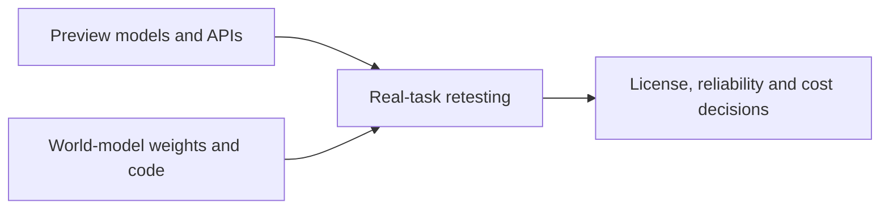

# AI Daily Brief · 2026-11-12 (catch-up)

[English (current)](2026-11-12.md) · [中文](../../../daily/2026-11/2026-11-12.md)

- **Collection note:** Compiled retrospectively on November 13, 2026. All four primary releases predate compilation; their original dates are stated. This is not presented as monitoring completed before 11:00 Beijing time on November 12.
- **Edition:** Four catch-ups, with no filler. [Archive](../../INDEX.md) · [Trend tracker](../../../TRACKERS.md).

## Key conclusions

1. **Chinese models are extending long-task and multimodal delivery.** Qwen4-Max-Preview has a time-limited Token Plan; the ERNIE 5.5 Flash Preview API is live, while its post-trained weights remain a future commitment. Vendor demonstrations and scores need independent task testing.
2. **Two kinds of inspectable world-model artifact arrived.** Runway released Praxis-1 robot video-action weights and code; IFM released PAN 2 video world-model weights and training/inference code. One targets robot control and the other action-conditioned simulation. Neither proves a playable game world.

## Notable developments

### 1. Alibaba Cloud provides time-limited Qwen4-Max-Preview access

- **What happened:** Alibaba Cloud documents `qwen4-max-preview` with text, image/video understanding, tool use and structured output, and a one-million-token context limit. The preview runs from 10:00 Beijing time November 11 to 24:00 November 25, supports only Token Plan and will be retired afterward.
- **Why it matters / lenses:** Product decisions and investment monitoring. Complex agent and multimodal workflows can be tested, but a temporary plan does not establish long-term API pricing or open weights.
- **Published / type / primary sources:** November 11, 2026, official Alibaba Cloud product documentation; [Chinese](https://help.aliyun.cn/zh/model-studio/qwen4-max-preview) · [English](https://help.aliyun.com/en/model-studio/qwen4-max-preview).
- **Corroboration / confidence:** The two languages come from the same provider, not independent corroboration. Availability and dates: high; capability and task economics await independent testing.
- **Trend:** T01/T03 first tracked here; missed November 11 release.

### 2. Baidu releases ERNIE 5.5 Flash Preview

- **What happened:** Baidu calls this the first post-trained version of its earlier Base model, with 280B total/14B active parameters and a one-million-token context. The API is on Qianfan. Weights are promised by November 25 and must not be described as already released. Game, 3D and video demonstrations used an agent framework and outside tools/assets.
- **Why it matters / lenses:** Product decisions, AI in gaming and editorial planning. Retest the long-running game-development demonstration for runnable builds, asset licenses, retries and human involvement. This is a coding-agent example, not a game world model.
- **Published / type / primary sources:** November 11, 2026, official Baidu model announcement; [Chinese](https://ernie.baidu.com/zh/release/ernie-5-5-flash-preview/) · [English](https://ernie.baidu.com/release/ernie-5-5-flash-preview/).
- **Corroboration / confidence:** Both versions are Baidu materials. API delivery: high; vendor demonstrations, benchmarks and future weights require verification.
- **Trend:** T01/T05 first tracked here; missed November 11 release.

### 3. Runway releases Praxis-1 robot world-action artifacts

- **What happened:** Runway provides the 27B Praxis-1 base and robot-fine-tuned checkpoints plus inference and fine-tuning code under Apache 2.0. The model predicts video and robot actions jointly. The company reports 46.2% success on RoboLab-120.
- **Why it matters / lenses:** Product decisions, technical context and investment monitoring. Video pretraining now has a robotics-control delivery path. Keep downloadable artifacts separate from real-robot generalization and long-task reliability; measure deployment memory and adaptation cost.
- **Published / type / primary sources:** November 11, 2026, Runway announcement; [release](https://runway.com/news/company-news/praxis-1-is-now-available) · [research](https://runway.com/research/praxis-1-video-pretraining-to-robot-control) · [code](https://github.com/runwayml/praxis-1-oss).
- **Corroboration / confidence:** Weights and code can be inspected; the research and release share a publisher. Rankings and real-robot outcomes need independent retesting. This is distinct from a playable game world model.
- **Trend:** T02 warming; September's preview has become artifact delivery.

### 4. IFM releases PAN 2 action-conditioned video world model (November 10 catch-up)

- **What happened:** MBZUAI's IFM says PAN 2 simulates subsequent video from a starting scene and text action, and released weights plus training/inference code under Apache 2.0. Its own report calls long-term world consistency an open challenge.
- **Why it matters / lenses:** Technical context, AI in gaming and editorial planning. Study action-conditioned simulation and reproducibility; short video and scores do not establish a persistent interactive game.
- **Published / type / primary sources:** November 10, 2026, IFM press release and technical blog; [release](https://ifm.ai/pan2/press-release/) · [technical blog](https://ifm.ai/blog/pan2/).
- **Corroboration / confidence:** Two materials from one institution are not independent tests. Artifact release: high; physical consistency and long-horizon performance need outside evaluation.
- **Trend:** T02/T05 first tracked here; missed November 10 release.

## Tracking and limitations

- **To verify:** Qwen4 availability after preview, promised ERNIE weights, Praxis-1 cross-hardware reliability, and PAN 2 long-horizon state consistency.
- **Coverage limit:** This retrospective edition does not claim complete real-time coverage of November 11–12. Publication dates and precise launch times differ; vendor examples are not independent acceptance tests.
