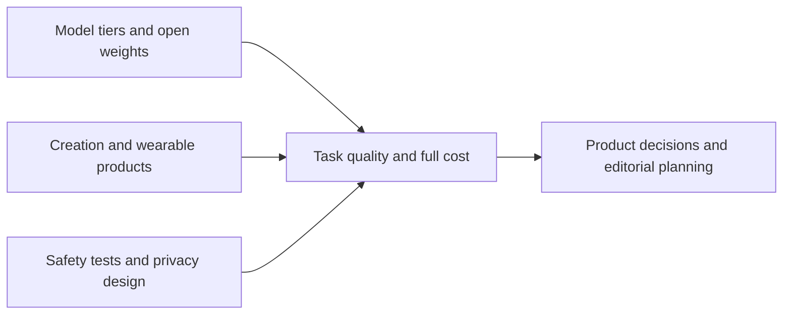

# AI Daily Brief · 2026-11-13

[English (current)](2026-11-13.md) · [中文](../../../daily/2026-11/2026-11-13.md)

- **Collection cutoff:** November 13, 2026, 11:00 Asia/Shanghai. Sources dated only November 12 cannot establish their exact launch hour, so they appear here; see the separate [November 12 catch-up](2026-11-12.md).
- **Edition:** Six high-signal developments. The Hydrogen model and Search deployment are linked rather than counted as separate foundation models. [Archive](../../INDEX.md) · [Trend tracker](../../../TRACKERS.md).

## Key conclusions

1. **Capable models are being assigned different jobs.** Google launched Gemini 4 Hydrogen and Antigravity Orchestrator to switch dynamically between Carbon and Hydrogen. Product selection needs completed-task quality, routing overhead and full workflow cost; vendor benchmarks do not establish independent production performance.
2. **Creative software is turning character continuity and shot variants into usable tools.** Flow added five creator-built tools. For interactive content, test continuity across shots, asset rights and rework time.
3. **Open-weight speech models are reaching self-hosted use cases.** Salesforce released SOV-Transcribe-1 under Apache 2.0 for non-streaming transcription. Named entities, format control and noisy audio are practical acceptance tests.
4. **Safety and privacy now shape delivery.** Anthropic's Anvil automated red-team results are internal research; Google's Gemini eyewear is open for pre-order with stated privacy features. Both need outside validation.

## Notable developments

### 1. Google launches Gemini 4 Hydrogen and Antigravity Orchestrator

- **What happened:** Google positions Hydrogen for frequent coding and agent execution, with availability across AI Studio, the Gemini API, enterprise products, the Gemini app and Search. API list prices are $1.50/$7.50 per million input/output tokens, with a one-million-token context. Antigravity Orchestrator can assign work dynamically to Carbon and Hydrogen. Google reports near-Carbon task success on Terminal-Bench 4.0 with 24% less quota and 19% faster completion on average.
- **Why it matters / lenses:** Product decisions, investment monitoring and technical context. Model routing must be measured by end-to-end success, retries, latency and quota, not only per-call price. Vendor benchmarks and partner comments are not independent production tests.
- **Published / type / primary source:** November 12, 2026, Google model and product announcement; [official release](https://blog.google/innovation-and-ai/models-and-research/gemini-models/introducing-gemini-4-hydrogen/).
- **Corroboration / confidence:** Release, interface and list price are official and high confidence. Performance and safety figures are mainly Google-reported and await independent retesting.
- **Trend:** T01/T04 warming; extends Carbon and lower-cost execution tiers.

### 2. Google Search deploys Hydrogen for complex queries and visual results

- **What happened:** Google says Hydrogen is reaching Search users globally, with multi-part query retrieval, website links, tables, images and custom tools. This is a distribution extension of the same Hydrogen model, not a second foundation-model launch.
- **Why it matters / lenses:** Product decisions and editorial planning. AI Search may alter content discovery and conversion; test source visibility, click-through, citation accuracy and regional differences.
- **Published / type / primary source:** November 12, 2026, Google Search announcement; [official release](https://blog.google/products-and-platforms/products/search/gemini-4-hydrogen-search-upgrade/).
- **Corroboration / confidence:** Google's two posts share a publisher. Feature launch: high confidence; traffic impact lacks independent data.
- **Trend:** T01/T08 warming; product extension of item 1.

### 3. Google Flow releases five visual-storytelling tools

- **What happened:** Flow added Character Poster, Character Arc, Pixel Machine, Lucid Glass and Pocket Studio for visual style, character changes across ages, retro looks, optical effects and shot variants from one phone video.
- **Why it matters / lenses:** Product decisions, editorial planning and AI in gaming. Character continuity and shot variants matter to interactive-story asset pipelines. Test editability, cross-scene consistency, rights and rework time. These are creative tools, not a game world model.
- **Published / type / primary source:** November 12, 2026, Google Labs product announcement; [official release](https://blog.google/innovation-and-ai/models-and-research/google-labs/new-google-flow-tools/).
- **Corroboration / confidence:** One official source. Tool release: high confidence; time savings and finished quality need independent tests.
- **Trend:** T03/T05 warming.

### 4. Salesforce releases open-weight SOV-Transcribe-1 speech model

- **What happened:** Salesforce published SOV-Transcribe-1 on Hugging Face, with 4B active/26B total parameters, non-streaming ASR, instruction-guided formatting, keyword hints and multilingual support. Weights carry Apache 2.0. The company cites a first-place ranking among open-weight models on a specified leaderboard.
- **Why it matters / lenses:** Product decisions and technical context. Voice-agent failures often occur in emails, numbers, names and tool arguments. Retest on actual accents, noise, latency and entity accuracy. Open weights do not imply real-time conversational latency.
- **Published / type / primary sources:** November 12, 2026, Salesforce team article and model card on Hugging Face; [release](https://huggingface.co/blog/salesforce-sovereign-intelligence/sov-transcribe-1) · [model card](https://huggingface.co/salesforce-sovereign-intelligence/SOV-Transcribe-1).
- **Corroboration / confidence:** Weights and license can be inspected. A third-party leaderboard is cited selectively by the publisher; application performance needs independent testing.
- **Trend:** T03/T04 first tracked here.

### 5. Anthropic reports Anvil automated red-team research

- **What happened:** Anthropic's researchers say their internal Anvil system found specified weaknesses in its biological, cyber and anti-distillation safeguard tests faster than contracted human red teams, and is used before releases. It depends on internal frontier models and safeguard details; the paper also distinguishes attacker conditions from real traffic.
- **Why it matters / lenses:** Product decisions and technical context. Safety testing is moving from static prompts to adaptive agent pressure tests. Check scope, repair loops, false positives, cost and independent review; the internal comparison does not prove every safeguard is secure.
- **Published / type / primary source:** November 12, 2026, Anthropic safety research; [research article](https://safeguards.anthropic.com/2026/automated-red-teaming/).
- **Corroboration / confidence:** One research team, with readable methods and limits. Comparative advantage and production protection are not independently reproduced; medium confidence.
- **Trend:** T07 warming.

### 6. Google opens pre-orders for Gemini intelligent eyewear

- **What happened:** Google announced pre-orders for eyewear designed with Gentle Monster, Warby Parker and Samsung, with sales beginning December 10. It integrates Gemini, navigation and live translation. Google describes restrictions on camera-visual history and training use, bystander face redaction and a recording indicator. Designs and market availability differ.
- **Why it matters / lenses:** Product decisions, investment monitoring and editorial planning. A multimodal assistant moves into a wearable context where interaction, social acceptance and privacy constraints all matter. Pre-orders do not establish sales or retention.
- **Published / type / primary source:** November 12, 2026, Google hardware announcement; [official release](https://blog.google/innovation-and-ai/technology/xr-ar/google-intelligent-eyewear-collections-pre-order/).
- **Corroboration / confidence:** Single vendor announcement. Pre-order status: high confidence; battery life, privacy effectiveness and adoption need outside testing.
- **Trend:** T03/T08 first tracked here; watch December delivery.

## Tracking and limitations

- **Warming:** Model tiers and routing, character/shot control in creative tools, self-hosted speech and automated safety testing.
- **To verify:** Hydrogen's full task cost and Search referrals; Flow long-form continuity; SOV-Transcribe-1 entity accuracy; outside replication of Anvil; eyewear delivery and privacy effectiveness.
- **Coverage limit:** A source dated only November 12 is not assumed to precede yesterday's 11:00 cutoff. US providers dominate this edition, which is not evidence that other regions had no progress. The November 12 catch-up is separate.
