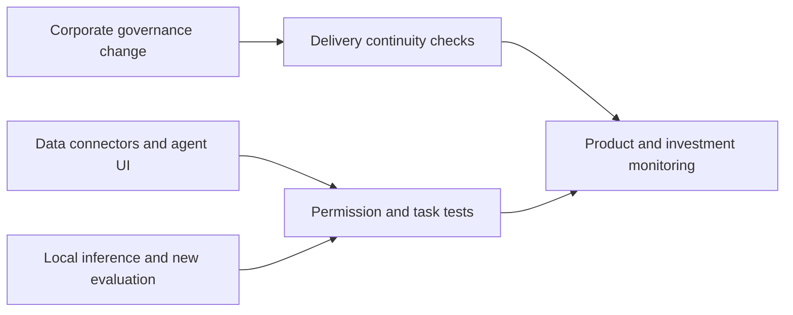

# AI Daily Brief · 2026-11-14

[English (current)](2026-11-14.md) · [中文](../../../daily/2026-11/2026-11-14.md)

- **Collection cutoff:** November 14, 2026, 11:00 Asia/Shanghai. Sources dated only November 13 do not establish an exact launch hour. A2UI, dated November 11, is an explicit catch-up.
- **Edition:** Five high-signal items, with no filler. [Archive](../../INDEX.md) · [Trend tracker](../../../TRACKERS.md).

## Key conclusions

1. **NVIDIA has a major leadership change.** The company confirms Jensen Huang resigned as CEO, president and director; CFO Colette Kress is interim CEO, and the board has begun a successor search. Operational continuity is the board's expectation, not an observed outcome.
2. **Personal agents are reaching more sensitive data.** US Gemini users may opt to connect Google Wallet and Plaid-linked accounts to read spending information; Google says the connector is read-only. Permission scope, correction, financial-advice boundaries and disconnect behavior need product testing.
3. **Two layers beneath agent products are maturing.** llama.cpp 1.0 formalizes library API/ABI versioning; Google's A2UI 1.0 specifies interactive agent screens. One concerns local-inference integration, the other confirmable and editable interfaces.
4. **Evaluation is starting to ask whether assistants help when users ask the wrong question.** Ai2's XYBench tests mismatches between a requested method and the underlying goal. Scores cannot substitute for user research.

## Notable developments

### 1. NVIDIA announces CEO transition

- **What happened:** NVIDIA's board says Jensen Huang resigned as president, CEO and director effective November 12. CFO Colette Kress is also interim CEO, Harvey C. Jones became board chair, and the board is searching for a permanent successor.
- **Why it matters / lenses:** Investment monitoring and product decisions. Watch November 17 earnings, customer deliveries and actual roadmap changes. The statement that operations will continue uninterrupted is the board's expectation, not verified performance. No unverified attribution of private motives is made.
- **Published / type / primary sources:** November 12, 2026, NVIDIA investor-relations announcement; [release](https://investor.nvidia.com/news/press-release-details/2026/NVIDIA-Announces-CEO-Transition/) · [management page](https://investor.nvidia.com/governance/management-team/default.aspx).
- **Corroboration / confidence:** Two official pages confirm appointments but share a company. Personnel facts: high confidence; strategic and financial impact remains to be seen.
- **Trend:** T08 first tracked here; follow earnings and succession.

### 2. US Gemini users can connect Google Wallet

- **What happened:** Google says US Gemini app users can opt to connect Wallet and, through Plaid, linked card and bank accounts for spending-based budgeting, subscription answers and charts. The company says the connector is read-only, cannot move or invest funds and can be disabled.
- **Why it matters / lenses:** Product decisions and investment monitoring. Personalized agents are touching sensitive data. Test permission scope, mistaken transaction interpretations, data handling after disconnect and financial-advice boundaries. A read-only claim does not eliminate privacy risk.
- **Published / type / primary source:** November 13, 2026, Google product announcement; [official release](https://blog.google/innovation-and-ai/products/gemini-app/google-wallet-gemini-app/).
- **Corroboration / confidence:** Single vendor source. Rollout and US scope: high confidence; privacy implementation and actual utility need independent checks.
- **Trend:** T01/T08 first tracked here; extends personal cross-app context.

### 3. llama.cpp releases version 1.0.0 libraries

- **What happened:** ggml-org announced llama.cpp and ggml libraries v1.0.0 and says future API/ABI incompatibilities will be signaled by major-version changes. This is a versioning commitment for local multimodal-model inference infrastructure, not a new model.
- **Why it matters / lenses:** Product decisions and technical context. Private and local deployments rely on stable interfaces. Test model coverage, backend compatibility, quantization quality and existing application builds when upgrading.
- **Published / type / primary source:** November 13, 2026, ggml-org team article; [release note](https://huggingface.co/blog/ggml-org/llama-cpp-v1).
- **Corroboration / confidence:** Maintainer's first-hand account; version release is high confidence, while downstream migration stability requires project testing.
- **Trend:** T04 warming; local inference is moving toward interface governance.

### 4. Ai2 releases XYBench evaluation resource

- **What happened:** Ai2 published XYBench with more than 8,000 questions to test whether assistants detect a mismatch between a user's proposed method and actual goal, alongside a paper, data and code. The team says it won an EMNLP 2026 Best Resource Paper award.
- **Why it matters / lenses:** Product decisions, editorial planning and technical context. Users often express a faulty solution path rather than their need. Add such cases to agent tests, while checking real intent, mistaken corrections and domain safety.
- **Published / type / primary sources:** November 13, 2026, Ai2 team Hugging Face article; [release](https://huggingface.co/blog/allenai/xybench) · [code](https://github.com/allenai/xybench).
- **Corroboration / confidence:** Data and code can be inspected; conclusions are team-reported. Transfer to real product tasks needs independent validation.
- **Trend:** T01/T06 first tracked here; from literal answers toward intent correction.

### 5. Google releases stable A2UI 1.0 (November 11 catch-up)

- **What happened:** Google released A2UI 1.0, a generative-UI protocol in which an agent describes interactive forms or charts and a host app renders native components. It adds bidirectional function calls and accessibility support. Web, Flutter and SwiftUI renderers are listed; Jetpack Compose 1.0 remains forthcoming.
- **Why it matters / lenses:** Product decisions and technical context. Agent output can become confirmable, editable work. Test structured-content safety, component permissions, accessibility and cross-platform compatibility. A stable protocol does not mean every SDK is already at 1.0.
- **Published / type / primary source:** November 11, 2026, official Google Developers article; [release](https://developers.googleblog.com/a2ui-10-build-delightful-fast-reliable-agentic-experiences/).
- **Corroboration / confidence:** First-hand protocol and SDK list; interoperability and production adoption need outside tests.
- **Trend:** T01/T03 first tracked here; missed November 11 release.

## Tracking and limitations

- **To verify:** Real delivery effects of NVIDIA's leadership change; Wallet permissions and error handling; llama.cpp 1.0 downstream upgrades; XYBench's predictive value for user tasks; and A2UI cross-host compatibility.
- **Coverage limit:** This edition includes high-signal events with readable primary materials. Company statements, product descriptions and research findings are labeled separately; related reports and vendor tests are not counted as independent validation.
