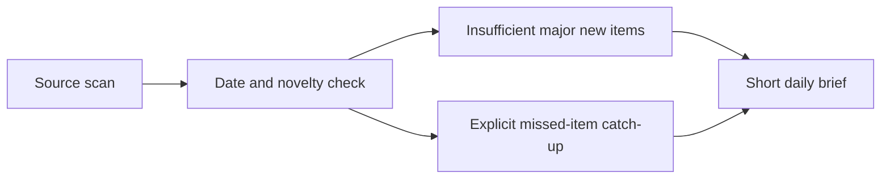

# AI Daily Brief · 2026-11-15

[English (current)](2026-11-15.md) · [中文](../../../daily/2026-11/2026-11-15.md)

- **Collection cutoff:** November 15, 2026, 11:00 Asia/Shanghai; compiled after the cutoff. Official, research and Hugging Face sources were reviewed. Search gaps are not evidence of no industry-wide releases.
- **Assessment: No major update today.** One missed November 13 item is recorded below and is not counted as a new release today. [Archive](../../INDEX.md) · [Trend tracker](../../../TRACKERS.md).

## Key conclusions

1. **The high-signal increment today does not justify a routine 20–30-item edition.** Continue tracking model tiers, agent permissions and delivered world-model artifacts without recounting old news.
2. **Reusable datasets are also AI industry deliverables.** DeepMind released historical and live SatWeave and PARDIG data for weather and hydrology research; its accuracy claims still need outside review.

## Catch-up development

### 1. Google DeepMind opens SatWeave and PARDIG weather datasets (November 13 catch-up)

- **What happened:** DeepMind released historical archives and live feeds for SatWeave satellite imagery mosaics and PARDIG precipitation data, both relevant to WeatherNext 3 development. It reports roughly 15-minute, 10-kilometer resolution for PARDIG and internal evaluation against radar and weather stations.
- **Why it matters / lenses:** Technical context and product decisions. Reusable data may lower the barrier to training and validating weather and hydrology applications. Check license, latency, regional error and maintenance. This is a dataset release, not a new foundation model.
- **Published / type / primary sources:** November 13, 2026, Google DeepMind research announcement; [official report](https://deepmind.google/blog/opening-the-datasets-behind-our-ai-weather-models/) · [paper and data entry point](https://developers.google.com/earth-engine/datasets).
- **Corroboration / confidence:** Public data access can be inspected. Accuracy comparisons are publisher-run, with no independent replication here. Delivery: high confidence; performance awaits validation.
- **Trend:** T02/T06 first tracked here; missed November 13 item.

## Tracking and limitations

- **To verify:** Actual delivery after yesterday's NVIDIA leadership change, Gemini Wallet permissions, and independent regional quality checks for these datasets.
- **Coverage limit:** A short edition means this scan found too few major incremental items. It does not imply that no AI news occurred anywhere.
