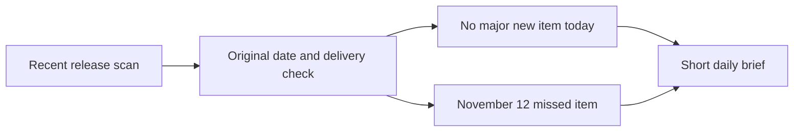

# AI Daily Brief · 2026-11-16

[English (current)](2026-11-16.md) · [中文](../../../daily/2026-11/2026-11-16.md)

- **Collection cutoff:** November 16, 2026, 11:00 Asia/Shanghai; recent official releases, Hugging Face and technology media were reviewed.
- **Assessment: No major update today.** The item below is a catch-up from an official November 12 release, not a November 16 launch. [Archive](../../INDEX.md) · [Last week's brief](../../weekly/2026-W46.md).

## Key conclusions

1. **This scan found too few verified major developments for a routine 20–30-item edition.** Older news and unverified community reposts were not used to fill the count.
2. **Classification and routing models warrant a separate evaluation.** Perplexity Decider v1.3 delivers downloadable weights and APIs for probabilistic decisions, extraction and routing. It is not a generative agent; vendor evaluations need real-task replication.

## Catch-up development

### 1. Perplexity releases Decider v1.3 and Decider Flash v1.3 (November 12 catch-up)

- **What happened:** Perplexity released two decision models supporting binary and multiclass classification, scoring, and `locate` text extraction; Flash is a smaller distilled version. The company says both have downloadable Apache-licensed weights on Hugging Face and are available through OpenRouter and the Decisions API.
- **Why it matters / lenses:** Product decisions and technical context. Compare probability outputs, latency and cost per task for moderation, routing and content labeling; calibrate thresholds on a labeled in-house set. A classifier is not an agent that independently completes long tasks.
- **Published / type / primary sources:** November 12, 2026, Perplexity official technical blog; [release post](https://www.perplexity.ai/hub/blog/perplexity-decider) · [API community announcement](https://community.perplexity.ai/c/announcements/9).
- **Corroboration / confidence:** Both sources are from the publisher and are not independent corroboration. Weights, license and API delivery are externally inspectable; performance gains remain vendor claims. High confidence in delivery; effectiveness awaits independent testing.
- **Trend:** T01/T04 continuing momentum; missed November 12 item.

## Tracking and limitations

- **To verify:** Error rates, threshold drift and total task cost in real moderation and routing work. See the [W46 weekly brief](../../weekly/2026-W46.md) for last week's access, license and long-run outcome checks.
- **Coverage limit:** “No major update today” describes this scan window and these sources; it does not mean no AI release occurred anywhere.
