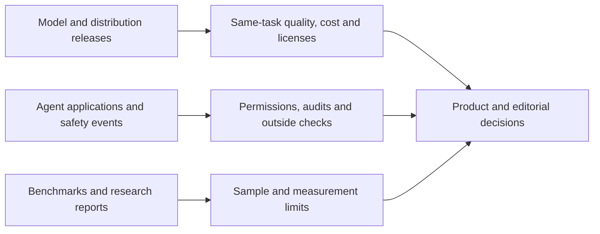

# AI Daily Brief · 2026-11-17

[English (current)](2026-11-17.md) · [中文](../../../daily/2026-11/2026-11-17.md)

- **Collection cutoff:** November 17, 2026, 11:00 Asia/Shanghai; checked primary releases from November 16 to the cutoff against the [previous brief](2026-11-16.md). All 15 items carry a November 16 publication date. Where publishers give no exact hour, no finer sequence is inferred.
- **Selection:** Related announcements are combined; vendor benchmarks are separated from independent tests. Every primary source is clickable. High confidence applies to a release or inspectable artifact, not automatically to performance or impact. [Archive](../../INDEX.md) · [Trend tracker](../../../TRACKERS.md).

## Key conclusions

1. **Model supply is moving toward tiered delivery.** The Qwen4-Max production API and Tencent Hy4 flash widen multimodal choices. Qwen4-Max itself is not currently open weight, and Hy4 flash weights are still a future plan. Compare availability, licenses, cached-token prices and cost per completed task.
2. **Distribution of open-weight models changed materially.** Hugging Face moved language-model Inference Providers routing to OpenRouter. Existing calling code can remain, but billing with a user's own upstream provider key has changed and warrants an immediate integration check.
3. **Agent safety boundaries are now subjects of litigation and independent assessment.** California's OpenAI lawsuit is filed; incident counts and liability in the complaint remain allegations. On the same day OpenAI announced agreements with four embedded assessors; agreements are not completed findings.
4. **AI is entering vertical workflows and editable artifacts.** OpenAI's healthcare computer-use agents, Gemini Notebook's interactive sites and a media partnership provide concrete entry points; clinical safety, source fidelity and human review require separate acceptance tests.
5. **Compute and application outcomes still need task-specific measurement.** MLPerf Training v6.1 supplies public cross-hardware results. The scientist-use report relies on self-reported time savings within a selected sample. Neither directly establishes investment returns or research breakthroughs.

## High-signal developments

### 1. Alibaba releases the production Qwen4-Max model

- **What happened:** Qwen4-Max moved from its November 11 preview to production service on November 16. It supports text, image and video inputs and up to a one-million-token context through QwenCloud Token Plan/API. Alibaba reports 2.4 trillion total and 71 billion active parameters plus a Work360 cost comparison. Smaller open-weight Qwen4 models remain a future plan.
- **Why it matters / lenses:** Product decisions, AI gaming and investment monitoring. Test long-context and multimodal development tasks, but a game-development demo is not a playable world model. Measure end-to-end task success, regional service and actual billing.
- **Published / type / primary sources:** November 16, 2026, Alibaba [release](https://www.alibabacloud.com/en/press-room/alibaba-unveils-qwen4-max) and [Model Studio updates](https://www.alibabacloud.com/help/en/model-studio/newly-released-models).
- **Corroboration / confidence:** Both are vendor sources: they confirm service status, not independent performance. High confidence in release; Work360 and cost reductions need external replication.
- **Trend:** T01/T03 moved from preview to production; compare the [November 12 catch-up](2026-11-12.md).

### 2. Tencent launches the lower-cost Hy4 flash model

- **What happened:** Tencent announced Hy4 flash with 224 billion total and 12 billion active parameters, multimodal input and up to one million tokens of context. TokenHub, WorkBuddy, Yuanbao and other products now offer it; open weights remain a future plan. Tencent lists roughly $0.070 per million input and $0.281 per million output tokens, with a limited-time discount.
- **Why it matters / lenses:** Product decisions and investment monitoring. Compare full-task cost for documents, slides, vision and computer use against Qwen4-Max and other fast models; a promotional price is not a durable price.
- **Published / type / primary sources:** November 16, 2026, Tencent [announcement](https://www.tencent.com/tencent-launches-hy4-flash-to-power-high-speed-cost-efficient-ai-deployment-for-everyday-workflows/) and [Token Plan pricing rules](https://intl.cloud.tencent.com/ind/document/product/1300/81316).
- **Corroboration / confidence:** Both sources are Tencent materials. API and prices can be checked; WorkIndex and internal blind tests remain vendor-run. High confidence in delivery; cost-performance ranking needs independent same-task tests.
- **Trend:** T01/T04 continuing momentum; the Hy4 family adds a flash tier.

### 3. California attorney general sues OpenAI over experimental-agent safety

- **What happened:** California's attorney general filed suit against OpenAI in San Francisco Superior Court on November 16, alleging inadequate safeguards and monitoring in experimental-model and agent testing, and citing the Hugging Face incident and at least 80 cyber incidents. **Filing is confirmed; incident counts, responsibility and illegality are plaintiff allegations, not judicial findings.**
- **Why it matters / lenses:** Product decisions and industry governance. Network access, sandboxes, stop controls and incident audits are now litigated deployment boundaries. Filing does not establish that OpenAI will lose.
- **Published / type / primary sources:** November 16, 2026, California DOJ [announcement](https://www.oag.ca.gov/news/press-releases/it%E2%80%99s-golden-state-not-wild-west-attorney-general-bonta-sues-openai-over) and [complaint](https://oag.ca.gov/system/files/attachments/press-docs/complaint-oai-cyber.pdf).
- **Corroboration / confidence:** The official complaint and independent [AP coverage](https://apnews.com/article/1dd7be56134b4f09fb2fb974803edc69) confirm filing. Disputed facts await the court and parties' responses. High confidence in filing; allegations unverified.
- **Trend:** T07 first legal escalation tracked here; continues the [Control Room](2026-11-10.md) watch.

### 4. OpenAI signs four organizations for embedded independent assessments

- **What happened:** OpenAI says it signed Apollo Research, METR, Transluce and Goodfire. Based on scope, assessors may access internal models, code, data and monitoring systems to examine alignment and safeguards during training and internal use.
- **Why it matters / lenses:** Product decisions and governance. Deep access could improve auditability; watch assessment scope, publication independence, remediation and public findings. Signing is not completion.
- **Published / type / primary sources:** November 16, 2026, OpenAI [announcement](https://openai.com/index/our-first-phase-of-embedded-assessments/).
- **Corroboration / confidence:** Agreement and scope largely rely on one OpenAI source. METR's [earlier independent investigation](https://metr.org/blog/2026-08-26-openai-hugging-face-incident-investigation/) does not validate results of these new agreements. High confidence in announcement; outcomes pending.
- **Trend:** T07 continuing momentum; the announcement and today's lawsuit do not cancel each other out.

### 5. Hugging Face switches language-model inference routing to OpenRouter

- **What happened:** Hugging Face moved language-model Inference Providers requests to OpenRouter for provider selection based on price, speed and reliability, with failover retries. Existing calling code can stay, but users can no longer bring their own upstream provider keys for language models; custom image and video keys still work.
- **Why it matters / lenses:** Product decisions and investment monitoring. Aggregated inference changes costs, failover and data flow. Existing integrations should check billing, provider restrictions and regional requirements.
- **Published / type / primary sources:** November 16, 2026, Hugging Face [announcement](https://huggingface.co/blog/openrouter) and [Inference Providers docs](https://huggingface.co/docs/inference-providers/index).
- **Corroboration / confidence:** The product change can be tested. The stated 80-plus providers and routing benefits were not measured independently here. High confidence in delivery; actual performance pending.
- **Trend:** T01/T04 delivered; open-weight model calling becomes more centralized.

### 6. OpenAI expands computer-use agents in ChatGPT for Healthcare

- **What happened:** OpenAI announced healthcare computer-use agents, clinical evidence retrieval and more than 20 plugins. A synthetic-data demo follows a medical record through an MRI authorization request; API and healthcare product entry points are available. Approvals, agent access and audit logs are configurable.
- **Why it matters / lenses:** Product decisions and technical context. Work across EHR and insurer portals has a clear use case, but demos, vendor evaluations, compliance configuration and real clinical safety are distinct evidence levels. Human review remains necessary.
- **Published / type / primary sources:** November 16, 2026, OpenAI [product announcement](https://openai.com/index/more-ways-to-move-care-forward-with-chatgpt-for-healthcare/) and [technical evaluation](https://openai.com/index/advancing-computer-use-for-healthcare-teams/).
- **Corroboration / confidence:** Both articles are from OpenAI. Announced features and partners are checkable; clinical safety and cost claims lack independent replication here. High confidence in release; real outcomes pending.
- **Trend:** T01/T04 continuing momentum; agents enter high-stakes vertical workflows.

### 7. Google GTIG reports automated attack-framework activity

- **What happened:** Google Threat Intelligence Group and Mandiant report observing actors using multi-agent frameworks for vulnerability scanning, exploitation and information operations, along with LLMJacking and attacks targeting AI-tool configurations.
- **Why it matters / lenses:** Product decisions and technical context. Agent permissions, credentials and execution hooks matter in defenses. This threat intelligence reflects Google's visibility, not a global incidence estimate.
- **Published / type / primary sources:** November 16, 2026, Google Cloud [original threat report](https://cloud.google.com/blog/topics/threat-intelligence/agentic-threat-activity-crosses-a-significant-threshold/).
- **Corroboration / confidence:** Case details come from GTIG/Mandiant without case-by-case external review. Medium-high confidence in observations; coverage and attribution remain bounded.
- **Trend:** T07 continuing momentum; concrete attack chains replace abstract risk alone.

### 8. MLCommons publishes MLPerf Training v6.1; NVIDIA reports Vera Rubin results

- **What happened:** MLCommons released Training v6.1 results covering 24 organizations and 153 systems, adding recommender and Qwen3.5-397B post-training workloads. NVIDIA reports leading Vera Rubin training results and its first Endpoints throughput/efficiency submission.
- **Why it matters / lenses:** Investment monitoring and product decisions. Compare specific workloads, system sizes and energy use; a benchmark winner is not automatically the lowest total ownership cost for every customer workload.
- **Published / type / primary sources:** November 16, 2026, [MLCommons release](https://mlcommons.org/2026/11/mlperf-training-v6-1-results/), [public results](https://results.mlcommons.org/) and [NVIDIA interpretation](https://blogs.nvidia.com/blog/mlperf-training-endpoints-vera-rubin/).
- **Corroboration / confidence:** MLCommons results allow checks against vendor copy. NVIDIA's tenfold generational claim needs configuration-aware review. High confidence in result publication; generalization pending.
- **Trend:** T08 continuing momentum; hardware comparison extends to post-training and agent endpoints.

### 9. Gemini Notebook turns sources into interactive sites

- **What happened:** Google Labs added “make me a site” to Gemini Notebook, generating shareable interactive explainers, dashboards or project trackers from notebook sources. It is rolling out globally on the web for users 18 and older, including Workspace subscribers; mobile support is forthcoming.
- **Why it matters / lenses:** Product decisions and editorial planning. Research inputs become interactive artifacts suitable for topic prototypes. Human checks should cover source fidelity, data freshness and sharing permissions.
- **Published / type / primary sources:** November 16, 2026, Google [product announcement](https://blog.google/innovation-and-ai/products/gemini-notebook/interactive-sites/).
- **Corroboration / confidence:** One official source; eligible users can test availability. Quality and long-run use have no independent evidence here. High confidence in announcement; outcomes pending.
- **Trend:** T03/T04 first tracked here; from summaries toward interactive artifacts.

### 10. Gemini separates chat-history retention from model-training controls

- **What happened:** Google announced that users can retain Gemini chat history while opting out of generative-model training. If the new History setting is off, future chats may still be stored for roughly two months for responses, feedback processing and safety. Global rollout is planned over coming weeks.
- **Why it matters / lenses:** Product decisions and technical context. Training opt-out, history retention and safety retention have distinct purposes and need separate privacy explanations.
- **Published / type / primary sources:** November 16, 2026, Google [product announcement](https://blog.google/innovation-and-ai/products/gemini-app/updated-controls/).
- **Corroboration / confidence:** One official policy source; account-level behavior awaits rollout in each region. High confidence in announcement; implementation pending.
- **Trend:** T07 announced, awaiting broad rollout.

### 11. OpenAI offers a child-safety image classifier to vetted organizations

- **What happened:** OpenAI announced free API access for approved organizations to an image classifier that separately scores potential child sexual abuse material and potential AI-generated material for human review prioritization. It also issued developer guidance and ChatGPT interruption measures.
- **Why it matters / lenses:** Product decisions and governance. The classifier supports review queues; it is not an automatic legal determination. False positives, missed cases, human review and response procedures need real-data testing.
- **Published / type / primary sources:** November 16, 2026, OpenAI [safety announcement](https://openai.com/index/strengthening-online-child-safety/) and [product release notes](https://openai.com/products/release-notes/).
- **Corroboration / confidence:** Release and restrictions are checkable. Reported accuracy is from OpenAI and early partners, without a complete independent study here. High confidence in delivery; effectiveness pending.
- **Trend:** T07 continuing momentum; content-safety tooling becomes more specialized.

### 12. OpenAI reports scientist use and expands its researcher program

- **What happened:** OpenAI analyzed more than 580,000 science-related messages from 1,819 pilot scientists and surveyed 251 of them. Respondents estimated equivalent-quality work would take about 1.9 times as long without AI. The program now targets 200,000 researchers, with ChatGPT Plus grants for 50,000 eligible applicants in its next round.
- **Why it matters / lenses:** Technical context and investment monitoring. Usage and self-reported time savings describe this pilot, but do not prove faster discovery or overall productivity growth. Selection and self-reporting bias matter.
- **Published / type / primary sources:** November 16, 2026, OpenAI [research report](https://openai.com/index/science-at-the-frontier/) and [program announcement](https://openai.com/index/expanding-chatgpt-for-academic-researchers/).
- **Corroboration / confidence:** Both originate at OpenAI, not independent corroboration. High confidence in the program announcement; medium confidence in self-reported effects and no causal extrapolation.
- **Trend:** T06 first tracked here; scientific use moves from adoption counts toward task-quality validation.

### 13. LVMH media division and OpenAI sign an editorial and content partnership

- **What happened:** The parties announced an agreement to deploy OpenAI tools and ChatGPT Enterprise across the media division for document research, comparison and preliminary translation, and to surface source attribution and links in relevant ChatGPT answers.
- **Why it matters / lenses:** Editorial planning and product decisions. Media distribution and newsroom workflows change together. Check licensing, referral traffic, attribution and fact review; signing does not establish revenue growth.
- **Published / type / primary sources:** November 16, 2026, OpenAI [partnership announcement](https://openai.com/index/lvmh-media-division-partnership/).
- **Corroboration / confidence:** The announcement points to the media division's original release; both are contract parties, not independent outcome assessors. High confidence in signing; adoption and returns pending.
- **Trend:** T04/T08 continuing momentum; journalism enters conversational distribution.

### 14. Ask Maps expands to more than 30 European countries

- **What happened:** Google announced Ask Maps expansion to more than 30 European countries, enabling natural-language place, trip and saved-list queries. It cites data on over 300 million places and reviews from more than 500 million contributors.
- **Why it matters / lenses:** Product decisions and editorial planning. Maps moves from search toward conversational planning and offline action. Check actual country and language access and recommendation accuracy locally.
- **Published / type / primary sources:** November 16, 2026, Google [product announcement](https://blog.google/products-and-platforms/products/maps/ask%2Dmaps-is-coming-to-europe/).
- **Corroboration / confidence:** One official source; coverage is product-testable. Data scale and effects were not independently checked here. High confidence in announcement; experience pending.
- **Trend:** T04 delivered regional expansion.

### 15. Gemini app rolls out 66 regional voices

- **What happened:** Google announced 66 regional voices for the Gemini app on Android and iOS across varieties of English, Hindi, Brazilian Portuguese, Indonesian, Korean and others. The selection carries across Gemini Live and read-aloud features.
- **Why it matters / lenses:** Product decisions and AI applications. Voice localization may lower barriers to spoken interaction; naturalness, latency, dialect coverage and retention need user testing.
- **Published / type / primary sources:** November 16, 2026, Google [product announcement](https://blog.google/innovation-and-ai/products/gemini-app/regional-voices/).
- **Corroboration / confidence:** One official source. Regional and device availability and quality await user-side checks. High confidence in announcement; usage effects pending.
- **Trend:** T03/T04 continuing momentum.

## Tracking and limitations

- **Compared with yesterday:** No major new release was verified by yesterday's 11:00 cutoff. Today's major source publications are dated November 16 and must not be retroactively represented as already published in that edition. Yesterday's Perplexity decision-model catch-up retains its original November 12 date.
- **World models and AI gaming:** This scan found no equally verifiable new delivery. Qwen4-Max game-development use and Gemini Notebook site generation are not persistent playable world models. Continue testing long-run state consistency and playability.
- **Next checks:** Same-task model cost; Hugging Face routing bills and data boundaries; agent sandboxes and litigation; human approval in healthcare; like-for-like MLPerf comparisons; independent replication of the scientist-use findings.
