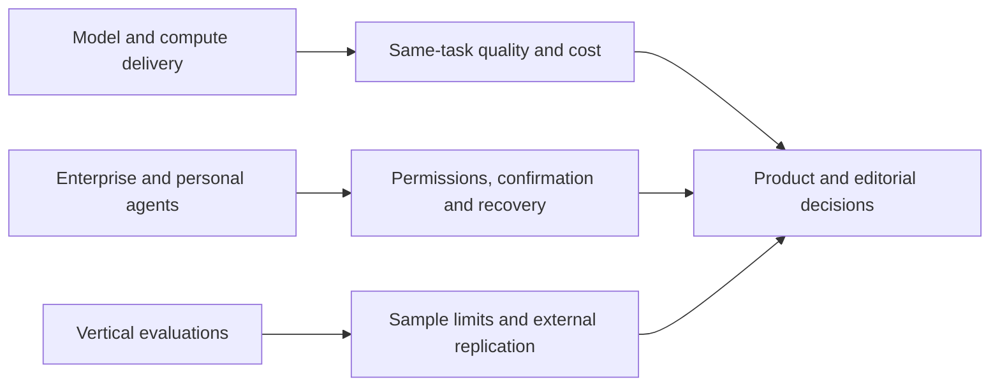

# AI Daily Brief · 2026-11-18

[English (current)](2026-11-18.md) · [中文](../../../daily/2026-11/2026-11-18.md)

- **Cutoff:** November 18, 2026, 11:00 Asia/Shanghai. This edition covers November 17 releases and removes overlap with the [previous edition](2026-11-17.md). Pages without a time of day establish only the publication date.
- **Selection and evidence:** 13 high-signal developments. Related features of one announcement are grouped. Vendor benchmarks and customer cases retain their original attribution. A confirmed announcement does not independently establish performance, availability to every user, or impact. [Index](../../INDEX.md) · [Trend tracker](../../../TRACKERS.md).

## Key takeaways

1. **Foundation-model competition now covers completed tasks and tiered costs.** OpenAI released GPT-6.2 Astra and Sol; Microsoft introduced coding, image, voice, security and decision models. Vendor benchmarks and list prices do not replace comparable end-to-end tests.
2. **Enterprise agents are competing over context, tools and permissions.** ChatGPT for Sales, Microsoft IQ and Copilot, and Gemini Tasks connect CRM records, institutional knowledge, payments and cross-app actions. Check authorization scope, human confirmation, recovery from failures and bills first.
3. **The boundary around access to model weights matters.** Microsoft's forthcoming MAI Licensed Weights is an Azure-based licensed program for selected enterprise customers, not publicly downloadable open weights or an open-source release.
4. **Compute supply now has earnings and shipment evidence.** NVIDIA reported fiscal third-quarter revenue of $115.8 billion and Data Center revenue of $107.6 billion, and says Rubin NVL72 has shipped. Future scale and customer value remain separate questions.
5. **Vertical-model scores have sample boundaries.** Astra for Law's published legal benchmark results merit attention, but do not establish reliability across all legal work or replace lawyer review.
6. **No comparably new world-model or AI-game delivery was verified in this cycle.** NVIDIA's earnings release repeats earlier Cosmos work; it is not counted as a November 17 model launch. Continue tracking long-horizon consistency, control and player value.

## High-signal developments

### 1. OpenAI releases GPT-6.2 Astra and Sol

- **What happened:** OpenAI released Astra for complex professional work and Sol for everyday multistep tasks. Both are available through ChatGPT Work, Codex and the API. Its listed Astra API prices per million input/cached-input/output tokens are $8/$0.40/$40; Sol is $2/$0.10/$10.
- **Why it matters / lenses:** Product decisions and editorial planning. Select models by deliverable quality, task success and total cost. Claims about game and 3D frontend work need blind tests on the same project.
- **Published / type / primary sources:** November 17, 2026, OpenAI [model announcement](https://openai.com/index/introducing-gpt-6-2-astra-sol/) and [model release notes](https://help.openai.com/en/articles/9624314-model-release-notes).
- **Corroboration / confidence:** Both are vendor sources; they support names, access and list prices, not independent benchmark rankings. High confidence in release; performance needs independent testing.
- **Trend:** T01/T04 continuing momentum; further foundation-model tiering.

### 2. OpenAI introduces ChatGPT for Sales

- **What happened:** A new Sales plugin offers account prioritization, call preparation and follow-up workflows, alongside more than 30 new or expanded partner plugins connecting CRMs, call notes and sales material.
- **Why it matters / lenses:** Product decisions and investment monitoring. Value depends on connected-data quality, permissions and actual sales workflows, not plugin count. It is a signal for vertical-agent distribution.
- **Published / type / primary source:** November 17, 2026, OpenAI [product announcement](https://openai.com/index/introducing-chatgpt-for-sales/).
- **Corroboration / confidence:** One vendor source. High confidence in the announcement; effects on sales-cycle length are unverified independently.
- **Trend:** T04 continuing momentum from general assistant toward sales workflow.

### 3. Astra for Law is updated and access requests expand

- **What happened:** OpenAI updated the legal model configuration and search index built on GPT-6.2 Astra. All ChatGPT Enterprise customers may now request access through the Trusted Access Program; access is not automatic. OpenAI cites an Artificial Analysis LAB-AA evaluation of 120 assignments across 24 legal areas and reports a 20.8% full-credit rate.
- **Why it matters / lenses:** Product decisions and technical context. A specialized index and instructions could affect vertical-product competition, while the full-credit rate itself argues for professional review on high-stakes work.
- **Published / type / primary source:** November 17, 2026, OpenAI [legal-model announcement](https://openai.com/index/astra-law-6-2/).
- **Corroboration / confidence:** The score is attributed to a third-party benchmark but was reviewed here through OpenAI's page. High confidence in request availability; real legal-work performance and cross-jurisdiction validity need replication.
- **Trend:** T04 delivered with wider access requests; continuing momentum since September's limited launch.

### 4. Microsoft launches MAI Code 2 and Code 2 Flash at Ignite

- **What happened:** Microsoft introduced two agentic coding models and says both are available in GitHub Copilot. Code 2 Flash is in limited preview in Foundry. Performance and cost comparisons are from Microsoft-published evaluations.
- **Why it matters / lenses:** Product decisions and investment monitoring. The models divide complex fixes from frequent small edits. Compare merge rates, rework and total bills on real repositories.
- **Published / type / primary sources:** November 17, 2026, Microsoft [MAI model overview](https://microsoft.ai/news/microsoft-ignite-2026/) and [Ignite remarks](https://blogs.microsoft.com/blog/2026/11/17/ignite-2026-building-the-frontier-ecosystem/).
- **Corroboration / confidence:** Both are Microsoft sources. High confidence in the release and stated access; price-performance claims need independent testing.
- **Trend:** T01/T04 continuing momentum; coding models split by task frequency.

### 5. Microsoft expands its image, realtime-voice and security models

- **What happened:** MAI Image 2.7 and Image 2.7 Flash are available in Foundry. MAI Realtime 1 can be tried in Labs, with commercial interest registration. MAI Cyber 2 Flash targets security tasks. Microsoft lists a realtime-voice starting price of $0.01 per audio minute; rankings and price comparisons are vendor claims.
- **Why it matters / lenses:** Multimodal product decisions and editorial planning. Test image quality, voice latency and security false positives separately. A trial, limited preview and production service are different states.
- **Published / type / primary source:** November 17, 2026, Microsoft [model overview](https://microsoft.ai/news/microsoft-ignite-2026/).
- **Corroboration / confidence:** One vendor overview; some named leaderboards are inspectable, but were not independently rerun here. High confidence in the announcement; comparative results remain unverified.
- **Trend:** T01/T03/T07 new model variants; continuing multimodal and defense tiering.

### 6. Microsoft introduces Decision 1.1 and a licensed-weights plan

- **What happened:** Decision 1.1, a routing and classification model, was announced as generally available. MAI Licensed Weights is a forthcoming option for selected enterprises to deploy and customize model weights in their own Azure environments through Frontier Company engagements. It is not a public weights download.
- **Why it matters / lenses:** Product decisions and investment monitoring. Routing and model control may affect procurement; verify eligibility, licenses, portability and vendor-reported costs separately.
- **Published / type / primary sources:** November 17, 2026, Microsoft [Ignite remarks](https://blogs.microsoft.com/blog/2026/11/17/ignite-2026-building-the-frontier-ecosystem/) and [Licensed Weights explanation](https://microsoft.ai/news/introducing-mai-licensed-weights/).
- **Corroboration / confidence:** Two Microsoft sources. High confidence in Decision 1.1 availability and the plan's announcement; actual weight delivery, customer outcomes and speed claims await checks.
- **Trend:** T01/T04 delivery and pending verification coexist; model-control boundaries become more specific.

### 7. Microsoft IQ packages enterprise context as reusable plugins

- **What happened:** Microsoft IQ combines Work, Fabric, Foundry and Web IQ with more than 350 third-party connectors. Governed company data, rules and skills can become business plugins reused across agents. Microsoft says these can work in Copilot, Foundry and other assistants.
- **Why it matters / lenses:** Product decisions and investment monitoring. An enterprise context layer may be harder to replace than a single model. Check inherited permissions, freshness, citation accuracy and cross-platform interoperability.
- **Published / type / primary source:** November 17, 2026, Microsoft [Azure announcement](https://azure.microsoft.com/en-us/blog/introducing-the-new-microsoft-iq-putting-your-organizations-intelligence-to-work-in-every-agent/).
- **Corroboration / confidence:** One vendor announcement. High confidence in the architecture announcement; cross-platform production availability and returns need external verification.
- **Trend:** T04 continuing momentum; agent competition moves into institutional context.

### 8. Copilot Home reaches general availability while Autopilot rolls out

- **What happened:** Microsoft says Copilot Home and Office in Copilot are generally available. Code is expected to become generally available in coming weeks; Autopilot starts rolling out to Frontier customers, while Today remains in private preview.
- **Why it matters / lenses:** Product decisions and editorial planning. A unified entry point, automatic model routing and persistent agents require tenant-permission, handoff and execution-audit checks. The modules do not share one availability state.
- **Published / type / primary source:** November 17, 2026, Microsoft [Copilot announcement](https://www.microsoft.com/en-us/copilot/blog/2026/11/17/copilot-at-microsoft-ignite-expanding-whats-possible-with-intelligence-built-for-work/).
- **Corroboration / confidence:** One vendor source. High confidence in stated release states; long-running task outcomes remain unverified.
- **Trend:** T04 continuing momentum; enterprise work consolidates into one entry point.

### 9. Gemini Tasks expands free access in six countries

- **What happened:** Google announced a free gradual rollout of Gemini Tasks, powered by Gemini 4 Hydrogen, in the US, Japan, Korea, Canada, Australia and India. Advanced features start in the US. The product can operate across calls, calendars, shopping and payments. Google describes isolated virtual machines, confirmation for critical actions and spending limits.
- **Why it matters / lenses:** Product decisions and editorial planning. Agents are moving from answers to delegated transactions. Verify actual availability by region and user, and test mistaken actions, merchant choice and permission revocation.
- **Published / type / primary source:** November 17, 2026, Google [Gemini Tasks announcement](https://blog.google/innovation-and-ai/products/gemini-app/tasks-in-gemini-free-new-features/).
- **Corroboration / confidence:** One official source. High confidence in the gradual rollout announcement; safety and completion rates have not been independently tested.
- **Trend:** T04 continuing momentum; personal agents enter transactions.

### 10. Google Search AI Mode adds temporary threads

- **What happened:** AI Mode now has temporary threads for one-off queries. Google says they do not enter account history, use prior preferences or affect later personalization; users can switch modes in the interface.
- **Why it matters / lenses:** Product decisions and technical context. Privacy mode and personalization can coexist. Check data-retention policy and regional availability; absence from history does not establish that all service logs are absent.
- **Published / type / primary source:** November 17, 2026, Google [Search announcement](https://blog.google/products-and-platforms/products/search/temporary-threads-ai-mode/).
- **Corroboration / confidence:** One official source. High confidence in the feature announcement; implementation detail and user experience need checking.
- **Trend:** T04/T07 new development; finer personalization controls.

### 11. NVIDIA reports fiscal Q3 results and Rubin shipments

- **What happened:** For the quarter ending October 25, 2026, NVIDIA reported $115.8 billion in revenue, up 103% year over year, and $107.6 billion in Data Center revenue, up 110%. It says Vera Rubin NVL72 has started shipping. Fiscal Q4 revenue guidance is $130 billion, plus or minus 3%.
- **Why it matters / lenses:** Investment monitoring and product decisions. Earnings offer stronger evidence of current supply and demand than a roadmap, but shipments do not prove every customer has deployed. Guidance is forward-looking.
- **Published / type / primary source:** November 17, 2026, NVIDIA [earnings release and GAAP tables](https://nvidianews.nvidia.com/news/nvidia-announces-financial-results-for-third-quarter-fiscal-2027).
- **Corroboration / confidence:** Formal company financial disclosure supports historical revenue. Shipments and forward guidance are company statements; customer deployments need external confirmation. High confidence in historical figures; outlook pending.
- **Trend:** T08 delivered; the [previously awaited](2026-11-15.md) earnings figures are now available.

### 12. GPT-6.2 system card discloses differentiated high-capability classifications

- **What happened:** OpenAI released a GPT-6.2 system card. Its deployment-safety material classifies Astra as meeting the High threshold for AI self-improvement capabilities while Sol is below that threshold, and describes cybersecurity risk management.
- **Why it matters / lenses:** Product decisions and technical context. Different capability levels affect access, red-teaming and deployment controls. These are evaluations under OpenAI's framework, not independently measured rates of real-world harm.
- **Published / type / primary sources:** November 17, 2026, OpenAI [system card](https://deploymentsafety.openai.com/gpt-6-2-astra-sol/alignment-to-our-model-spec) and [model announcement](https://openai.com/index/introducing-gpt-6-2-astra-sol/).
- **Corroboration / confidence:** Two documents from one vendor support the classification; external effects are unverified. High confidence in disclosure; real-world risks require testing.
- **Trend:** T07 continuing momentum; model tiering brings different safety requirements.

### 13. Microsoft adds business analytics to Agent 365 governance

- **What happened:** Microsoft announced Agent 365 Business Analytics to relate agent spending to business outcomes. In its Ignite remarks it said the platform has more than 50 million agents. Agent count alone does not establish user count or value.
- **Why it matters / lenses:** Product decisions and investment monitoring. Scaling agents needs identity, governance and cost attribution. Verify active-agent definitions, double counting and outcome metrics.
- **Published / type / primary source:** November 17, 2026, Microsoft [Ignite remarks](https://blogs.microsoft.com/blog/2026/11/17/ignite-2026-building-the-frontier-ecosystem/).
- **Corroboration / confidence:** One vendor source. High confidence in the feature announcement; the 50-million figure's denominator and ROI need external checks.
- **Trend:** T04/T07 continuing momentum; enterprise agent management adds cost and outcome layers.

## Watchlist

- **China and world models:** This cycle scanned Chinese-language leads and world-model updates, but does not recount November 16's Qwen4-Max and Hy4 flash. Cosmos work repeated in NVIDIA's earnings release points to earlier releases. Next cycle will seek newly dated and inspectable artifacts.
- **Priority tests:** GPT-6.2 and MAI Code 2 on the same repository tasks; Gemini Tasks permissions and recovery; Astra for Law across jurisdictions; Rubin customer deployments; Microsoft IQ cross-platform permissions.
