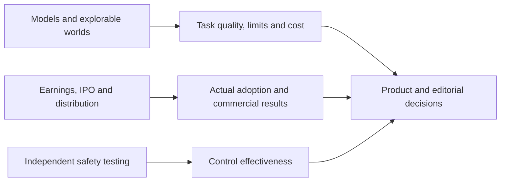

# AI Daily Brief · 2026-11-19

[English (current)](2026-11-19.md) · [中文](../../../daily/2026-11/2026-11-19.md)

- **Cutoff:** November 19, 2026, 11:00 Asia/Shanghai. The focus is primary releases dated November 18, deduplicated against the [previous edition](2026-11-18.md). Pages without a time of day establish only a publication date.
- **Selection:** 14 high-signal developments. A single event is not split to fill a quota. A company or research publication confirms that it was published; performance, usage, commercial value and forecasts receive separate evidence labels. [Index](../../INDEX.md) · [Trend tracker](../../../TRACKERS.md).

## Key takeaways

1. **World models are moving from research preview to limited user experience.** Genie 4 entered Project Genie for eligible Google AI Ultra users; Genie 3 sessions can run for three minutes. Google still identifies camera latency, detailed physics and long-term scene permanence as limitations. This is not a mature game engine.
2. **Model competition again centers on completed-task efficiency.** Gemini 4 Neon has a one-million-token window and published API prices; DaisyRose-27B and Rumble-2-Flash provide downloadable weights. Vendor scores, batched speech throughput and real product tasks need separate tests.
3. **Capital markets and application data provide new evidence.** Anthropic priced its IPO at $83 per share, with trading planned for November 19 and closing for November 20. Tencent disclosed RMB207.3 billion in third-quarter revenue and a company-reported WorkBuddy DAU above 10 million.
4. **Agent safety requires independent tests alongside vendor controls.** A GAO report made public on November 18 documents targeted safeguard-bypass tests on four platforms conducted in spring 2026. OpenAI described its staged controls the same day. The test samples do not yield a general incident rate; vendor control descriptions do not validate effectiveness externally.
5. **Distribution expands again.** Google is bringing Gemini App to lower-memory Android devices; OpenAI added live dictation and signed a content partnership with Le Figaro. Check device compatibility, speech accuracy and publisher traffic respectively.

## High-signal developments

### 1. Google launches Gemini 4 Neon

- **What happened:** Neon is rolling out through the Gemini API, Google AI Studio, the business product, Antigravity and paid Gemini plans. It has a one-million-token window and listed prices per million input/cached-input/output tokens of $3/$0.15/$15. Google cites several outside leaderboards and its own task results.
- **Why it matters / lenses:** Product decisions and editorial planning. Compare coding, spreadsheet and long-task completion, latency and full-task costs under the same setup; leaderboard position alone does not settle procurement.
- **Published / type / primary source:** November 18, 2026, Google [model announcement](https://blog.google/innovation-and-ai/models-and-research/gemini-models/introducing-gemini-4-neon/).
- **Corroboration / confidence:** The post links external leaderboards, but this cycle did not rerun them. High confidence in the launch and list prices; performance ranking and regional availability need checks.
- **Trend:** T01/T04 new entrant; further model tiering.

### 2. Genie 4 enters Project Genie and Genie 3 sessions grow longer

- **What happened:** Google is rolling out Project Genie with Genie 4 to eligible AI Ultra subscribers, adding mid-session text edits, native audio, a creation agent and a sharing gallery. Genie 3 sessions extend from 60 seconds to up to three minutes; Pro users may join a waitlist.
- **Why it matters / lenses:** AI in gaming, world models and editorial planning. Users can explore creation and sharing directly, but this remains a research-stage experience. Google identifies camera latency, complex physical interaction, audio precision and long-term scene permanence as open challenges.
- **Published / type / primary sources:** November 18, 2026, Google [Project Genie update](https://blog.google/innovation-and-ai/models-and-research/google-deepmind/genie-4-now-available-project-genie/). Its [Genie 4 research introduction](https://deepmind.google/blog/genie-4-a-new-generation-of-world-simulation/) dates to October 27; today's change is access.
- **Corroboration / confidence:** Both are Google sources. High confidence in the access terms and stated limitations; long-term playability, creation efficiency and retention need independent testing.
- **Trend:** T02/T05 moved from trusted-tester preview to limited consumer delivery; not a mature game creation tool.

### 3. Anthropic prices its IPO at $83 per share

- **What happened:** Anthropic announced pricing of roughly 980 million Class A shares at $83 each. It expects trading under ANT on Nasdaq to begin November 19 and closing on November 20. Pricing and effective registration do not mean trading or closing has happened.
- **Why it matters / lenses:** Investment monitoring and technical context. A listing would create public-market valuation and disclosure evidence. Track offer price, first trading price, proceeds by seller and later financial performance separately.
- **Published / type / primary sources:** November 18, 2026, Anthropic [IPO pricing announcement](https://www.anthropic.com/news/anthropic-prices-initial-public-offering); [AP coverage](https://apnews.com/article/70b660ddf900d90bbf484ecdf1fb441c) independently reports the pricing event.
- **Corroboration / confidence:** Official announcement and independent media corroborate pricing; high confidence. Trading and closing remain future events.
- **Trend:** T08 advanced from the [proposed filing](../2026-10/2026-10-27.md) to pricing, without completing the listing process.

### 4. Tencent's third-quarter results disclose AI usage and investment

- **What happened:** Tencent reported third-quarter 2026 revenue of RMB207.3 billion, up 8% year over year, and RMB65.1 billion in capital-expenditure payments, up 225%. It says WorkBuddy exceeded 10 million daily active users consuming over 100 trillion tokens per day. Domestic Games revenue was RMB47.6 billion; International Games revenue was RMB18.9 billion. Its profit measure excluding new AI products must not be confused with IFRS profit.
- **Why it matters / lenses:** Product decisions, investment monitoring and gaming. Model capabilities now connect to app use, compute prepayments and profit structure. Token consumption is not independently demonstrated user value or revenue. Domestic and international game growth diverged.
- **Published / type / primary sources:** November 18, 2026, Tencent [third-quarter earnings PDF](https://www.tencent.com/wp-content/uploads/2026/11/Tencent-Announces-2026-Third-Quarter-Results.pdf) and [investor page](https://www.tencent.com/investors/).
- **Corroboration / confidence:** Both are company sources. High confidence in disclosed figures; WorkBuddy measurement, AI unit economics and causal product contribution need independent checks.
- **Trend:** T01/T04/T08 continuing momentum, linked to the [Hy4 flash release](2026-11-17.md) without recounting it as a new model.

### 5. GAO makes public targeted safeguard-bypass tests of four platforms

- **What happened:** The US Government Accountability Office publicly released on November 18 a report completed in October. In spring 2026 it tested Claude, Grok, ChatGPT and Gemini under specific attack-planning scenarios and recorded feasible assistance after repeated prompting despite safeguards triggering. Scenario mapping was anonymized; the test does not cover current model versions.
- **Why it matters / lenses:** Product decisions and safety governance. Independent red-team evidence can inform layered controls and escalation. Four targeted samples do not estimate the dangerous-output rate for ordinary users; attack details should not be repeated.
- **Published / type / primary source:** Completed October 16, 2026; publicly released November 18, US GAO [report GAO-27-108814](https://files.gao.gov/reports/GAO-27-108814/index.html).
- **Corroboration / confidence:** The original government report documents its method and samples. High confidence in the report; extrapolation across versions is limited. Vendor responses are not independent replication.
- **Trend:** T07 newly public independent evidence, a different measurement lens from the [prior day's system card](2026-11-18.md).

### 6. OpenAI explains staged frontier-model risk management

- **What happened:** OpenAI described controls from research sandboxes through internal and external deployment. It says monitoring was strengthened after the Hugging Face incident, all internal tool-using deployments are monitored, and some training or releases were paused.
- **Why it matters / lenses:** Product decisions and governance. The post supplies concrete sandbox, monitoring, stopping and incident-disclosure criteria, but a vendor description does not prove coverage or effectiveness in each setting.
- **Published / type / primary source:** November 18, 2026, OpenAI [risk-management explanation](https://openai.com/index/managing-frontier-ai-risk/).
- **Corroboration / confidence:** One vendor statement. High confidence in disclosure; effectiveness awaits external assessment. It does not directly negate the GAO tests of earlier systems.
- **Trend:** T07 continuing momentum; internal controls, litigation and outside tests proceed in parallel.

### 7. Rumble-2-Flash opens a 0.5-billion-parameter multilingual speech model

- **What happened:** Reson8 published Rumble-2-Flash on Hugging Face, claiming coverage of more than 40 languages under Apache 2.0 with Transformers and vLLM support. It also reports roughly half a second to process an hour of audio in a particular batched test.
- **Why it matters / lenses:** Multimodal product decisions and content production. A smaller speech model can support edge and self-hosted tests, but batched throughput is not live-meeting latency. Test mixed Chinese-English speech, accents, names and privacy boundaries.
- **Published / type / primary sources:** November 18, 2026, Reson8 [Hugging Face release](https://huggingface.co/blog/rumble-2-flash) and [model card](https://huggingface.co/Reson8/Rumble-2-Flash).
- **Corroboration / confidence:** Release and model card come from the same team. Weights and license can be checked; speed and accuracy are vendor evaluations pending replication. High confidence in artifacts, pending performance checks.
- **Trend:** T03/T04 new option for deployable speech recognition.

### 8. DaisyRose-27B releases reinforcement-learning post-training weights

- **What happened:** RadixArk released DaisyRose-27B based on Qwen3.8-27B, with BF16, FP8 and NVFP4 weights under Apache 2.0. It reports training on 1,200 curated tasks and a Terminal-Bench 4.1 pass@1 rise from 5.6% to 12.0%.
- **Why it matters / lenses:** Model R&D and investment monitoring. The small, curated-task post-training approach merits replication; training budget, base-model comparison, tool setup and benchmark scores require matched-condition checks.
- **Published / type / primary source:** November 18, 2026, RadixArk [Hugging Face technical post](https://huggingface.co/blog/RadixArk/daisyrose-27b-pushing-the-frontier-of-post-trainin).
- **Corroboration / confidence:** Weights are inspectable; performance and training efficiency are mainly team-reported. High confidence in delivery, uncertain generalization.
- **Trend:** T01 new open-weight post-training entrant.

### 9. Gemini App extends to lower-memory Android Go devices

- **What happened:** Google announced the Gemini App for eligible Android Go devices, offering voice conversation, camera-based learning and image generation across more than 45 languages. This does not mean every older device supports it.
- **Why it matters / lenses:** Product decisions and investment monitoring. Lower-memory hardware broadens potential reach. Check actual compatibility, network cost, language quality and retention rather than equating installation eligibility with active users.
- **Published / type / primary source:** November 18, 2026, Google [Android Go announcement](https://blog.google/innovation-and-ai/products/gemini-app/gemini-lower-memory-devices/).
- **Corroboration / confidence:** One official source. High confidence in the expansion announcement; coverage and performance require external checks.
- **Trend:** T04 delivered; personal AI distribution reaches lower-end devices.

### 10. ChatGPT adds Live Dictation

- **What happened:** OpenAI updated dictation to transcribe text while a person speaks and removed the previous ten-minute recording limit. Its release notes say it is rolling out globally across plans on iOS, Android, web and desktop.
- **Why it matters / lenses:** Product decisions and editorial planning. Speech input may reduce friction for long explanations. Test noisy settings, bilingual recognition, long-session stability and editing effort.
- **Published / type / primary source:** November 18, 2026, OpenAI [ChatGPT release notes](https://help.openai.com/en/articles/6825453-chatgpt-release-notes).
- **Corroboration / confidence:** One official release log. High confidence in the announcement; access and accuracy need user testing.
- **Trend:** T03/T04 new real-time editing direction in speech interaction.

### 11. OpenAI and Le Figaro announce a content partnership

- **What happened:** The parties announced that current and archived Le Figaro journalism will be discoverable in ChatGPT through summaries, excerpts and source links. Le Figaro also plans to introduce ChatGPT Enterprise to teams.
- **Why it matters / lenses:** Editorial planning and product decisions. Track attribution, referral traffic and licensing scope. The agreement does not establish subscription or traffic revenue growth.
- **Published / type / primary sources:** November 18, 2026, OpenAI [partnership announcement](https://openai.com/index/le-groupe-figaro-and-openai-announce-partnership/) and the linked Groupe Figaro statement.
- **Corroboration / confidence:** Both parties confirm the deal but are participants in the same transaction. High confidence in the agreement; commercial results pending.
- **Trend:** T04/T09 continuing momentum; news distribution moves into chat.

### 12. a16z invests in Linq and argues messaging will become an agent entry point

- **What happened:** a16z's Kimberly Tan, Josh Elman and Kenan Saleh announced an investment in Linq. They argue that agents will become an important way users interact with businesses and cite DoorDash's Apple Messages for Business ordering example.
- **Why it matters / lenses:** Investment monitoring and product planning. This is an investor view, not proof that agents have become the primary entry point for all services. Its evidence is messaging-channel use and a case study; limitations include the authors' financial interest and missing broad conversion and retention comparisons.
- **Published / type / primary source:** November 18, 2026, a16z [investment statement and viewpoint](https://a16z.com/announcement/investing-in-linq/).
- **Corroboration / confidence:** Investment is disclosed by one investor source; the thesis needs companies' own adoption data. High confidence in the announcement, medium confidence in the forecast.
- **Trend:** T04/T09 first tracking of this investment; agent messaging channels continue to gain attention.

### 13. OpenAI describes model-assisted chip design

- **What happened:** OpenAI described improvements to its Jalapeño chip and work with AMD. It estimates that model-proposed changes cut standard-cell area by about 13% in the vector unit and 10% in the matrix unit, with the improvements verified on silicon.
- **Why it matters / lenses:** Product decisions, investment monitoring and technical context. AI can enter EDA workflows, but this is one team's specific design case. Assess total design cost, verification effort and transfer to other projects.
- **Published / type / primary source:** November 18, 2026, OpenAI [chip-design research post](https://openai.com/index/advancing-chip-design-with-our-models/).
- **Corroboration / confidence:** A company case that partners could later verify. Area and production effects currently rely on OpenAI's account. High confidence in publication; generality unverified.
- **Trend:** T08 continuing momentum; model capability enters hardware R&D.

### 14. Microsoft and Intel deepen Azure infrastructure collaboration

- **What happened:** The companies announced a long-term agreement covering Intel EMIB packaging for Azure first-party chips, next-generation Xeon capacity, CXL memory efficiency and confidential computing. The page is dated November 18; its release text is dated November 17.
- **Why it matters / lenses:** Investment monitoring and infrastructure decisions. Supply and packaging may affect inference cost and delivery, but an agreement is not volume production of new hardware.
- **Published / type / primary source:** Announced November 17 and posted November 18, Microsoft [joint collaboration release](https://news.microsoft.com/source/2026/11/18/microsoft-and-intel-deepen-collaboration-to-deliver-differentiated-azure-infrastructure/).
- **Corroboration / confidence:** Joint announcement from the parties. High confidence in the agreement; capacity, performance and delivery dates await evidence.
- **Trend:** T08 first tracking of this agreement; AI infrastructure supply diversifies.

## Watchlist

- **World models and games:** Prioritize a direct Genie 4 trial. Record session duration, input response, editing depth, scene persistence, replayability and sharing, not only demo visuals.
- **Model selection:** Test Neon, DaisyRose and Rumble on matched tasks, devices and data scope; do not interpret batched speech throughput as live latency.
- **Markets and governance:** Verify Anthropic's actual trading and closing, Tencent's AI unit economics and safeguard changes since the GAO's tests of older versions.
