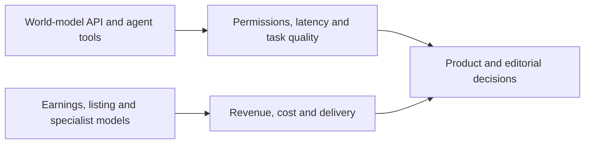

# AI Daily Brief · 2026-11-20

[English (current)](2026-11-20.md) · [中文](../../../daily/2026-11/2026-11-20.md)

- **Cutoff:** November 20, 2026, 11:00 Asia/Shanghai. This edition checks November 19 releases and two earlier omissions against the [previous brief](2026-11-19.md). A page with only a date does not establish its time of publication. [Index](../../INDEX.md) · [Trend tracker](../../../TRACKERS.md).
- **Selection:** 11 verifiable developments, including two explicitly marked November 18 catch-ups. We did not pad the edition to 20 items. Vendor performance claims, company financial disclosures and independent results are labeled separately.

## Key takeaways

1. **Genie 4 has moved from limited consumer access to a developer integration path.** Google now offers access through the Gemini API and AI Studio for interactive-world prototypes. Long-run consistency, control latency, player retention and cost still need testing.
2. **Agent competition is shifting toward execution environments and tool management.** Gemini on Mac adds background computer use, while Gemini API Tool Retrieval previews on-demand tool schemas. Permissions, recovery and full-task costs are the acceptance tests.
3. **There is more evidence on AI commercialization, but the measures differ.** Alibaba disclosed RMB60.973 billion in quarterly AI Cloud and Compute Services revenue, up 53% year over year, alongside a six-month adjusted EBITA loss in AI Labs and Applications. Anthropic shares have begun Nasdaq trading; offering settlement remains a separate milestone.
4. **On-device delivery and specialized models offer alternative paths.** Microsoft Edge adds the open-weight Aion Instruct model; Cloudflare offers Clairic document extraction weights. Both need matched-task performance checks.
5. **Gaming has a new character-behavior signal, without a playable-product validation.** MyMems plans to use Artificial Agency's Behavior Engine and targets a 2027 community release. Today's evidence is a partnership and development plan.

## High-signal developments

### 1. Genie 4 reaches the Gemini API and AI Studio

- **What happened:** A day after limited Project Genie consumer access, Google said developers can use Genie 4 through the Interactions API and AI Studio. Text, a reference image or both can seed a continuous navigable 720p world at 24 FPS with native audio. That is an output specification, not measured generation speed.
- **Why it matters / lenses:** Product decisions, AI in gaming and editorial planning. Builders can integrate a world model into prototypes; test persistence, control latency, cost, recovery and actual player interest.
- **Published / type / primary sources:** November 19, 2026, Google [developer announcement](https://blog.google/innovation-and-ai/technology/developers-tools/genie-4-in-gemini-api/) and independent [industry coverage](https://www.testingcatalog.com/google-opens-genie-4-world-model-to-developers-in-gemini-api/).
- **Corroboration / confidence:** The announcement and independent coverage confirm developer access; high confidence. World-state consistency is a vendor claim, with no long-run playability test here.
- **Trend:** T02/T05 new integration delivered, extending [yesterday's](2026-11-19.md) limited consumer access.

### 2. Gemini App for Mac adds background computer use

- **What happened:** Google says Gemini can use Mac apps, local files and websites in a separate background window. Users select app permissions, watch a preview and approve key actions. Rollout is gradual for English users in the US on Apple Silicon Macs running macOS 15 or later.
- **Why it matters / lenses:** Product decisions and editorial planning. The assistant can execute end-to-end tasks. Test permission boundaries, undo behavior, privacy and task completion.
- **Published / type / primary source:** November 19, 2026, Google [product announcement](https://blog.google/innovation-and-ai/products/gemini-app/computer-use-mac/).
- **Corroboration / confidence:** One official source; high confidence in the announcement and access terms, with real-world completion rates untested independently.
- **Trend:** T04 new Mac execution surface; monitor adoption.

### 3. Gemini API previews Tool Retrieval

- **What happened:** Tool Retrieval in the Interactions API can search for and load tool parameter schemas on demand, avoiding a full library in every request. Google says the preview works with Gemini 3.6 and later models.
- **Why it matters / lenses:** Product decisions and technical context. Larger agent tool libraries may use fewer input tokens and less time; evaluate selection accuracy, token use and end-to-end latency on real workflows.
- **Published / type / primary source:** November 19, 2026, Google [API announcement](https://blog.google/innovation-and-ai/technology/developers-tools/gemini-api-tool-retrieval/).
- **Corroboration / confidence:** One official source; high confidence in preview availability, while efficiency gains remain vendor claims.
- **Trend:** T04 new preview, pending validation.

### 4. Alibaba discloses September-quarter AI cloud growth

- **What happened:** Alibaba reported quarterly total revenue of RMB271.519 billion, up 10% year over year. AI Cloud and Compute Services revenue was RMB60.973 billion, up 53%; external-customer revenue rose 64%. It separately reported a RMB24.364 billion adjusted EBITA loss for AI Labs and Applications over the six months ended September 30, reflecting AI investment and Qwen inference costs. The six-month loss is not a quarterly figure.
- **Why it matters / lenses:** Investment monitoring and product decisions. Cloud growth coexists with app investment. Track recurring payment, margins, inference cost and free cash flow separately; group net profit does not establish AI product profitability.
- **Published / type / primary sources:** November 19, 2026, Alibaba [earnings release](https://data.alibabagroup.com/ecms-files/1532295521/e676aff4-e76d-489b-960a-47b9cf36485d/Alibaba%20Group%20Announces%20September%20Quarter%202026%20Results%20and%20Interim%20Results%20for%20the%20Six%20Months%20Ended%20September%2030%2C%202026.pdf) and [SEC filing exhibit](https://www.sec.gov/Archives/edgar/data/1577552/000110465926130115/tm2630263d1_ex99-1.htm).
- **Corroboration / confidence:** The filing checks the disclosed figures but originates from the same company. High confidence in disclosure; future profitability and causal AI contribution need validation.
- **Trend:** T08 continuing momentum; compare with yesterday's Tencent disclosure without combining unlike measures.

### 5. Anthropic shares begin trading on Nasdaq

- **What happened:** Nasdaq confirmed ANT began trading on November 19 and opened at $111.50 per share, after Anthropic priced the IPO at $83. Trading does not establish that the offering's planned November 20 closing has occurred.
- **Why it matters / lenses:** Investment monitoring. Pricing is now followed by an observable public market. Separate short-term share moves from longer-run operations.
- **Published / type / primary sources:** November 19, 2026, Nasdaq [listing report](https://www.nasdaq.com/newsroom/anthropic-marks-ipo-at-nasdaq) and Anthropic [pricing announcement](https://www.anthropic.com/news/anthropic-prices-initial-public-offering).
- **Corroboration / confidence:** The exchange and issuer are distinct sources confirming trading and pricing; high confidence. Settlement and long-term valuation remain open.
- **Trend:** T08 advanced from yesterday's “trading pending” to “trading started”; closing awaits confirmation.

### 6. Microsoft Edge adds Aion Instruct and a Prompt API origin trial

- **What happened:** Microsoft says the 2.3-billion-parameter Aion Instruct model is now built into Edge and its weights are available on Hugging Face. Developers can test the Prompt API in an origin trial. Edge downloads the model on first need on suitable devices, and users can disable on-device AI.
- **Why it matters / lenses:** Product decisions and technical context. Browser-side inference could reduce cloud use; check the license, device coverage, quality, download size and cross-browser behavior.
- **Published / type / primary source:** November 19, 2026, Microsoft Edge [developer announcement](https://blogs.windows.com/msedgedev/2026/11/19/hybrid-intelligence-on-the-web-introducing-aion-instruct-and-prompt-api-in-microsoft-edge/).
- **Corroboration / confidence:** One official source; high confidence in release and weight access. Comparisons with Phi are vendor claims.
- **Trend:** T01/T04 new on-device model and browser API surface.

### 7. ChatGPT Health expands devices and connections

- **What happened:** OpenAI's release notes say Health is gradually rolling out to Android, desktop, dots and sites, with Health Connect on Android. Eligible US users include Free, Go, Plus and Pro; dots currently require Pro. Its health privacy notice was also updated on November 19.
- **Why it matters / lenses:** Product decisions and investment monitoring. Health connections create a sensitive personal-data surface. Check consent, separation, advice accuracy and geographic availability; the update is not evidence of clinical efficacy.
- **Published / type / primary sources:** November 19, 2026, OpenAI [release notes](https://help.openai.com/en/articles/6825453-chatgpt-release-notes) and [health privacy notice](https://openai.com/policies/health-privacy-policy/).
- **Corroboration / confidence:** Both are OpenAI materials, not independent corroboration. High confidence in stated rollout; experience and privacy implementation await external checks.
- **Trend:** T04/T07 continuing momentum; gradual rollout.

### 8. Gemini adds a cross-assistant conversation migration path

- **What happened:** Google describes importing a summary of preferences from another assistant and then uploading a ZIP export of past conversations to continue in Gemini.
- **Why it matters / lenses:** Product decisions and editorial planning. Switching costs may fall; test summary fidelity, data formats, privacy and memory quality after migration.
- **Published / type / primary source:** November 19, 2026, Google [migration guide](https://blog.google/innovation-and-ai/products/gemini-app/switch-ai-assistants-transfer-history/).
- **Corroboration / confidence:** One official source; high confidence in the described path, with migration quality untested independently.
- **Trend:** T04 new competitive migration surface.

### 9. Google and Blue Origin announce a space-compute launch partnership

- **What happened:** Google says Blue Origin's New Glenn is targeted to launch Project Suncatcher satellites in the first quarter of 2029 to explore solar-powered AI infrastructure in orbit. Launch and operation have not occurred.
- **Why it matters / lenses:** Investment monitoring and technical context. This is a long-horizon compute-supply experiment and does not yet establish cost or commercial viability.
- **Published / type / primary source:** November 19, 2026, Google [partnership announcement](https://blog.google/innovation-and-ai/models-and-research/google-research/blue-origin-project-suncatcher-partnership/).
- **Corroboration / confidence:** One official source; high confidence that the plan was announced, with delivery and economics unverified.
- **Trend:** T08 new long-horizon infrastructure path.

### 10. Cloudflare releases Clairic weights (November 18 catch-up)

- **What happened:** Cloudflare updated the 27B Clairic and introduced the 9B Clairic-flash for document-field extraction on November 18, with Workers AI endpoints and Hugging Face weights. It published input-token prices and internal evaluations. Available weights do not by themselves settle whether every use meets an open-source definition.
- **Why it matters / lenses:** Product decisions and technical context. Compare structured extraction with general LLMs on accuracy, latency, license and full cost; internal tests are not independent benchmarks.
- **Published / type / primary source:** November 18, 2026, Cloudflare [model announcement](https://blog.cloudflare.com/open-clairic/); recorded here as a catch-up.
- **Corroboration / confidence:** One vendor source. High confidence in the model and weight links; performance and promotional price terms require direct checks.
- **Trend:** T01/T03 catch-up; specialist models gaining momentum.

### 11. MyMems names Artificial Agency's behavior engine (November 18 catch-up)

- **What happened:** Gallium Studios and Artificial Agency announced on November 18 that MyMems, a social simulation shaped by player memories and relationships, will use Behavior Engine for its characters. A community release is targeted for 2027; the game is still in development.
- **Why it matters / lenses:** AI in gaming and editorial planning. Track how character behavior and personal memories become gameplay, while distinguishing a partnership, a demo and a playable release.
- **Published / type / primary sources:** November 18, 2026, Artificial Agency [partnership release](https://www.artificial.agency/news/gallium) and Gallium [project page](https://galliumstudios.com/); recorded here as a catch-up.
- **Corroboration / confidence:** Both partners confirm the collaboration, but neither is independent of the project. High confidence in the partnership; delivery and player value remain unverified.
- **Trend:** T05 catch-up; awaiting delivery. A character-behavior system is not labeled a world model.

## Next checks

- Confirm Anthropic's offering close and subsequent public financial reporting; do not infer long-term value from the first trading day.
- Prototype Genie 4 API, Gemini Mac and Tool Retrieval on matched tasks, recording latency, failure, permissions and total cost.
- Follow playable AI-game releases and real player feedback; MyMems is still a development project.
