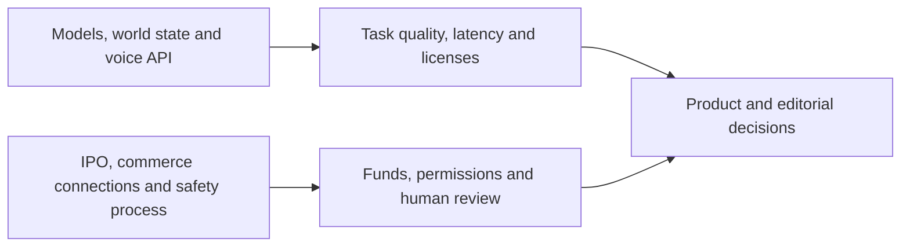

# AI Daily Brief · 2026-11-21

[English (current)](2026-11-21.md) · [中文](../../../daily/2026-11/2026-11-21.md)

- **Cutoff:** November 21, 2026, 11:00 Asia/Shanghai. This edition checks November 20 releases against [yesterday's brief](2026-11-20.md). A page that lists only a date does not establish its publication time. [Index](../../INDEX.md) · [Trend tracker](../../../TRACKERS.md).
- **Selection:** 10 verifiable developments. Two papers are marked as catch-ups with their original November 18 submission dates. We did not pad the edition to 20 with weak signals; vendor figures and independent replication are kept separate.

## Key takeaways

1. **Anthropic's IPO moved from trading to closing.** The company disclosed completion of the Class A offering and concurrent private placement. Offering proceeds, proceeds to the company and secondary-market value are different measures.
2. **Local multimodal models and agent adaptation meet at the cost-per-task question.** Inkling 2 Mini offers downloadable weights. Hugging Face's harness-adapter research suggests that joint optimization for a task and execution framework may change task economics; reported benchmarks still need replication.
3. **Two world-model papers propose explicit state designs.** WM^MLLM uses a panorama with revision history; WorldRuler uses an executable rule graph. These are research results, not delivered playable games.
4. **Voice and commerce agents continue to expand.** GPT-Live-1.1 has reached the developer API, while Google has added US shopping and financial connections to Search and Gemini. Test conversation quality, permissions and completed transactions separately.
5. **In high-stakes applications, auxiliary signals remain distinct from final decisions.** Watch Duty uses Gemini radio transcription to help humans verify wildfire reports. Google's speed and error-rate figures are project-reported.

## High-signal developments

### 1. Anthropic announces closing of its IPO and concurrent private placement

- **What happened:** Anthropic says its IPO closed with 1.127 billion Class A shares at $83 each, including a 147-million-share underwriters' option. Gross IPO proceeds were about $93.5 billion, of which the company received about $91.6 billion; a roughly $26 billion Class N private placement with seven technology companies also closed. Anthropic receives no proceeds from shares sold by existing stockholders.
- **Why it matters / lenses:** Investment monitoring. Trading was confirmed yesterday; closing is the new milestone. Keep total proceeds, proceeds to Anthropic, the private placement and market capitalization separate, and track compute spending and future earnings.
- **Published / type / primary sources:** November 20, 2026, Anthropic [closing announcement](https://www.anthropic.com/news/ipo-close); the earlier [final SEC prospectus](https://www.sec.gov/Archives/edgar/data/2130357/000162828026074944/anthropicpbc-424b4.htm) sets out deal terms.
- **Corroboration / confidence:** The prospectus checks planned terms; the issuer remains the source for completed closing. High confidence in the announcement; use-of-proceeds outcomes await verification.
- **Trend:** T08 delivered, following yesterday's start of trading.

### 2. Inkling 2 Mini releases open weights for a local multimodal model

- **What happened:** Thinking Machines Lab's model card provides Inkling 2 Mini weights under Apache 2.0. It takes text and images and produces text. A Hugging Face technical post describes a looped-layer mixture-of-experts design with about 26B total and 3B active parameters per token, plus Transformers, llama.cpp and MLX paths.
- **Why it matters / lenses:** Product decisions and technical context. Local vision and coding tasks can now be tested against other models for memory, throughput, license and cost per completed task.
- **Published / type / primary sources:** November 20, 2026, [model card](https://huggingface.co/thinkingmachines/Inkling-2-Mini) and [Hugging Face technical post](https://huggingface.co/blog/inkling2mini).
- **Corroboration / confidence:** Weights and license are inspectable; performance comparisons largely come from the issuer and partner. High confidence in delivery, with leaderboard results awaiting independent replication.
- **Trend:** T01/T03 first appearance; local multimodal open weights gaining momentum.

### 3. Hugging Face reports an agent harness-adapter experiment

- **What happened:** Hugging Face published a method for training an RL LoRA adapter inside a target agent harness and task distribution. In its specified Terminal-Bench 2.1 / pi harness setup, the team reports Qwen3.8-27B pass@1 rising from 39% to 55% while average tokens fall from 2.9K to 1.5K.
- **Why it matters / lenses:** Product decisions and technical context. Model selection should include the execution harness. Reproduce results with matched tasks, training cost, inference bills and retries.
- **Published / type / primary source:** November 20, 2026, Hugging Face [research post and artifacts](https://huggingface.co/blog/harness-adapters-at-scale).
- **Corroboration / confidence:** Method and artifacts can be inspected; figures are from one team's setup, not a general cross-harness gain. High confidence in publication, with generalization pending.
- **Trend:** T01/T04 first appearance; task-specific training gaining momentum.

### 4. GPT-Live-1.1 reaches the OpenAI developer API

- **What happened:** OpenAI's API changelog dates GPT-Live-1.1 access to November 19; its official community post on November 20 describes WebRTC standby, which bills at a lower rate during idle periods. The model was already used in ChatGPT Voice; the new step is developer access. Its model page lists $0.05 per active minute and $0.02 per standby minute, with backend models and tools billed separately.
- **Why it matters / lenses:** Product decisions and editorial planning. Real-time character experiences and voice agents can compare accent consistency, interruption handling, number recognition, idle cost and full-task bills.
- **Published / type / primary sources:** November 19 [API changelog](https://developers.openai.com/api/docs/changelog); November 20 [official community note](https://community.openai.com/t/gpt-live-1-1-has-arrived-in-the-api/1418537) and [model pricing page](https://developers.openai.com/api/docs/models/gpt-live-1.1).
- **Corroboration / confidence:** All are from the same vendor. High confidence in API status and list prices; quality improvements are vendor claims.
- **Trend:** T03/T05 previously unrecorded API delivery; monitor real interaction quality.

### 5. Google expands Connected Apps across Search and Gemini

- **What happened:** Google announced a US rollout of grocery connections for Albertsons, Safeway, Shaw's and Target to assemble orders and check out. Experian expands from Gemini to Search, and H&R Block supports tax estimates. Angi and Thumbtack account connections are planned for the coming weeks.
- **Why it matters / lenses:** Product decisions and investment monitoring. Agents are moving from suggestions to commerce actions. Check consent, merchant coverage, completion rates and error handling; planned connections are not live ones.
- **Published / type / primary source:** November 20, 2026, Google [product announcement](https://blog.google/products-and-platforms/products/search/connected-apps-holiday-errands/).
- **Corroboration / confidence:** One official source. High confidence in announced rollout scope; usage outcomes and future connections await verification.
- **Trend:** T04 continuing momentum in commerce agents.

### 6. WM^MLLM uses an external panorama state for editable worlds (paper catch-up)

- **What happened:** The paper puts world state outside the generator in a panorama with revision history. Multimodal LLMs plan, position and check local edits; the authors report reproducible revisits at the same revision and results on several paper-defined benchmarks.
- **Why it matters / lenses:** World models, AI in gaming and technical context. Explicit state may constrain scene drift. Larger 3D spaces, dynamic characters, real-time response and player experience still need testing.
- **Published / type / primary source:** First submitted November 18, 2026; surfaced in the community November 20. [arXiv paper](https://arxiv.org/abs/2611.24193).
- **Corroboration / confidence:** The paper is inspectable; experiments are author-reported, without independent replication here. High confidence in publication, uncertain generalization.
- **Trend:** T02/T05 catch-up; first tracked explicit-state route.

### 7. WorldRuler controls interactive worlds with a rule graph (paper catch-up)

- **What happened:** The paper proposes an executable 3D graph that saves rules, dependencies and object state, then closes a loop among rule execution, video generation and perceptual feedback. The researchers built RuleVerse using GTA-V and Habitat. A November 19 revision corrected author information.
- **Why it matters / lenses:** World models, AI in gaming and technical context. Saving rules and state matters for game-like interaction; long-run consistency, player control and actual running cost still need tests.
- **Published / type / primary source:** First submitted November 18 and revised November 19, 2026, [arXiv paper](https://arxiv.org/abs/2611.24869).
- **Corroboration / confidence:** Method and experiments are available, but performance is author-evaluated. High confidence in publication; real game delivery remains unverified.
- **Trend:** T02/T05 catch-up; first tracked configurable-rule route.

### 8. Google describes Watch Duty's wildfire-radio transcription tool

- **What happened:** Google.org says it worked with nonprofit Watch Duty to build a Gemini-based transcription tool from historical fire-radio recordings. It provides leads for human reporters to verify. Google reports word error rate falling from 38% to 22.34% in a specified degraded-audio test and some leads reaching reporters within 30 seconds.
- **Why it matters / lenses:** Product decisions and technical context. In a high-stakes workflow, the model supplies traceable leads and humans verify alerts. Test independently on local audio and missed-event cases.
- **Published / type / primary source:** November 20, 2026, Google [partnership case study](https://blog.google/company-news/outreach-and-initiatives/google-org/watch-duty-gemini-tool/).
- **Corroboration / confidence:** One partner's account. High confidence the project exists; speed and error rates should not be generalized to all regions or incidents.
- **Trend:** T04/T07 first appearance; public-safety workflow awaits external assessment.

### 9. Anthropic updates coordinated disclosure principles for Claude-discovered vulnerabilities

- **What happened:** Anthropic published principles for vulnerabilities found by Claude in open-source software and authorized closed-source systems. It aims to review reports with humans and suggest fixes, generally disclosing critical or high-severity issues after 30 days and other issues after 45 days, or earlier after a patch; security reasons can alter timing.
- **Why it matters / lenses:** Product decisions and technical context. Automated vulnerability discovery needs human review, maintainer capacity and paced disclosure. A policy does not establish observed compliance.
- **Published / type / primary source:** Updated November 20, 2026, Anthropic [coordinated disclosure principles](https://www.anthropic.com/coordinated-vulnerability-disclosure).
- **Corroboration / confidence:** One official policy. High confidence in the text; implementation outcomes need outside observation.
- **Trend:** T07 safety governance gaining momentum.

### 10. OhanASR releases Armenian speech models

- **What happened:** Metric-AI published recorded-speech and streaming OhanASR-v0.1 variants on Hugging Face. The team says its recorded-speech version fine-tunes an approximately 2B-parameter multilingual model on 820 hours of Armenian audio.
- **Why it matters / lenses:** Product decisions and technical context. Low-resource-language streaming recognition can address gaps in broad speech products; test accents, noise, latency and license terms.
- **Published / type / primary source:** November 20, 2026, Metric-AI [Hugging Face release](https://huggingface.co/blog/Metric-AI/ohan-asr-v01).
- **Corroboration / confidence:** One team source. High confidence in publication; quality and training-data size are team-reported.
- **Trend:** T03 new regional speech capability; independent evaluation pending.

## Next checks

- Track Anthropic's public earnings and capital deployment; offering size does not prove model quality or business return.
- Run sustained matched-scene tests on the two explicit-state papers and Genie 4, separating research, API access and playable products.
- Record complete-task cost, permissions, quality and recovery for local multimodal and live-voice options.
