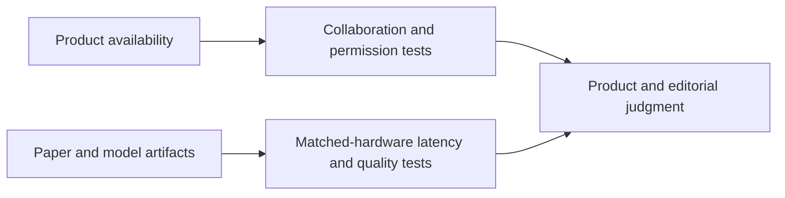

# AI Daily Brief · 2026-11-22

[English (current)](2026-11-22.md) · [中文](../../../daily/2026-11/2026-11-22.md)

- **Collection cutoff:** November 22, 2026, 11:00 Asia/Shanghai; deduplicated against the [previous brief](2026-11-21.md). [Index](../../INDEX.md) · [Trend tracker](../../../TRACKERS.md).
- **Selection result: no major new update today.** After checking the official release pages of OpenAI, Anthropic, Google and Hugging Face, as well as recent papers, this edition records two previously missed developments. Their original publication dates are November 20 and 17; neither is presented as a new release today. This finding is limited to the sources scanned and is not a claim that nothing was released worldwide.

## Key conclusions

1. **Product interface changes merit tracking, but require real usage evidence.** ChatGPT Space is rolling out to Plus users; interactive pages and presentations can update using connected apps and tools. Permissions, collaboration efficiency and output quality remain to be tested.
2. **Response latency, not playback frame rate, is the key interactive video metric.** The FastFrames paper reports per-frame latency on specified B200 configurations and provides model artifacts; the measurements come from the authors and do not establish long-term player experience.

## Catch-up developments

### 1. ChatGPT Space begins rolling out to Plus users

- **What happened:** OpenAI's release notes say that, starting November 20, Space is rolling out globally to Plus users aged 18 or older. Users can create interactive pages and presentations that update using connected apps and tools. Shared content requires access permission; Free users currently cannot open shared pages, and public links are unavailable. The same update also lists Live Dictation rolling out to all plans.
- **Why it matters / lens:** Product decisions and editorial planning. An AI workspace is moving from one-off answers toward continually updated collaborative artifacts. Check eligible access, connection permissions, update accuracy and editing cost; a rollout does not mean universal availability.
- **Publication / type / original source:** November 20, 2026, OpenAI [ChatGPT release notes](https://help.openai.com/en/articles/6825453-chatgpt-release-notes), official product documentation.
- **Corroboration / confidence:** One first-party source. The announced scope and limits have high confidence; adoption and productivity effects require independent evidence.
- **Trend:** T04/T06, November 20 catch-up; editable, continually updated AI work products continue to gain attention.

### 2. Apple researchers release FastFrames interactive-video paper and model artifacts

- **What happened:** Apple and Cornell researchers propose FastFrames, an autoregressive video generation system that simplifies pixel decoding and KV-cache updates to reduce end-to-end per-frame latency. The paper reports 36 ms per frame for the 1.3B variant on one B200 and 45 ms per frame for the 14B variant on eight B200s. Apple's Hugging Face page provides model artifacts and reproduction instructions. These are author measurements for different models and hardware setups, not a matched-configuration ranking.
- **Why it matters / lens:** Multimodal research, AI in gaming, product decisions and technical context. Interactive world generation calls for tests of input-to-frame latency, long-run consistency and total running cost. This paper offers a technical approach, not proof of a sustained playable game. Model and code licenses also need separate review.
- **Publication / type / original sources:** Originally submitted November 17, 2026, [arXiv paper](https://arxiv.org/abs/2611.23226); Apple [model page](https://huggingface.co/apple/FastFrames-L), research paper and first-party model artifacts.
- **Corroboration / confidence:** Artifacts can be inspected, but performance numbers are author-run experiments without independent matched-configuration replication. High confidence in the paper and artifacts; broader performance claims await validation.
- **Trend:** T02/T05, November 17 catch-up; interactive video research is shifting from playback frame rate toward per-frame response metrics.

## Next checks

- Continue checking primary releases, especially world models, AI games, LLMs and US/China developments; do not pad a low-signal weekend.
- Test Space permissions and update accuracy; reproduce FastFrames end-to-end response under matched resolution, hardware and interactive inputs.
