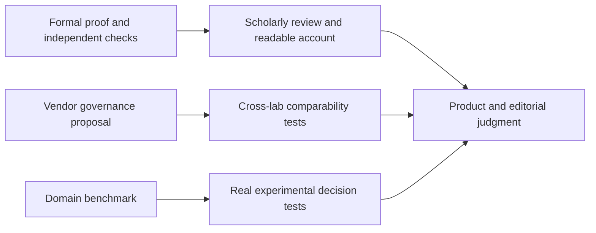

# AI Daily Brief · 2026-11-23

[English (current)](2026-11-23.md) · [中文](../../../daily/2026-11/2026-11-23.md)

- **Collection cutoff:** November 23, 2026, 11:00 Asia/Shanghai; deduplicated against the [previous brief](2026-11-22.md). [Index](../../INDEX.md) · [Trend tracker](../../../TRACKERS.md) · [W47 weekly brief](../../weekly/2026-W47.md).
- **Selection:** Three items: a major event missed yesterday and its verification progress; an opinion published November 22; and a November 20 benchmark catch-up. When the source provides only a date, no publication time is inferred. Older items are not added to reach a 20-item target.

## Key conclusions

1. **A Claude-assisted Riemann Hypothesis proof has received substantial formal verification.** The researcher presented it on November 20; the Lean/Mathlib communities stated on November 21 that the theorem statement and proof passed their checks. An MIT verification page records multiple checkers, an isolated build and checks still in progress. Attribute the result to human–AI collaboration and formal verification; await a readable mathematical account and further scholarly discussion.
2. **A frontier-capability governance proposal uses pretraining loss as a shared measure.** OpenAI chief scientist Jakub Pachocki argues for comparable perplexity/cross-entropy measurements across labs and capability thresholds. This is an interested research and governance view, not an industry standard; he also lists dataset comparability and weak links to actionable tasks as limitations.
3. **AI-for-science benchmarks must remain separate from real discoveries.** MedChemBench tests structure recognition, evidence interpretation, compound choice and property prediction from historical medicinal chemistry work. OpenAI acknowledges that it does not establish new drug discovery or better laboratory decisions.

## High-signal developments

### 1. Lean/Mathlib verify a Claude-assisted formal Riemann Hypothesis proof (major catch-up)

- **What happened:** Anthropic researcher and mathematician Levent Alpöge released his account and Lean artifact of a Riemann Hypothesis proof developed with Claude on November 20. In a November 21 joint statement, the Lean and Mathlib communities said the target theorem and proof were correct after checking the Mathlib statement, source compilation, statement matching and formal proof. MIT mathematician Andrew Sutherland's verification page records an isolated rebuild, module checks and independent proof checkers; as of its November 22, 16:20 UTC update, some end-to-end checks were still running.
- **Why it matters / lens:** Editorial planning, technical context and product decisions. This is a high-signal case of AI-assisted mathematics with machine-checkable output. Coverage should separate the proof claim, formal verification and the ongoing work of making the mathematics understandable. Claude should not be described as the sole author, nor should formal checks be framed as the end of all scholarly work.
- **Publication / type / original sources:** November 20, 2026, [Alpöge's original note](https://alpo.ge/remark.pdf); November 21 [Lean/Mathlib joint statement](https://leanprover-community.github.io/blog/posts/riemann-hypothesis/); [MIT verification record](https://math.mit.edu/~drew/grh/) updated November 22, 2026, 16:20 UTC. Original research account, community verification and independent check record.
- **Corroboration / confidence:** The joint statement and MIT record corroborate the main formal checks. Independent checkers' acceptance of the exported proof has high confidence. A readable account, simplification and long-run scholarly appraisal remain underway.
- **Trend:** T07 adds an “AI-assisted discovery → formal artifact → independent verification” chain; the November 21 event is a catch-up, with verification progress through November 22.

### 2. OpenAI chief scientist proposes perplexity for discussing frontier capability and safety boundaries

- **What happened:** Jakub Pachocki disclosed his team's pretraining cross-entropy progress on a fixed internal code dataset and proposed comparable perplexity measures and development limits across labs. He predicts that lower loss may accompany new capabilities, but this is an inference rather than an established threshold law.
- **Why it matters / lens:** Product decisions, investment monitoring, technical context and editorial planning. A common measure might enable earlier discussion of capability and safety gates. But the opaque internal dataset, differences in training data, inference-stage advances and downstream task performance limit comparability. A single pretraining metric is neither synonymous with general intelligence nor an agreed governance standard.
- **Publication / type / original source:** November 22, 2026, OpenAI chief scientist Jakub Pachocki's [original essay](https://openai.com/index/perplexity-and-intelligence/), an interested research view and disclosure of internal vendor data; no publication time is shown.
- **Corroboration / confidence:** The first-party essay verifies its author and proposal. The internal loss curve, capability extrapolation and cross-lab feasibility lack independent replication. The confirmed fact is that he made the proposal, not that the proposed framework works.
- **Trend:** T01/T07, first appearance of this cross-lab pretraining-metric proposal; measurement and governance discussion is gaining attention.

### 3. OpenAI releases medicinal chemistry reasoning benchmark MedChemBench (catch-up)

- **What happened:** MedChemBench uses 99 problems drawn from 117 papers and patents to test molecular structure recognition, interpretation of experimental evidence, compound ranking and property prediction. OpenAI says the historical source materials may have appeared in training, and responses are single attempts without tools or new experiments. The published model scores are vendor-run evaluations.
- **Why it matters / lens:** Product decisions, technical context and investment monitoring. Drug-discovery tools need separate tests for structural correctness, experimental reproducibility and actual decision impact. Benchmark scores do not establish new drug discovery or laboratory productivity.
- **Publication / type / original source:** November 20, 2026, OpenAI [research overview and paper link](https://openai.com/index/introducing-medchembench/), official research and vendor benchmark.
- **Corroboration / confidence:** The first-party material supports the benchmark design and release. Model comparisons lack independent matched-setting replication, and real discovery capability is unproven. High confidence in the release; real-world effect awaits validation.
- **Trend:** T01/T07, November 20 catch-up; domain benchmarks are moving beyond generic Q&A to structural and evidence-based reasoning.

## Next checks

- Follow remaining formal checks, a readable paper and independent mathematical explanations of the Riemann Hypothesis proof; correct overclaims or faulty attribution promptly.
- Watch for a shared dataset and comparable protocol for cross-lab loss metrics; independently rerun MedChemBench and test real experimental decisions.
- Continue looking for verifiable LLM, multimodal, world-model and AI-game releases without counting older announcements again.
