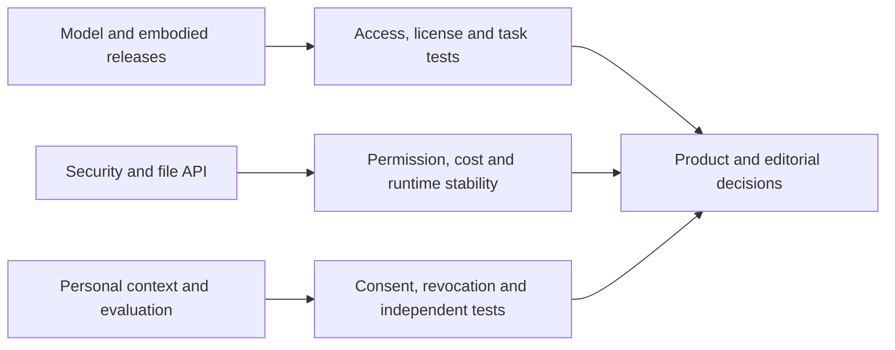

# AI Daily Brief · 2026-11-24

[English (current)](2026-11-24.md) · [中文](../../../daily/2026-11/2026-11-24.md)

- **Collection cutoff:** November 24, 2026, 11:00 Asia/Shanghai; November 23 primary releases were checked and deduplicated against the [previous brief](2026-11-23.md). [Index](../../INDEX.md) · [Trend tracker](../../../TRACKERS.md). A precise publication time is not inferred when a source lists only a date.
- **Selection:** Seven verifiable developments cover a new model, embodied AI, agent security, file processing, personal context and evaluation methods. Low-signal items were not added to reach 20. Vendor evaluations, community projects and product availability are kept separate.

## Key conclusions

1. **A model announcement and access are separate facts.** Z.ai's GLM-5.4 is available in AutoClaw through the GLM Coding Plan. Its official model article confirms the publication date, but does not establish that weights are public or that every channel is live.
2. **Embodied models are incorporating actions into pretraining.** X Square Robot announced WALL-OSS-1.0, combining vision, language and action, and access through WALL-API-1.0. Company-run real-robot results and a public simulation leaderboard use different settings and do not establish readiness for large-scale production.
3. **Agent security and cost are moving into runtime systems.** OpenAI and Cisco's Shirudo can run human-approved temporary eBPF protections before a permanent patch. Gemini API file slicing moves large-file selection and billing boundaries to the server. Both need validation on production-like workloads.
4. **Permission scope is central to personal-context products.** Google Wallet is rolling out as an opt-in connection in Search AI Mode; Drive and Gemini app connections are planned for the coming weeks. Read access to Wallet is not permission to transfer or invest funds.
5. **Small decision models and agent-evaluation methods both advanced.** IVE/Ivonnet provide artifacts for visual document decisions, while Hugging Face lays out an evaluation maintenance workflow from claim to score. Author-reported scores need retesting on users' own data and failure cases.

## High-signal developments

### 1. Z.ai brings GLM-5.4 to the Coding Plan and AutoClaw

- **What happened:** Z.ai published an official GLM-5.4 article on November 23. Its AutoClaw team confirmed the flagship model is integrated into AutoClaw through the GLM Coding Plan, with 1.5× quota there for V2, V3 and Team Edition users. The directly checkable delivery scope here is the product access described above.
- **Why it matters / lens:** Product decisions, investment monitoring and editorial planning. The model can enter matched coding-agent tests covering plan quotas, retries, price and regional availability. Plan access must not be described as a public weight release.
- **Publication / type / original sources:** November 23, 2026, Z.ai [model article](https://z.ai/blog/glm-5.4) and [AutoClaw availability notice](https://autoclaw.z.ai/en/blog/model/GLM-5.4/), first-party company material.
- **Corroboration / confidence:** Two sources from the same group are internal corroboration only. Product access has high confidence; architectural performance and cross-task gains await independent tests.
- **Trend:** T01/T04, first appearance; model and coding-agent plan integration.

### 2. X Square Robot releases WALL-OSS-1.0 embodied foundation model

- **What happened:** The company says WALL-OSS-1.0 puts vision, language and action data into pretraining and offers model capability to researchers and businesses via WALL-API-1.0. Its materials describe real-robot tasks and RoboDojo simulation results; independent media confirm the release. Performance figures largely come from company settings and statements.
- **Why it matters / lens:** Product decisions, investment monitoring and technical context. The route from pretraining to action generation warrants tests on new objects and tasks, human takeover rate and sustained operation. This is a vision-language-action model, not a playable game world model; API access also does not mean new weights are public.
- **Publication / type / original sources:** November 23, 2026, X Square Robot [model article](https://x2robot.com/en/blog/wall-oss-1) and [news page](https://x2robot.com/en/news); [Beijing News report](https://www.bjnews.com.cn/detail/1795412560129297.html). Company sources and independent media.
- **Corroboration / confidence:** The company and press corroborate the launch. Real-task scores and generalization remain primarily vendor claims pending independent robot tests.
- **Trend:** T02/T05, first appearance of this embodied model update; action-inclusive pretraining is gaining attention.

### 3. OpenAI and Cisco release open-source runtime Shirudo

- **What happened:** The partners announced Shirudo, which uses eBPF to load human-approved temporary protections on running Linux systems while permanent patches are prepared. Inspectable code is available. OpenAI's Java4Shell/Elasticsearch demonstration is a controlled test, not evidence of broad production effectiveness.
- **Why it matters / lens:** Product decisions and technical context. Agent security extends from finding flaws to protection deployment and audit. Test signatures, false positives, rollback, kernel compatibility and human approval. Open-source licensing of the project does not make every generated shield safe.
- **Publication / type / original sources:** November 23, 2026, OpenAI [technical overview](https://openai.com/index/introducing-shirudo/) and Cisco [joint announcement](https://newsroom.cisco.com/c/r/newsroom/en/us/a/y2026/m11/cisco-and-openai-launch-shirudo-a-new-project-to-safeguard-agentic-ai.html), two first-party partner sources.
- **Corroboration / confidence:** The partners' accounts corroborate delivery, not independent third-party performance. High confidence in the release; production protection awaits replication.
- **Trend:** T07, first appearance; agent security moves from scanning to controlled runtime protection.

### 4. Gemini API adds server-side file slicing and more document formats

- **What happened:** Google says the Gemini 4 API can select pages, spreadsheet cells, audio/video intervals and content layers from PDF, Office/OpenDocument and other files. The server processes and bills for the inspected parts. The interfaces are available in Google AI Studio and the Gemini platform; existing file-size and page limits still apply.
- **Why it matters / lens:** Product decisions and technical context. Multimodal agents can read large files selectively, potentially reducing whole-file context and local conversion. Test bills, missed evidence and data permissions on real document sets.
- **Publication / type / original source:** November 23, 2026, Google [developer announcement](https://blog.google/innovation-and-ai/technology/developers-tools/file-slicing-controls/), first-party product and API documentation.
- **Corroboration / confidence:** One official source. Interface availability and scope have high confidence; savings and task quality require independent measurement.
- **Trend:** T03/T04, continuing rise; multimodal input control moves into the API layer.

### 5. Google Search AI Mode expands Personal Intelligence connections

- **What happened:** Google says users can opt in to connect Wallet to Search AI Mode, with a rollout in progress. Drive and Gemini app connections are planned for the coming weeks. Google explicitly states that Wallet access here is read-only for the assistant: it cannot transfer, manage or invest funds for users, and connections can be turned off.
- **Why it matters / lens:** Product decisions, editorial planning and investment monitoring. Search is bringing payment and document context into answers. Personalized advice and transaction execution must remain distinct; test consent granularity, revocation, explainability, incorrect advice and regional availability.
- **Publication / type / original source:** November 23, 2026, Google [Search product announcement](https://blog.google/products-and-platforms/products/search/google-search-personal-intelligence-apps/), first-party source.
- **Corroboration / confidence:** One official source. Announced rollout stages and read-only limits have high confidence; real effects and future connections are unverified.
- **Trend:** T04/T06, continuing rise; personal context enters the search interface.

### 6. Illuin releases IVE and Ivonnet document decision models

- **What happened:** Illuin's team published IVE-4B and Ivonnet-0.8B on Hugging Face. Given a document image or text, a question and options, they output option probabilities. Weights, inference code and server code are offered under Apache 2.0. The team reports Decision Index and visual-document scores while noting primarily English training, limited long-document input and weaker multi-step reasoning.
- **Why it matters / lens:** Product decisions and technical context. Extraction, classification, reranking and interface choices might use one probabilistic model; a decision classifier is not an autonomous agent. Independently test Chinese receipts, long documents and calibration datasets.
- **Publication / type / original sources:** November 23, 2026, the team's [Hugging Face community article](https://huggingface.co/blog/QuentinJG/ive-release) and [model page](https://huggingface.co/illuin/IVE-4B), original publisher material.
- **Corroboration / confidence:** Artifacts and license are inspectable. Leaderboard and latency figures are team reports; cross-language results need replication. High confidence in release, broader performance pending validation.
- **Trend:** T01/T04, first appearance; specialist decision models expand.

### 7. Hugging Face publishes a guide to maintaining agent evaluations

- **What happened:** Hugging Face's article decomposes agent evaluation into the task claim, environment, run traces, scoring and maintenance, including flawed tasks, graders and artifacts to share. Its platform leaderboard counts are self-reported, not an industry total.
- **Why it matters / lens:** Product decisions, technical context and editorial planning. Agent assessment needs more than one leaderboard score. Keep auditable traces, task versions, human review and failure cases, and track how grader revisions change rankings.
- **Publication / type / original source:** November 23, 2026, Hugging Face [methods article](https://huggingface.co/blog/agentic-evals), first-party platform method and viewpoint.
- **Corroboration / confidence:** The publication and described workflow are verifiable. Method effectiveness and platform-scale figures lack independent validation; this is practical guidance, not a common standard.
- **Trend:** T01/T04/T07, continuing rise; evaluation expands from model answers to agent processes and outputs.

## Next checks

- Compare GLM-5.4 access channels, licensing, total cost and independent performance on matched tasks; test WALL-OSS-1.0 on real robots and track human takeover.
- Test Shirudo's false blocks and rollback, Gemini file slicing's omissions and bills, and Google Personal Intelligence's consent boundaries on production-like workloads.
- Continue tracking actually playable world-model and AI-game releases; this edition does not relabel a robot VLA or mini-game creation feature as a new world model.
