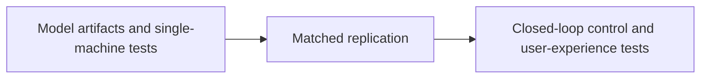

# AI Daily Brief · 2026-11-28 (compiled late)

[English (current)](2026-11-28.md) · [中文](../../../daily/2026-11/2026-11-28.md)

- **Collection window:** Verifiable publications available by November 28, 2026, 11:00 Asia/Shanghai; compiled after 17:10 the same day. Sources are mainly November 27 technical releases. Deduplicated against the [previous brief](2026-11-27.md). [Index](../../INDEX.md) · [Trends](../../../TRACKERS.md). Exact times are not inferred from date-only sources.
- **Selection:** Two technical developments. No sufficiently evidenced new flagship LLM or playable AI game world model delivery was found. Reposts were not used to fill the count.

## Key conclusions

1. **Video-model deployment bottlenecks occur in both accelerators and host-side processing.** A Hugging Face engineer reports that an optimized LTX‑2.5 run on Trainium3 used 32 NeuronCores to produce a 10-second, 2048×1024 clip with sound in 22–23 seconds. This is a team experiment on one setup, not a cross-cloud cost conclusion.
2. **Released multimodal-tokenizer weights make replication more feasible.** Kandinsky Lab released audio, image and video KVAE‑3.0 VAEs and inference code. Its quality comparisons are team-run and need matched downstream models and budgets.
3. **Video continuation is not a controllable game world or robot simulation.** The Trainium3 demonstration generates continuations from the first second of footage and text; it is not conditioned on robot actions and cannot directly establish closed-loop training or real-time play.

## High-signal developments

### 1. Hugging Face optimizes LTX‑2.5 video generation on Trainium3

- **What happened:** An engineer ported the LTX‑2.5 video-and-audio pipeline to AWS Trainium3. On 32 NeuronCores, the team reports 22–23 seconds of steady-state generation time for a 10-second 2048×1024 clip. The article provides a multi-shot workflow, code and samples, plus continuation examples from one second of robot and car footage.
- **Why it matters / lens:** Product decisions and editorial planning. Multi-shot creation needs frame constraints, take selection and sound continuity. Deployment tests should separate model loading, host preprocessing, generation and decoding time.
- **Publication / type / original source:** November 27, 2026, Hugging Face [engineering article and code links](https://huggingface.co/blog/video-trainium3), project experiment.
- **Corroboration / confidence:** Code, samples and configuration are inspectable; speed lacks independent replication. Continuation follows text rather than robot actions, so it does not establish a closed-loop world model or playable game. High confidence in the experiment's publication, limited generality.
- **Trend:** T02/T03/T05, continuing rise; video deployment increasingly measures the entire pipeline rather than one model pass.

### 2. Kandinsky Lab releases KVAE‑3.0 multimodal tokenizers

- **What happened:** The team released model weights and inference code for audio, image and video VAEs. Its description lists 48 kHz stereo audio with a 50 Hz latent rate and spatial and temporal video compression. Win rates and reconstruction comparisons with other VAEs are team-run.
- **Why it matters / lens:** Product decisions and technical context. Tokenizers affect video and audio quality, training cost and latency. Switching requires matched tests of reconstruction, detail retention and finished-output quality on the same downstream model.
- **Publication / type / original source:** November 27, 2026, Kandinsky Lab [Hugging Face article and weight links](https://huggingface.co/blog/kandinskylab/kvae-3), team research release.
- **Corroboration / confidence:** Weights and code are inspectable; comparisons lack independent matched replication. High confidence in delivery, advantage unverified.
- **Trend:** T01/T02, first appearance; multimodal competition extends to latent representations.

## Next checks

- Replicate video generation at matched quality, concurrency and cloud cost; distinguish short video continuation from action-conditioned world models.
- Compare KVAE‑3.0 and existing tokenizers under the same downstream generator for quality, speed and compatibility.
