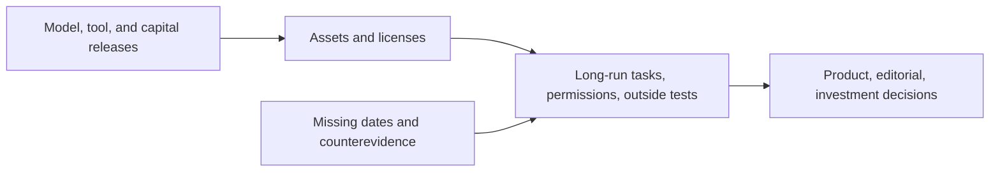

# AI Monthly Briefing · 2026-10 (incomplete daily coverage)

[English (current)](2026-10.md) · [中文](../../monthly/2026-10.md)

- **Compiled:** November 3, 2026, from the [archive index](../INDEX.md) and [W41 (Chinese only)](../../weekly/2026-W41.md), [W42](../weekly/2026-W42.md), [W43](../weekly/2026-W43.md), and [W44](../weekly/2026-W44.md). October 28–31 have no separate daily editions; some other editions were retrospective or early. Event counts cannot represent the full month.

## Key conclusions

1. **Agents moved from chat toward persistent tasks, tools, and permission governance.** Model capability, workflow connections, and recoverable work advanced together. A demo or vendor benchmark does not establish sustained ROI.
2. **World models followed several distinct paths.** Odyssey-3, Matrix-Game 4.0, Hy-Nomas, and Genie 4 respectively offer a playable preview, hybrid engine, interactive-video weights, and trusted-tester preview. Robot and laboratory world models have other task goals. Long-run consistency, latency, and cost remain shared gates.
3. **Open weights, cloud distribution, and compute supply jointly shape usability.** MiniMax M3.1 Flash and other weights require license and hardware checks; Google Cloud procurement modes change data responsibility; grid connection and construction safety affect compute delivery.
4. **Safety and research verification moved toward inspectable materials.** PHP fixes, containment red teaming, policy scope, AI-assisted research proofs, and Anthropic's S-1 each require their own primary files, outside validation, and implementation status.

## Trend evolution and key events

| Trend | Evidence this month | Unproven / contrary evidence | Next signal |
| --- | --- | --- | --- |
| Agent task systems | GPT-6 series, Decisions API, DeepSeek Search/Fetch, ServiceNow connection | One-off success differs from long-run reliability; seats are not ROI | Final task state, handoff, permissions, cost per task |
| World models / AI gaming | Odyssey-3, Matrix-Game, Hy-Nomas, Genie 4 offer different access modes | Playback FPS is not generation throughput; a research preview is not a mature game | Sustained player tests, state coherence, input delay |
| Open weights and multimodal | MiniMax, Meta, Mistral and others shipped weights or previews; voice, vision, video stacks grew | Open weights are not OSI open source; vendor scores are not independent tests | License, target-asset quality, actual hardware cost |
| Business and infrastructure | Anthropic proposed-IPO S-1, OpenAI financing reports, cloud distribution, Nscale grid issue | An S-1 is not a listing; funding reports and user seats are not profit | Financial disclosure, margin, grid access, delivery |
| Governance and research | Federal procurement scope, PHP patches, containment red team, AI research claims | Procurement limits are not a universal private ban; formal artifacts are not scholarly consensus | Implementation texts, independent security tests, expert review |

## Refuted or corrected claims

- “No October 8 world-model preview” was corrected by the [Odyssey-3 catch-up](../weekly/2026-W42.md).
- “Disney acquired all of Character.AI” is false; see [W42](../weekly/2026-W42.md).
- “China formally banned all 23 AI technologies” and “the U.S. banned private DeepSeek use” misstate the two policies' scopes.
- “Open weights mean open source,” “video generation proves a mature game,” and “funding or seats prove ROI” remain unsupported.

## Continuing watch and method limits

- Watch in November: Genie 4 and Hy-Nomas long-session tests, agent permissions and task costs, open-weight commercial licenses, Anthropic's S-1 process, and independent reviews of AI research claims.
- Reports contain retrospective catch-ups and no separate October 28–31 dailies. This archive cannot measure industry release frequency, China/U.S. share, or investment returns. This report is not investment or legal advice.
