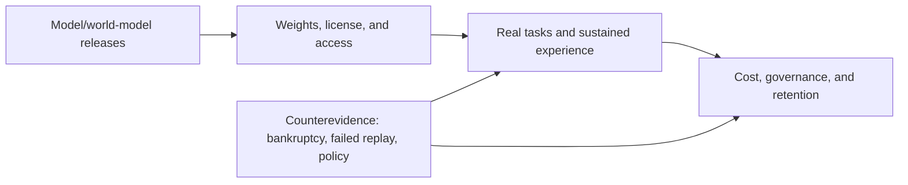

# AI Weekly Brief · 2026-W42 (October 12–18)

[中文](../../weekly/2026-W42.md) · [English (current)](2026-W42.md)

- **Compiled:** After 11:00 Asia/Shanghai on October 19, following the period's close.
- **Scope:** Synthesizes this repository's seven daily briefs for October 12–18. The October 12 edition was published after its scheduled time and corrected an October 8 Odyssey-3 omission. Events are deduplicated by original publication date and new evidence; item counts are not measures of industry attention.
- **Navigation:** [Archive index](../INDEX.md) · [Trend tracker (Chinese)](../../TRACKERS.md).

## Key conclusions of the week

1. **World models now have several distinct validation tracks.** Odyssey-3 offers a playable research preview; Matrix-Game 4.0 provides single-GPU code, weights, and a one-person demo; Google's VERID concerns physical experiments. These test continuous player experience, hybrid engine architecture, and real-world control respectively. They cannot be exchanged for one generic “AI can now build games” conclusion.
2. **Open weights compete on delivery, licensing, and total cost.** Muse Spark Open, Step 5 Preview, Reflection Beam, Ling 3.1 Flash, and DeepSeek 1017 have different forms of model delivery. Advertised parameters and context do not mean they run on the same hardware, permit the same commercial uses, or perform equally on real tasks.
3. **Agent differentiation increasingly depends on persistent state, tools, and governance.** Muse Wonder's memory framing, DeepSeek Search/Fetch, Tencent Hy-Memory, and Anthropic's internal engineering and safety reports shift attention from one-turn scores to tool calls, memory writes, authorization boundaries, and recoverable task outcomes. Internal and vendor benchmarks do not yet establish general ROI.
4. **AI entertainment shows a sharp contrast between supply and business durability.** Epic offered a downloadable preview of an AI-assisted rewrite of its Launcher, while Character.AI entered Chapter 11 and sought a partial-IP licensing transaction. Faster creative/engineering supply is a different question from a character-companion platform's long-term unit economics and safety liabilities.
5. **Infrastructure, policy, and organizational effects demand stricter delivery tests.** Microsoft's production deployment of Maia 200, Anthropic's internal workforce study, and China's draft technology-export catalog plus immediate registration rule are different evidence types. Promotional performance, one-company samples, and a draft must not become independent industry conclusions or an already-effective blanket ban.

## Daily evidence index

| Date | Main increment | Evidence boundary |
| --- | --- | --- |
| [Oct 12](../../daily/2026-10/2026-10-12.md) | Odyssey-3 correction; voice-agent opinion | Playability is not sustained game quality; opinion is not fact |
| [Oct 13](../../daily/2026-10/2026-10-13.md) | Muse Wonder, Maia, agent safety, vertical apps | Separate production deployment, vendor benchmarks, and controlled experiments |
| [Oct 14](../../daily/2026-10/2026-10-14.md) | Wider Gemini 4 Argon access, robotic world model, Character.AI backfill | Wider access is not initial release; Disney did not buy the whole platform |
| [Oct 15](../../daily/2026-10/2026-10-15.md) | API snapshot migration, Epic Launcher preview, multimodal workflow | Specific snapshots, not the entire series, are retiring; preview is not stable production |
| [Oct 16](../../daily/2026-10/2026-10-16.md) | Matrix-Game 4.0, Muse Spark Open, Step 5 Preview, Bee | Weights/demo delivery is distinct from performance and scaled impact |
| [Oct 17](../../daily/2026-10/2026-10-17.md) | Beam/Ling weights, Anthropic employment, VERID/OneWM | Internal data do not generalize; scientific closed loop is not a playable game |
| [Oct 18](../../daily/2026-10/2026-10-18.md) | Export draft and immediate registration, DeepSeek 1017/Search/Fetch, Hy-Memory | Draft is not a ban; vendor scores and a community replay cannot be used as a head-to-head comparison |

## Trend evolution and validation plan

| Trend | Change this week | Counterevidence / unsupported claim | Next signal |
| --- | --- | --- | --- |
| T01 Agents and persistent work | Memory, search tools, workflows, and orchestration became product-level concerns | Offline memory-classifier gains regressed in a small replay; customer cases lack independent net-benefit audits | Task end state, missed/false writes, human takeover, total cost |
| T02/T05 World models and AI games | Odyssey-3 playability, Matrix-Game code/weights, and VERID physical experiments | Game-development-agent examples are not real-time world models; physical labs are not game runtimes | 10–30-minute player tests, state consistency, latency/cost, recovery in robotics |
| T03/T06 Open models | US and Chinese labs delivered varied licenses, scales, and device profiles | Claimed 1M context, large parameter counts, and vendor scores do not prove product fitness | Quality and full cost on matched tasks, hardware, and licensing terms |
| T07 Safety and policy | Multi-step election misuse, agent external side effects, temporary export registration | “23 AI technologies are formally banned from export” is false; the immediate registration requirement still matters | Final catalog, scope, measured incident rates, revocation/audit controls |
| T08 Business value | Platform distribution, enterprise cases, AI-entertainment restructuring, internal employment data | Interaction volume is not ROI; Character.AI's large audience did not ensure independent viability | Retention, gross margin, moderation/liability cost, organizational controls |

## Refuted or still unsupported

- **“There was no verifiable world-model preview on October 8”: corrected.** [Odyssey-3's official playable preview](https://odyssey.systems/meet-odyssey-3) was backfilled on October 12; it still does not establish a mature game runtime.
- **“Disney has bought all of Character.AI”: unsupported.** The [company statement](https://blog.character.ai/an-update-on-character-ai/) describes a bankruptcy process and a stalking-horse bid for a non-exclusive perpetual license to certain IP. The platform is still operating; the final sale outcome remains open.
- **“China has already banned exports of 23 AI technologies”: false.** The [Commerce Ministry notice](https://www.mofcom.gov.cn/zcfb/blgg/art/2026/art_1666fcaa24424766afe0683498ff0908.html) proposes changes to the catalog; separate pre-export temporary registration for specified situations took immediate effect.
- **“Vendor model scores, open weights, and customer demos prove commercial value”: still unsupported.** Independent task quality, end-to-end costs, license terms, and sustained usage are needed.

## Watch next week

1. Cross-context, sustained, and cost tests of Matrix-Game, VERID, and OneWM, separating game experience from experiment control.
2. New weights on real hardware, Chinese-language tasks, and commercial license terms; task-level DeepSeek Search/Fetch tests before November billing.
3. Character.AI's auction and service continuity; real retention and safety cost for AI entertainment tools.
4. Scope and consultation changes to China's export catalog; product-level evaluation of agent side effects and memory writes.

## Method and limitations

This synthesis draws on seven daily editions and their primary sources. We did not independently rerun models, pricing, robotics, or game tests. The October 12 correction and the October 14 major Character.AI backfill retain their original event dates; such gaps make the briefs unsuitable for calculating shares of all industry events. KOL opinions remain labeled as opinions, not objective results. This is not investment, legal, or medical advice.
