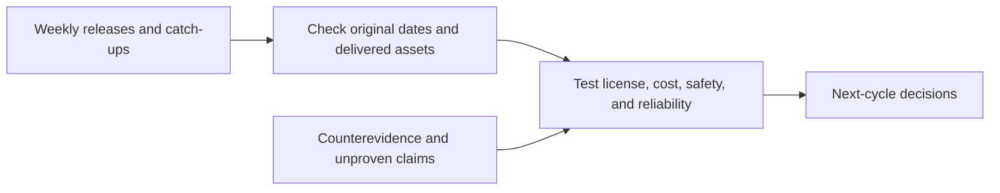

# AI Weekly Briefing · 2026-W43 (October 19–25)

[English (current)](2026-W43.md) · [中文](../../weekly/2026-W43.md)

- **Compiled:** October 27, 2026, Asia/Shanghai, after the full calendar week; this is not an on-time October 26 publication.
- **Basis:** The [seven October 19–25 daily briefs](../INDEX.md). October 24 was an early edition and October 25 caught up on older releases. We group by original publication date and evidence strength, not by the count of backfilled items.

## Key conclusions

1. **Model-delivery decisions now turn on licenses, deployment responsibility, and cost per completed task.** MiniMax M3.1 Flash weights are downloadable with commercial-license limits. Google Cloud added more OpenAI/Claude purchasing routes, while Claude deployment modes have different data processors. DeepInfer and llm-d serve different inference layers and cannot be compared by one score.
2. **Agent acceptance criteria are becoming actionable.** Decisions API general availability, ThinkingBox's repeated-success study, and OpenAI's research-environment containment disclosure all point to separate tests for one-off correctness, sustained success, permissions, and recovery.
3. **World models, vision, and embodied data occupy different product layers.** Tencent Hy-Nomas offers interactive-video weights/code; NVIDIA Cosmos3-H-Dreams targets surgical-action-conditioned simulation; WeVisOne-VL is an image-perception model; AGIBOT released physical-reasoning data. Video FPS is not generation throughput; research simulation is not a mature game or clinical system.
4. **Capital, compute, and software-adoption evidence remain different.** Private financing reports, public-market moves, Nscale's power access, the TSMC construction accident, and enterprise employee reach do not separately establish demand, delivery dates, or ROI.
5. **Policy and safety claims require scope.** The U.S. DeepSeek federal civilian procurement rule is not a private-use ban. PHP vulnerability fixes are real public-software outcomes; model-assisted discovery workflows and production security capability need separate assessment.

## Daily increment index

| Date | Main increment | Evidence boundary |
| --- | --- | --- |
| [Oct 19](../daily/2026-10/2026-10-19.md) | Benefit-fund proposal, Character.AI/Disney, Nscale power | Proposal is not completed; project risk is not cancellation of all cooperation |
| [Oct 20](../daily/2026-10/2026-10-20.md) | MiniMax API, migration evaluation, reviewable generation | Vendor speed claims are not independent ROI |
| [Oct 21](../daily/2026-10/2026-10-21.md) | Federal procurement rule, inference stack, vertical agents | Separate policy scope from code delivery |
| [Oct 22](../daily/2026-10/2026-10-22.md) | Model distribution, PHP fixes, sandboxes, multimodal data | Private preview differs from GA; apply patches first |
| [Oct 23](../daily/2026-10/2026-10-23.md) | Task reliability, retrieval/spatial data, research world model | Repeated success differs from any one success |
| [Oct 24](../daily/2026-10/2026-10-24.md) | Open-weight licenses, cloud buying, capital, chip construction | Early edition; financing reports and output effects need checks |
| [Oct 25](../daily/2026-10/2026-10-25.md) | Hy-Nomas, containment red team, embodied data, voice | October 20–23 catch-ups; no major same-day new launch |

## Trend evolution, counterevidence, and next signals

| Trend | Change this week | Disproven or not established | Next signal |
| --- | --- | --- | --- |
| T01 Agents | More specific task decisions, repeated success, and permission boundaries | One-off success is not long-run reliability; a repaired escape is not zero risk | Final task state, retry cost, boundary violations, rollback |
| T02/T05 World models / AI gaming | Separate assets in interactive video, robot simulation, visual perception, and training data | Output at 24 FPS is not generation speed; embodied models are not game runtimes | 10–30 minute state consistency, latency, task transfer |
| T03/T06 Open weights and infrastructure | More weights, inference frameworks, and cloud deployment modes | Open weights are not open source; a multi-vendor listing is not a shared contractual boundary | Commercial licenses, same-task total cost, region/data responsibility |
| T07 Policy and safety | Federal procurement scope, PHP fixes, and containment red team became more concrete | A universal U.S. DeepSeek ban is false; vendor red teaming is not an external audit | Implementation scope, patch adoption, independent attacks |
| T08 Commercial value | Capital, compute, and enterprise adoption figures moved in parallel | Employee reach, funding totals, or share moves alone do not establish ROI | Paid retention, gross margin, power access, delivery rate |

## Refuted claims and continuing watch

- **False:** “MiniMax M3.1 Flash is OSI open source.” It is open weight with commercial restrictions; see the [October 24 brief](../daily/2026-10/2026-10-24.md).
- **False:** “The DeepSeek rule covers all U.S. private use.” It concerns federal civilian agency procurement and IT systems; see the [October 21 brief](../daily/2026-10/2026-10-21.md).
- **Unproven:** “World models can already generate stable, mature playable games.” Long-horizon player studies, state consistency, latency, and cost remain necessary.
- **Watch:** Approval and governance of Anthropic's benefit fund; Character.AI court process; independent Hy-Nomas and voice-agent tests; Nscale power and contract status.

## Method and limits

We did not rerun model, game, robot, or cost experiments. An early edition and retrospective catch-ups mean the number of daily items is not an industry-activity statistic. Opinions, company claims, and independent tests remain distinct. This is not investment or legal advice.
