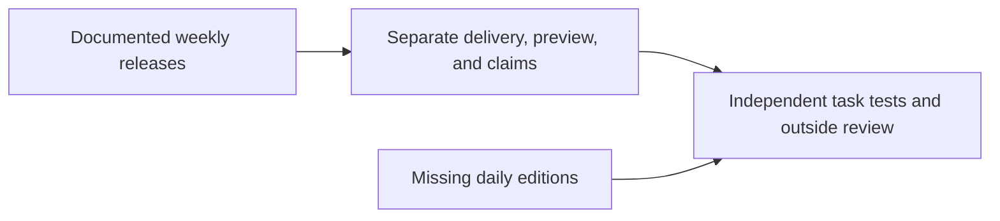

# AI Weekly Briefing · 2026-W44 (October 26–November 1; incomplete coverage)

[English (current)](2026-W44.md) · [中文](../../weekly/2026-W44.md)

- **Compiled:** November 3, 2026, after the period ended; coverage is incomplete.
- **Basis:** The [October 26 backfill](../daily/2026-10/2026-10-26.md), [late October 27 edition](../daily/2026-10/2026-10-27.md), and items in the [November 2 catch-up](../daily/2026-11/2026-11-02.md) explicitly dated October 28–31. No separate October 28–31 or November 1 daily editions exist. Missing editions cannot establish an absence of news.

## Key conclusions

1. **Model cost and graphical-interface ability advanced together.** GPT-6.1 Terra has a listed API and prices, while performance remains vendor evaluated. Judge it on completed-task cost and recovery.
2. **World models gained a new research preview.** Genie 4 supports interaction and native audio, but Google acknowledges long-run drift. Mature AI gaming remains to be demonstrated.
3. **Capital and research claims entered public scrutiny.** Anthropic's S-1 can be checked in the SEC index, though the offering is not effective. OpenAI's mathematical and physics results require independent scholarly review.
4. **Specialist agents and governance gained tighter boundaries.** ServiceNow workflow connections, Rosalind limited access, the Model Spec revision, and training-preference signal concern execution permissions, eligibility, safety, and website choice respectively.

## Trends, counterevidence, and next signals

| Trend | Observation | Unproven or contrary evidence | Next signal |
| --- | --- | --- | --- |
| T01/T03 Models and agents | Terra, ServiceNow, Rosalind add task and vertical entry points | Vendor scores, partnerships, and limited preview are not general deployment | Real-task success, permissions, cost |
| T02/T05 World models | Genie 4 trusted-tester preview | Google acknowledges long-run object and scene drift | Sustained player tests, input delay, cost per minute |
| T07 Governance | Training-preference signal, Model Spec update, specialist access | Signal implementation is planned; policy text is not industry-wide effect | Implementation, external audit, incident rates |
| T08/T09 Capital and research | S-1 filing, AI-assisted research claims | No completed listing; formal artifacts are not scholarly acceptance | Prospectus updates, public expert reviews |

## Refuted claims and method limits

- **False:** “Anthropic has completed an IPO.” The SEC records a proposed-offering S-1; the registration statement is not effective.
- **Unproven:** “Genie 4 reliably supports mature long-session games.” Google lists long-run consistency limits.
- **Unproven:** “AI has produced accepted ETH or quantum-field-theory conclusions.” Outside review is ongoing.
- The week has major collection gaps. This report summarizes documented material and does not measure event volume or geographic share.
