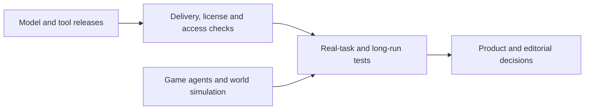

# AI Weekly Brief · 2026-W45 (November 2–8)

[English (current)](2026-W45.md) · [中文](../../weekly/2026-W45.md)

- **Compiled:** November 10, 2026, from seven [daily editions](../INDEX.md) for November 2–8. The November 2 edition was a late catch-up covering October 28–November 2. Events are attributed to their original publication dates, not catch-up dates.
- **Coverage limit:** Most days were high-signal short editions. This review is not an exhaustive release list and cannot support market-share or geographic-count claims.

## Key conclusions

1. **World models and game-playing agents require different tests.** [NVIDIA Cosmos 3](../daily/2026-11/2026-11-06.md) delivered controllable simulation checkpoints; [Project EVE](../daily/2026-11/2026-11-08.md) tested trading, cooperation and saboteur detection in existing games. The former needs long-run environment consistency; the latter needs evidence of strategy generalization. Neither establishes automatic production of a mature game.
2. **Foundation-model selection needs delivery, license and task cost together.** [Tencent Hy4](../daily/2026-11/2026-11-06.md) announced vision and computer-use capabilities while new weights were pending that week; [Mistral Large 4](../daily/2026-11/2026-11-05.md) delivered open weights with license conditions; [Baidu ERNIE-5.5-Flash-Base](../daily/2026-11/2026-11-07.md) is pretrained weights with regional and commercial restrictions. A generic “open” label obscures material differences.
3. **Agent systems are moving toward specific environments and structured components.** [ServiceNow workflows](../daily/2026-11/2026-11-02.md), [Kakao's decision model](../daily/2026-11/2026-11-08.md) and [Conductor joining Meta](../daily/2026-11/2026-11-07.md) concern enterprise execution, classification modules and product distribution respectively. They are different kinds of progress.
4. **Safety now includes restricted access and outside testing.** [GPT-6 Cyber](../daily/2026-11/2026-11-07.md) had limited distribution, [OpenAI and Hacktron](../daily/2026-11/2026-11-08.md) arranged collaborative testing, and the [METR assessment](../daily/2026-11/2026-11-07.md) offered an external but highly uncertain estimate of faster AI R&D. Testing plans and reports do not establish repairs or durable outcomes.
5. **Multimodal creation still needs production metrics.** [OpenAI Images 2.6](../daily/2026-11/2026-11-05.md) and [Gemini Omni 1.2 Flash](../daily/2026-11/2026-11-07.md) offered new image and video capabilities. Judge cross-shot consistency, rework time and cost per finished asset rather than demos alone.

## Trend changes and key events

| Trend | Confirmed progress this week | Limit or counterevidence | Next signal |
| --- | --- | --- | --- |
| T01 Agents and foundation models | Hy4, Large 4, ERNIE base, Kakao decision component, ServiceNow connection | Announcement, API, weights and license differ; vendor scores lack independent replication | Promised weights, license review, task success and total cost |
| T02/T05 World models and AI games | Cosmos 3 checkpoints and Project EVE; Genie 4 preview in November 2 catch-up | Simulation is not a playable game; EVE replay profits are not live financial returns; Genie 4 acknowledges long-run drift | Long-run consistency, input latency, strategy generalization and recovery |
| T03 Multimodal production | Images 2.6, Gemini Omni 1.2 Flash, LeRobot v0.7.0 | Video generation, robotics data tools and finished creative quality are different | Asset reuse, cross-shot consistency, tool cost |
| T07 Safety and governance | Restricted GPT-6 Cyber, Hacktron testing, external METR assessment | A partnership does not mean bugs were fixed; R&D acceleration estimate has redaction and attribution limits | Disclosed fixes, outside reruns, R&D productivity over time |
| T08 Company and capital | OpenAI's proposed Pierre acquisition; Conductor joining Meta | A proposed acquisition differs from completed product integration; migration has costs | Transaction completion, service migration, retention and new entry points |

## Rejected claims and continuing watches

- **Rejected:** “EVE in-game profits prove Claude can invest.” The trading study replayed historical orders without a live market responding to agent orders.
- **Rejected:** “Kakao's decision model is a complete agent.” It returns classification probabilities and scores rather than independently executing long tasks.
- **Not yet established:** “The Hy4 announcement means new weights are already open.” Tencent's November 4 release said the weights and system card would follow.
- **Not yet established:** “Vendor video demos and scores prove interactive-content production readiness.” Cross-shot consistency, rework and cost need independent task tests.
- **Continue watching:** Long-run control in Genie 4 and Cosmos 3; strategy generalization in AI game agents; open-weight licenses; repair disclosures for restricted cyber models; final quality in creative workflows.

## Next-period checks

1. Confirm actual delivery of promised weights, system cards and access, and record exact licenses.
2. Track long-run state consistency for world models and task completion for game agents separately; do not use video playback frame rate as generation latency.
3. Measure human rework, asset reuse and cost per finished piece for multimodal creation.
4. Follow independent reruns, actual fixes and underlying-data disclosures in safety and research reports.

> Releases dated November 9 or later fall outside W45; see subsequent daily briefs.
