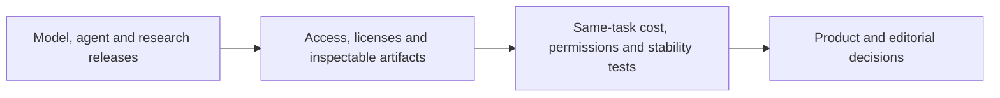

# AI Weekly Brief · 2026-W46 (November 9–15)

[English (current)](2026-W46.md) · [中文](../../weekly/2026-W46.md)

- **Compiled:** November 16, 2026, from the [November 9–15 daily archive](../INDEX.md). Some dailies were published late or contain catch-ups. Analysis follows original release dates and delivery status rather than counting a catch-up as a new event.
- **Coverage limit:** Several editions were short high-signal scans below the routine item target. These are judgments about recorded events, not a count of all industry releases or market share. Perplexity Decider v1.3, released November 12, appears as a catch-up in [Monday's brief](../daily/2026-11/2026-11-16.md) and is excluded from this week's daily coverage count.

## Key conclusions

1. **Foundation-model capability, price and access tier need joint comparison.** [Anthropic Fable/Mythos 5.2](../daily/2026-11/2026-11-10.md) share an underlying model with different safeguards; [Gemini 4 Carbon and Muse Ember](../daily/2026-11/2026-11-11.md) widen API choices; [Hydrogen](../daily/2026-11/2026-11-13.md) targets model routing. Vendor scores and list prices cannot replace complete-task quality and cost.
2. **Agent products are moving toward editable outputs and explicit permissions.** [Claude Sheets, Whiteboards, Data and ChatGPT Business Agents](../daily/2026-11/2026-11-11.md) enter workspaces and business discovery; [Gemini Wallet](../daily/2026-11/2026-11-14.md) touches personal spending data. Acceptance checks should record visible data scope, confirmation steps and task consequences.
3. **World models, robot control and game-development tools are distinct production paths.** [Praxis-1 and PAN 2](../daily/2026-11/2026-11-12.md) delivered weights and code for robot action prediction and action-conditioned video simulation respectively; [Gemini Robotics 2.5/GR00T 2](../daily/2026-11/2026-11-11.md) focus on embodied tasks; [Flow creation tools](../daily/2026-11/2026-11-13.md) are not playable world models. Measure long-run consistency, real-task success and finished-content rework separately.
4. **Safety and governance have operational boundaries, while external outcome evidence remains thin.** [OpenAI Control Room](../daily/2026-11/2026-11-10.md) discloses research-inference stopping controls; [Anthropic Anvil](../daily/2026-11/2026-11-13.md) discloses automated red teaming; [NVIDIA's leadership change](../daily/2026-11/2026-11-14.md) raises delivery-continuity questions. Separate company statements and internal tests from durable results.
5. **Inspectable artifacts provide a route to independent review.** [AlphaProof Code Signal](../daily/2026-11/2026-11-11.md), [Salesforce SOV-Transcribe-1](../daily/2026-11/2026-11-13.md), [llama.cpp 1.0 and XYBench](../daily/2026-11/2026-11-14.md), and [SatWeave/PARDIG data](../daily/2026-11/2026-11-15.md) delivered verification artifacts, weights, tools/benchmarks and data respectively. Public artifacts still need license and real-scenario checks.

## Trend development and key events

| Trend | Evidence this week | Limits or counterevidence | Next signal |
| --- | --- | --- | --- |
| T01/T04 Models and agents | Fable/Mythos 5.2, Carbon, Ember, Hydrogen, Claude workspaces, ChatGPT Business Agents | The same underlying model can have different access policies; vendor task scores differ from actual completion rates; some business features have eligibility and regional limits | Same-task cost, failure recovery, permission logs, actual business conversion |
| T02/T05 World models and AI gaming | Praxis-1/PAN 2 artifacts; Robotics 2.5, GR00T 2; Flow tools | Simulation and robot operation do not prove a playable game; vendor demos lack independent long-run evaluation | Long-run state consistency, physical-task success, interactive-content rework time |
| T03/T06 Multimodal and open artifacts | SOV-Transcribe-1 weights, SatWeave/PARDIG data, llama.cpp 1.0, A2UI 1.0 | Open weights are not automatically unrestricted open source; public data is not independent performance validation | License checks, regional error, compatibility and UI safety tests |
| T07/T08 Safety and governance | Control Room, Anvil, NVIDIA CEO transition | Stopping latency and red-team capability are vendor disclosures; business results after a leadership change are not yet visible | Outside replication, remediation reports, earnings and customer delivery |

## Disproved claims and continuing watch items

- **False:** “The same underlying model has the same access and safeguards”; Fable and Mythos have different public availability.
- **False:** “Robot video prediction or game creation tools already prove a persistent playable game world”; this week's materials concern training artifacts, control research and creation interfaces.
- **Not established:** “Leading vendor benchmarks mean the lowest cost per completed task”; identical tasks, retries, human review and failure rates have not been compared.
- **Not established:** “Published safety controls and internal red teaming eliminate the risk”; stop coverage, false positives and outside testing remain open.
- **Watch:** NVIDIA delivery after the transition; Gemini Wallet data permissions; open-artifact licenses and replication; world-model long-run stability; actual AI-game production and user metrics.

## Next-period checks

1. Compare routing, price, quality, retries and human takeover on the same real task set.
2. Inspect authorization granularity, audit logs, revocation and regional availability for agents and wallet features.
3. Test world simulation, robot operation, creation tools and playable games against their own success measures.
4. Track independent safety tests, public-artifact licenses, NVIDIA's next earnings and customer delivery.
