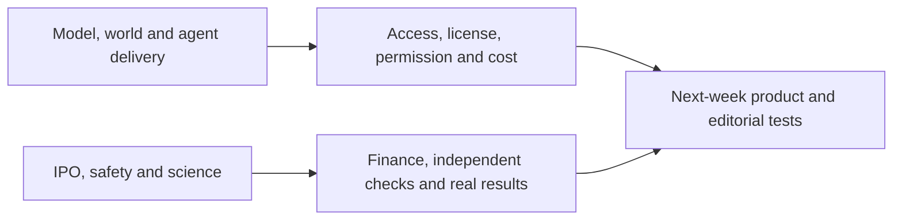

# AI Weekly Brief · 2026-W47 (November 16–22)

[English (current)](2026-W47.md) · [中文](../../weekly/2026-W47.md)

- **Compiled:** November 23, 2026; synthesizes the [November 16–22 daily briefs](../INDEX.md). Trends follow original event dates. The November 23 daily brief adds a major catch-up on the Riemann Hypothesis proof, which occurred during this week; it is included in the retrospective analysis but not counted as an item captured in that week's daily editions.
- **Coverage limit:** Monday and Sunday had short editions, and some research was recorded later. This is a synthesis of verified events, not a count of all industry releases or market share.

## Key conclusions

1. **Model competition is moving toward tiered delivery and cost per completed task.** [Qwen4-Max and Hy4 flash](../daily/2026-11/2026-11-17.md), [GPT-6.2 and Microsoft's MAI models](../daily/2026-11/2026-11-18.md), and [Gemini 4 Neon and Inkling 2 Mini](../daily/2026-11/2026-11-21.md) span APIs, licensed plans and downloadable weights. Vendor scores, prices and real task success rates need separate checks.
2. **World models have moved from demos to developer access, but playability remains a separate question.** [Project Genie and the Genie 4 API](../daily/2026-11/2026-11-20.md) add limited user and integration access; [WM^MLLM and WorldRuler](../daily/2026-11/2026-11-21.md) and [FastFrames](../daily/2026-11/2026-11-22.md) investigate state, rules and response latency. Papers, artifacts, APIs and game experience are distinct deliverables.
3. **Agents are entering execution environments and commercial actions.** [Gemini Tasks and enterprise context](../daily/2026-11/2026-11-18.md), [Gemini Mac and Tool Retrieval](../daily/2026-11/2026-11-20.md), and [Connected Apps and live voice](../daily/2026-11/2026-11-21.md) connect permissions, tools and transactions. Independent completion and human intervention costs remain scarce.
4. **Capital and safety show verifiable changes in status.** [Anthropic's IPO closed](../daily/2026-11/2026-11-21.md), while deployment of funds and returns remain unknown. [GAO's targeted attack tests](../daily/2026-11/2026-11-19.md) and vendor disclosure principles represent different levels of evidence.
5. **Verification of AI-assisted research deserves its own editorial thread.** [Lean/Mathlib's formal verification of the Riemann Hypothesis proof](../daily/2026-11/2026-11-23.md) is a major event from this week recorded today. It demonstrates the value of formal artifacts and independent checks; a readable account and long-run scholarly discussion remain. [MedChemBench](../daily/2026-11/2026-11-23.md) shows why benchmark scores must not be treated as experimental outcomes.

## Trend evolution and key events

| Trend | Evidence this week | Limit or counterevidence | Next signal |
| --- | --- | --- | --- |
| T01/T03 Models and multimodal | Qwen4-Max API, GPT-6.2, Gemini 4 Neon and Inkling 2 Mini weights; [daily brief](../daily/2026-11/2026-11-21.md) | Promised weights are not delivered weights; open weights are not necessarily open source; vendor scores lack independent replication | Matched-task quality, latency, licensing and total cost |
| T02/T05 World models and gaming | Genie 4 limited experience/API, WorldRuler and WM^MLLM papers, FastFrames artifacts; [daily brief](../daily/2026-11/2026-11-22.md) | 24 FPS is an output specification, not generation speed; per-frame latency does not establish long-run playability; MyMems remains a future plan | Long-run state, input response, player retention and operating cost |
| T04/T06 Agents and work interfaces | Gemini Mac, Tool Retrieval, Connected Apps and ChatGPT Space; [daily brief](../daily/2026-11/2026-11-22.md) | Rollouts are often limited by eligibility or region; the number of connections does not establish completed transactions | Permission revocation, recovery, conversion and editing rework |
| T07 Safety and AI science | GAO targeted tests, Anthropic disclosure principles and Lean/Mathlib formal verification; [catch-up](../daily/2026-11/2026-11-23.md) | A test sample cannot establish overall risk; a policy is not implementation evidence; the formal proof still needs a readable account | External retests, disclosure practice and independent mathematical explanations |
| T08 Capital and compute | Anthropic IPO closing, NVIDIA earnings and Rubin shipment, Alibaba AI-cloud revenue; [daily brief](../daily/2026-11/2026-11-21.md) | Proceeds are not returns; financial reporting periods differ; shipment is not customer value | Use of proceeds, customer deployment and unit economics |

## Corrected judgments and open checks

- **Corrected by this week's evidence:** “Anthropic announced an IPO but has not closed it” ceased to hold after November 20; the [issuer announcement](../daily/2026-11/2026-11-21.md) confirms closing. Gross proceeds, issuer proceeds and concurrent placement need separate treatment.
- **Not supported:** “Genie 4's 24 FPS is real-time generation speed”; it is an output specification. Interactive quality needs latency, duration and player-task tests.
- **Not supported:** “World-model papers or a partnership announcement mean a playable AI game has shipped.” WorldRuler, WM^MLLM and MyMems are at different research or planning stages.
- **Open:** A readable mathematical account of the formal proof; model cost per completed task; agent permissions and transaction success; open-weight licenses; and whether AI science benchmarks improve experimental decisions.

## Next-cycle test list

1. Compare models, voice and video systems on matched tasks, hardware and licenses, recording retries and human review.
2. Test Genie 4, FastFrames and rule/state papers separately for response, long-run consistency and player value; one FPS figure cannot stand in for experience.
3. Audit agent and commercial connections for permission granularity, revocation, logs and completed transactions.
4. Track scholarly explanation of the Lean proof, independent safety retests, Anthropic's use of proceeds and actual compute deployment.
