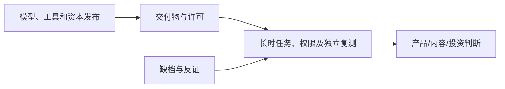

# AI 月报 · 2026-10（部分日期缺档）

[中文（当前）](2026-10.md) · [English](../en/monthly/2026-10.md)

- **编制时间：** 2026-11-03；以[历史索引](../INDEX.md)及 [W41](../weekly/2026-W41.md)、[W42](../weekly/2026-W42.md)、[W43](../weekly/2026-W43.md)、[W44](../weekly/2026-W44.md)复盘。10 月 28–31 日没有独立日报，部分其他日期为事后补档或提前版，不能做完整事件量统计。

## 月度关键结论

1. **Agent 从聊天交互走向持久任务、工具与权限治理。** 模型能力、工作流连接和可恢复任务同时推进；一次演示或厂商榜分不足以证明稳定 ROI。
2. **世界模型出现多条可区分路线。** Odyssey-3、Matrix-Game 4.0、Hy-Nomas 与 Genie 4 分别提供试玩、混合引擎、交互视频权重及可信测试者预览；机器人与实验世界模型另有任务目标。长时一致性、延迟和成本仍是共同门槛。
3. **开放权重、云分发和算力供应链共同决定可用性。** MiniMax M3.1 Flash 等权重交付需要逐项核许可证与硬件；Google Cloud 的模型采购模式改变数据责任边界；电力接入与工地安全影响算力交付。
4. **安全与科研验证从宏大主张进入可检查材料。** PHP 漏洞修复、模型隔离红队、政策适用范围、AI 辅助科研证明与 Anthropic S-1 都需要各自的原始文件、外部验证和实施状态。

## 趋势演变与关键事件

| 趋势 | 本月证据 | 仍未成立 / 反证 | 下一周期信号 |
| --- | --- | --- | --- |
| Agent 任务系统 | GPT-6 系列、Decisions API、DeepSeek Search/Fetch、ServiceNow 连接 | 单次成功率与长期可靠性不同；企业席位数非 ROI | 任务终态、人工接管、权限与每单成本 |
| 世界模型/AI 游戏 | Odyssey-3、Matrix-Game、Hy-Nomas、Genie 4 各有不同入口 | 视频播放帧率非生成速度；研究预览非成熟游戏 | 玩家长时测试、状态一致性、输入延迟 |
| 开放权重与多模态 | MiniMax、Meta、Mistral 等发布权重或预览；语音/视觉/视频工具链扩展 | 开放权重不等于 OSI 开源；厂商榜分非独立实测 | 许可证、目标素材库质量、真实硬件成本 |
| 商业和基础设施 | Anthropic 拟议 IPO S-1、OpenAI 融资报道、云模型分发、Nscale 电力问题 | S-1 非上市；融资报道和席位覆盖非利润 | 财务披露、毛利、并网和交付进度 |
| 治理与科研 | 联邦采购范围、PHP 补丁、隔离红队、AI 科研声明 | 采购限制非私人全面禁令；形式化材料非学界共识 | 实施文本、独立安全测试、专家评注 |

## 被证伪或纠正的判断

- “10 月 8 日无世界模型新预览”已由[Odyssey-3 补漏](../weekly/2026-W42.md)纠正。
- “Disney 已收购 Character.AI 整个平台”不成立；见[W42](../weekly/2026-W42.md)。
- “中国 23 项 AI 技术已全面正式禁运”“美国全面禁止私人使用 DeepSeek”均错误；两项政策应按适用范围阅读。
- “开放权重等于开源”“模型能生成视频就能运营成熟游戏”“融资或席位数等于 ROI”仍无证据支持。

## 持续观察与方法限制

- 下一月重点：Genie 4 与 Hy-Nomas 长时实测，Agent 的权限与任务级费用，开放权重商业许可，Anthropic S-1 后续，AI 科研声明的独立评审。
- 资料跨日补漏，10 月 28–31 日缺独立日报。不能依据本仓库条数推断行业发布频率、中美占比或投资收益。本报告不构成投资或法律意见。
