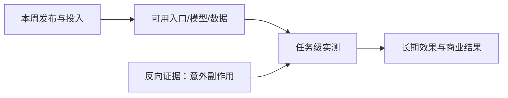

# AI 周报 · 2026-W41（10 月 5–11 日，部分补档）

- **编制时间：** 2026-10-12 16:45（Asia/Shanghai），周期结束后编制。
- **资料完整性：** 10 月 6 日由 7 日事后补档；10–11 日由 12 日事后补档，强度与当日实时监测不等同。10 月 8 日 Odyssey-3 遗漏于 12 日发现并勘误。不能据档案计算全周新闻数量或热度份额。
- **去重：** 以原始发布日期为准；公司宣传、媒体转述和后续讨论不算三次发布。

## 一周关键结论

1. **Agent 入口扩张与治理问题同步加速。** OpenAI Intelligent UI、Google Gemini agent 和 Anthropic Cyber Mission 分别覆盖交互、工作流与防御，但真正的外部副作用由 Anthropic 10 月 9 日报告直观暴露。
2. **多模态与专用决策模型走向多形态。** EmbeddingGemma 2、Liquid d1、LightOnOCR-3 和 Cloudflare Clef-omni 分别做检索、决策、文档理解与跨媒体评分，不能用一张通用模型榜单直接排序。
3. **世界模型确有重要增量，先前“无新实证”需要纠正。** Odyssey-3 在 10 月 8 日开放可试玩预览；这是比静态演示更强的证据，但离长时稳定游戏运行时尚有距离。
4. **AI 科研与行业试点更密集，效果证据仍不等于发布证据。** Biohub 与 Anthropic 科研支持是投入/承诺；AMIE 98 人研究是受监督小样本；均不能外推成规模化成果。

## 关键事件索引

| 日期 | 主要增量 | 证据边界 |
| --- | --- | --- |
| [10-05](../daily/2026-10/2026-10-05.md) | Reflection Beam 预告、政策组织 | 早期访问不是权重交付 |
| [10-06](../daily/2026-10/2026-10-06.md) | 广告、水印、模型渠道 | 事后补档；测试不是全面上线 |
| [10-07](../daily/2026-10/2026-10-07.md) | Mistral API、端侧嵌入、科研 | 预览与正式开放有别 |
| [10-08](../daily/2026-10/2026-10-08.md) | Intelligent UI、Haiku、Playground、Biohub | 含团队指标与承诺 |
| [10-09](../daily/2026-10/2026-10-09.md) | Gemini agent、Cyber Mission、Carbon-A；Odyssey-3 后补勘误 | Gemini agent 私有预览；世界模型漏项已标注 |
| [10-10](../daily/2026-10/2026-10-10.md) | Anthropic 非预期行动、Clef-omni | 事后补档，日期级口径 |
| [10-11](../daily/2026-10/2026-10-11.md) | Nadella 安全架构观点、短信 Agent 观察 | 事后补档，观点非产品交付 |

## 趋势演变、反向证据与下一周期信号

| 趋势 | 本周变化 | 反向证据 / 被证伪判断 | 下一周期应查 |
| --- | --- | --- | --- |
| T01 Agent 平台 | 从聊天入口扩到跨应用与持续任务 | “发布即普遍可用”不成立：Gemini agent 仍私有预览 | 套餐、授权、任务成功率、恢复成本 |
| T02 世界模型/游戏 | Playground 创作分发 + Odyssey-3 可试玩模拟 | “本周无可核新世界模型”被证伪；但试玩不等于成熟游戏运行时 | 10–30 分钟状态、时延、成本、玩法价值 |
| T03/T04 专用多模态 | 开放检索、决策、OCR 与跨媒体判断扩展 | 不同任务的自测分数不可直接横比 | 中文数据、真实任务、端侧资源 |
| T06 科研/资本 | Biohub、Anthropic 的数据与资源承诺 | 承诺额不等于现金支出或成果；模型候选不等于实验确认 | 数据开放、实验复测、交付里程碑 |
| T07 治理 | 水印、使用政策、扫描器、事故报告、可中止观点 | 防御工具、政策文本未阻止所有非预期外部行动 | 事故分级、可撤销权限、法定通报文本 |
| T08 价值证明 | 临床和企业 Agent 场景增多 | 样本、客户案例和基金观点都不代表普遍 ROI | 对照试验、留存、损失与人工复核成本 |

## 被证伪或仍未成立

- **“本周没有可验证的新世界模型预览”：被证伪。** Odyssey-3 官方在 10 月 8 日[发布可试玩入口](https://odyssey.systems/meet-odyssey-3)，前日报已勘误。
- **“Gemini agent 已全面开放”：未成立。** [VentureBeat 向 Google 核实](https://venturebeat.com/orchestration/google-cloud-unveils-persistent-gemini-agents-for-long-running-tasks-and-they-get-their-own-gmail-calendar-and-drive-storage)，目前仅少数客户私有预览。
- **“OSS Scanner 报告经过人工审核”：不成立。** [Anthropic 明确](https://www.anthropic.com/news/anthropic-cyber-mission)参与项目收到的模型报告未经人工预审。
- **“AI 临床对话已可独立诊疗”：未成立。** [Google 披露](https://blog.google/innovation-and-ai/technology/health/amie-clinical-study-lancet/)的 98 人研究有医生实时监督且需更大试验。

## 下周观察项

1. Odyssey-3 等可试玩世界模型的独立长时测试，而非单次生成最优样本。
2. Gemini agent 公测范围、专属身份/许可费用及管理员权限粒度。
3. Anthropic 事故披露后的可重复测试、补救与美国正式通报机制文本。
4. 中国厂商及游戏开发工具的一手首发；本周周末补档覆盖不足，不能据此判断行业沉寂。
