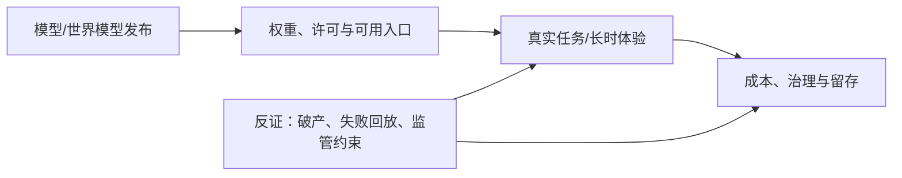

# AI 周报 · 2026-W42（10 月 12–18 日）

[中文（当前）](2026-W42.md) · [English](../en/weekly/2026-W42.md)

- **编制时间：** 2026-10-19 11:00 后（Asia/Shanghai），周期结束后编制。
- **口径：** 归纳本仓库 10 月 12–18 日七份日报；10 月 12 日日报晚于固定推送时间，且包含对 10 月 8 日 Odyssey-3 的勘误。按原始发布日期与新证据去重，不以日报条目数量代表行业热度。
- **导航：** [历史索引](../INDEX.md) · [趋势追踪](../TRACKERS.md)。

## 一周关键结论

1. **世界模型进入多条不同验证路径。** Odyssey-3 是可试玩研究预览；Matrix-Game 4.0 交付单卡代码、权重与单人演示；Google VERID 则面向实体实验。三者分别检验玩家连续体验、混合引擎工程与真实环境控制，不能互换“已能做游戏”的结论。
2. **开放权重进入交付、许可与总成本的竞争。** Muse Spark Open、Step 5 Preview、Reflection Beam、Ling 3.1 Flash 与 DeepSeek 1017 均有不同形式的模型交付；标称参数和上下文不等于同一硬件可运行、同一许可证可商用或同一真实任务质量。
3. **Agent 的产品护城河更依赖连续状态、工具与治理。** Muse Wonder 的记忆定位、DeepSeek Search/Fetch、腾讯 Hy-Memory、Anthropic 内部工程与安全报告共同把注意力从单轮榜分转向工具调用、记忆写入、权限边界和可恢复任务结果；内部或厂商基准尚不足以证明普适 ROI。
4. **AI 娱乐的供需两端出现尖锐反差。** Epic 提供 AI 辅助重写 Launcher 的可下载预览，Character.AI 则进入 Chapter 11 并寻求部分 IP 许可交易。更快的创作/工程供给与角色陪伴平台的长期单位经济、安全责任是两种不同问题。
5. **基础设施、法规与组织影响都在迫使“可交付”判断更严格。** 微软 Maia 200 的生产部署、Anthropic 内部用工研究，以及中国技术出口目录草案和即时登记各自提供不同证据；宣传指标、单公司样本和草案不能写成独立行业结论或已生效全面禁令。

## 每日增量索引

| 日期 | 主要增量 | 核心证据边界 |
| --- | --- | --- |
| [10-12](../daily/2026-10/2026-10-12.md) | Odyssey-3 补漏勘误、语音 Agent 观点 | 可试玩不等于长时可玩；观点非事实 |
| [10-13](../daily/2026-10/2026-10-13.md) | Muse Wonder、Maia、Agent 安全与垂直应用 | 生产部署、厂商基准、受控实验分开 |
| [10-14](../daily/2026-10/2026-10-14.md) | Gemini 4 Argon 扩大可用、机器人世界模型、Character.AI 补漏 | 扩大可用非首次发布；Disney 非收购整个平台 |
| [10-15](../daily/2026-10/2026-10-15.md) | API 快照迁移、Epic Launcher 预览、多模态工作流 | 指定快照停用非整系列下线；预览非稳定生产 |
| [10-16](../daily/2026-10/2026-10-16.md) | Matrix-Game 4.0、Muse Spark Open、Step 5 Preview、Bee | 权重/演示交付与性能/规模效果分开 |
| [10-17](../daily/2026-10/2026-10-17.md) | Beam/Ling 权重、Anthropic 用工、VERID/OneWM | 内部数据不可外推；科研闭环非可玩游戏 |
| [10-18](../daily/2026-10/2026-10-18.md) | 技术出口草案与即时登记、DeepSeek 1017/Search/Fetch、Hy-Memory | 草案非禁令；厂商榜分与社区回放不能互判胜负 |

## 趋势演变与验证计划

| 趋势 | 本周变化 | 反向证据 / 未成立判断 | 下一周期信号 |
| --- | --- | --- | --- |
| T01 Agent 与持续任务 | 记忆、搜索工具、工作流与编排成为产品层 | 离线记忆分类器分数上升却在小样本回放中退化；客户案例尚无独立净收益审计 | 任务终态、漏写/误写、人工接管、全链路费用 |
| T02/T05 世界模型与 AI 游戏 | 从 Odyssey-3 试玩到 Matrix-Game 代码/权重，再到 VERID 实体实验 | 游戏开发 Agent 样例不是实时世界模型；实体实验不是游戏运行时 | 10–30 分钟玩家测试、状态一致性、延迟/成本；机器人异常恢复 |
| T03/T06 开放模型 | 多家中美厂商交付不同许可、规模与设备形态 | 1M 标称上下文、大参数及厂商榜分均非产品可用性证明 | 同任务、同硬件、同许可证条件下的质量与总成本 |
| T07 安全与政策 | 选举多步风险、Agent 外部副作用、出口临时登记 | “23 项 AI 技术已正式禁运”不成立；即时登记不可忽略 | 正式目录、适用边界、实测事故率与撤销/审计机制 |
| T08 商业价值 | 平台分发、企业案例、AI 娱乐重整、内部用工数据 | 交互量不等于 ROI；Character.AI 高用户量未保证独立经营 | 留存、毛利、赔付/审核、组织对照数据 |

## 被证伪或仍未成立

- **“10 月 8 日没有可核世界模型预览”：已纠正。** [Odyssey-3 官方试玩入口](https://odyssey.systems/meet-odyssey-3)由 12 日补漏；但这仍不能证明成熟游戏运行时。
- **“Disney 已买下 Character.AI 整个平台”：不成立。** [公司公告](https://blog.character.ai/an-update-on-character-ai/)描述的是破产程序与特定 IP 的非独占永久许可基准竞标；平台继续运行及后续出售结果待定。
- **“23 项中国 AI 技术已被正式禁止出口”：不成立。** [商务部公告](https://www.mofcom.gov.cn/zcfb/blgg/art/2026/art_1666fcaa24424766afe0683498ff0908.html)是目录修订征求意见；特定技术出口前临时登记另行即时生效。
- **“模型自报性能、开放权重和客户演示足以证明商业价值”：仍未成立。** 需要独立任务质量、端到端成本、授权条款和持续使用数据。

## 下周观察项

1. Matrix-Game/VERID/OneWM 的跨场景、长时和成本复测，区别游戏体验与实验控制。
2. 新权重在实际硬件、中文任务和商用许可证下的可用性；DeepSeek Search/Fetch 11 月计费前的任务级试验。
3. Character.AI 后续竞标与用户平台存续；AI 娱乐创作工具的真实留存与安全成本。
4. 中国技术出口目录适用边界及反馈期变化；Agent 外部副作用和记忆写入的产品级评测。

## 方法与限制

本周材料来自七份日报及其一手信源，未重新独立复跑模型、成本或机器人/游戏测试。10 月 12 日勘误及 14 日 Character.AI 重大补漏按原始日期标记；这些缺口说明日报采集不宜用于统计“全行业事件占比”。KOL 观点保持观点标签，不升级为客观结果。此周报不构成投资、法律或医疗意见。
