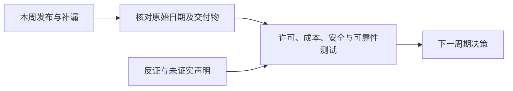

# AI 周报 · 2026-W43（10 月 19–25 日）

[中文（当前）](2026-W43.md) · [English](../en/weekly/2026-W43.md)

- **编制时间：** 2026-10-27（Asia/Shanghai），在完整自然周结束后补编；并非 10 月 26 日按时发布。
- **口径：** 汇总 [10 月 19–25 日七份日报](../INDEX.md)；24 日是提前版，25 日是旧消息补漏。按原始发布日期和证据等级归并，不把补录条数当成本周新增发布数。

## 一周关键结论

1. **模型交付的争议点转向许可、部署责任和完成任务的成本。** MiniMax M3.1 Flash 权重已可下载但有商业许可限制；Google Cloud 引入更多 OpenAI/Claude 采购路径，同时不同 Claude 部署方式有不同数据处理者；DeepInfer/llm-d 代表不同推理层，不能直接比较单一性能分数。
2. **Agent 的验收标准趋于可操作。** Decisions API 的正式可用、ThinkingBox 的重复成功率研究、OpenAI 研究环境的隔离披露共同提示：一次答对、连续成功、权限边界与退出恢复需要分开测。
3. **世界模型、视觉和具身数据构成不同产品层。** 腾讯 Hy-Nomas 提供交互式视频权重/代码，NVIDIA Cosmos3-H-Dreams 面向手术动作条件模拟，WeVisOne-VL 是图像感知模型，智元发布具身推理数据。视频帧率不等于生成速度，科研模拟不等于成熟游戏或临床系统。
4. **AI 产业资本、算力与软件采用的证据仍分层。** 私募融资报道、公共市场波动、Nscale 电力接入、台积电工地事故和企业员工覆盖数字都不能单独证明需求、交付时间或投资回报。
5. **政策与安全结论必须限定适用对象。** 美国 DeepSeek 联邦民事机构采购规定不能写成美国私人使用禁令；PHP 漏洞修复是真实公共软件成果，模型参与发现的流程与生产安全能力仍需分别评估。

## 每日增量索引

| 日期 | 主要增量 | 证据边界 |
| --- | --- | --- |
| [10-19](../daily/2026-10/2026-10-19.md) | 公益基金提议、Character.AI/Disney、Nscale 电力 | 提议非完成；项目风险非全部合作取消 |
| [10-20](../daily/2026-10/2026-10-20.md) | MiniMax API、迁移评测、可审阅生成流程 | 厂商速度口径非独立 ROI |
| [10-21](../daily/2026-10/2026-10-21.md) | 联邦采购规定、推理栈、垂直 Agent | 政策适用范围与代码交付分开 |
| [10-22](../daily/2026-10/2026-10-22.md) | 模型分发、PHP 修复、沙箱、多模态数据 | 私有预览与 GA 分开；补丁优先 |
| [10-23](../daily/2026-10/2026-10-23.md) | 任务可靠性、检索/空间数据、科研世界模型 | 重复成功率与至少成功一次分开 |
| [10-24](../daily/2026-10/2026-10-24.md) | 开放权重许可、云采购、资本、芯片工地 | 提前版；交易报道及产能影响待核 |
| [10-25](../daily/2026-10/2026-10-25.md) | Hy-Nomas、隔离红队、具身数据、语音 | 20–23 日补漏；无当日重大新发布 |

## 趋势演变、反证与下一周期信号

| 趋势 | 本周变化 | 被证伪或仍未成立 | 下一周期信号 |
| --- | --- | --- | --- |
| T01 Agent | 任务级决策、重复成功和权限边界有更具体材料 | 单次成功率不等于长期可靠性；隔离修复不等于零风险 | 真实任务终态、重试成本、越权率和回滚 |
| T02/T05 世界模型/AI 游戏 | 交互视频、机器人模拟、视觉感知和训练数据分别有资产 | 输出视频 24 FPS 不是生成速度；具身模型不是游戏运行时 | 10–30 分钟状态一致性、延迟、任务迁移 |
| T03/T06 开放权重与基础设施 | 权重、推理框架和云部署模式增加 | 开放权重不等于开源；多厂商上架不等于同一合同边界 | 商业授权、同任务总成本、区域/数据责任 |
| T07 政策安全 | 联邦采购范围、PHP 修复和隔离红队更具体 | “美国全面禁用 DeepSeek”不成立；厂商红队不等于外部审计 | 正式执行范围、补丁采用、独立攻防 |
| T08 商业价值 | 资本、算力和企业采用数字并行变化 | 员工覆盖、融资额或股价波动不能单独证明 ROI | 付费留存、毛利、电力接入和交付率 |

## 被证伪判断与持续观察

- **不成立：** “MiniMax M3.1 Flash 已按 OSI 定义开源”。它是附商业限制的开放权重，见[24 日日报](../daily/2026-10/2026-10-24.md)。
- **不成立：** “DeepSeek 相关限制覆盖美国所有私人使用”。规定针对联邦民事机构的采购和 IT 系统，见[21 日日报](../daily/2026-10/2026-10-21.md)。
- **仍未成立：** “世界模型已能稳定生成成熟可玩游戏”；需要长时玩家实验、状态一致性、延迟和成本。
- **持续观察：** Anthropic 公益基金的批准与实际治理、Character.AI 法院流程、Hy-Nomas 和语音 Agent 的独立复测、Nscale 项目的电力与合同状态。

## 方法与限制

本周未重新复跑模型、游戏、机器人或成本实验。日报有提前版及事后补漏，因此周内发文数不能充当行业热度统计。观点、公司声明和独立测试继续分开；本文不构成投资或法律意见。
