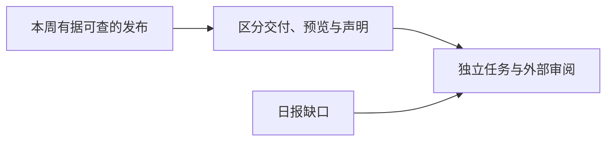

# AI 周报 · 2026-W44（10 月 26 日–11 月 1 日，资料不完整）

[中文（当前）](2026-W44.md) · [English](../en/weekly/2026-W44.md)

- **编制时间：** 2026-11-03；周期已结束，资料不完整。
- **范围：** 本周仅有[10 月 26 日补档](../daily/2026-10/2026-10-26.md)、[10 月 27 日延迟版](../daily/2026-10/2026-10-27.md)，以及[11 月 2 日补档](../daily/2026-11/2026-11-02.md)中明确标为 10 月 28–31 日发布的材料。10 月 28–31 日及 11 月 1 日未形成独立日报，不能以缺档推断无新闻。

## 一周关键结论

1. **模型成本与图形界面能力同步竞争。** GPT-6.1 Terra 已列出 API 与价格，性能仍为厂商自评；应以完成任务费用和恢复能力验收。
2. **世界模型出现新研究预览。** Genie 4 支持互动与原生音频，但官方承认长时漂移，距离成熟 AI 游戏仍有验证距离。
3. **资本与科研声明都进入公开复核期。** Anthropic S-1 可在 SEC 索引核对，发行尚未生效；OpenAI 的数学/物理成果需要学界独立审阅。
4. **专业 Agent 与治理边界收紧。** ServiceNow 工作流连接、Rosalind 限量预览、Model Spec 更新和训练偏好信号分别涉及执行权限、准入、安全和网站选择。

## 趋势、反证与下一周期信号

| 趋势 | 本周观察 | 仍未成立或反证 | 下一周期信号 |
| --- | --- | --- | --- |
| T01/T03 模型与 Agent | Terra、ServiceNow、Rosalind 增加任务及垂直入口 | 厂商榜分、合作与限量预览不等于可普遍部署 | 真实任务成功率、权限和费用 |
| T02/T05 世界模型 | Genie 4 可信测试者预览 | 官方承认长时物体与场景漂移 | 长时玩家测试、输入延迟、单位分钟成本 |
| T07 治理 | 训练偏好信号、Model Spec 更新、专业模型准入 | 支持信号尚待实施；政策文本非统一行业效果 | 实施范围、独立审计与事故率 |
| T08/T09 资本与科研 | S-1 申报、AI 辅助科研声明 | 未上市；形式化材料不等于学界接受 | 招股书后续、专家公开评注 |

## 被证伪判断与方法限制

- **不成立：** “Anthropic 已上市”；SEC 记录的是拟议 IPO 的 S-1，注册声明尚未生效。
- **仍未成立：** “Genie 4 已可稳定支撑长时成熟游戏”；官方列出了长时一致性限制。
- **仍未成立：** “AI 已得到公认的 ETH 或量子场论结论”；外部审阅尚在进行。
- 本周采集缺口较大，本报告只概括有据可查的材料，不统计事件量或地域占比。
