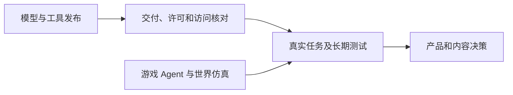

# AI 周报 · 2026-W45（11 月 2–8 日）

[中文（当前）](2026-W45.md) · [English](../en/weekly/2026-W45.md)

- **编制时间：** 2026-11-10；汇总 11 月 2–8 日七份[日报](../INDEX.md)，其中 11 月 2 日为跨 10 月 28 日至 11 月 2 日的延迟补档。按原始发布日期判断事件，不把补录日期当新发布。
- **范围限制：** 每日多为高信号短版，本周总结不代表全量发布清单，也不据此统计市场份额或地域占比。

## 一周关键结论

1. **世界模型与游戏 Agent 形成两条不同验证路线。** [NVIDIA Cosmos 3](../daily/2026-11/2026-11-06.md)交付可控仿真检查点；[Project EVE](../daily/2026-11/2026-11-08.md)在现有游戏中测试交易、合作与破坏者识别。前者要证明长时环境一致性，后者要证明 Agent 策略泛化；都未证明可自动生成成熟游戏。
2. **基础模型竞争同时看交付、许可和任务成本。** [腾讯 Hy4](../daily/2026-11/2026-11-06.md)公布视觉与计算机操作能力但当周权重待交付；[Mistral Large 4](../daily/2026-11/2026-11-05.md)交付开放权重并有许可条件；[百度 ERNIE-5.5-Flash-Base](../daily/2026-11/2026-11-07.md)是预训练权重，许可含地区及商业限制。单看“开放”标签会误导选型。
3. **Agent 系统往具体环境和结构化组件演进。** [ServiceNow 工作流](../daily/2026-11/2026-11-02.md)、[Kakao 决策模型](../daily/2026-11/2026-11-08.md)、[Conductor 加入 Meta](../daily/2026-11/2026-11-07.md)分别涉及企业执行、判别模块和产品渠道；它们不是同一类模型进步。
4. **安全从模型发布扩展到限制访问及外部测试。** [GPT-6 Cyber](../daily/2026-11/2026-11-07.md)受限分发，[OpenAI 与 Hacktron](../daily/2026-11/2026-11-08.md)建立协作测试，[METR 评估](../daily/2026-11/2026-11-07.md)则给 AI 研发加速提供外部但高不确定的估计。测试安排和报告都不能替代实际修复与持续效果。
5. **多模态创作交付仍需产线指标。** [OpenAI Images 2.6](../daily/2026-11/2026-11-05.md)和[Gemini Omni 1.2 Flash](../daily/2026-11/2026-11-07.md)提供新的图像/视频能力；应测跨片段一致性、返工时间和单位成片成本，而非仅以演示判断。

## 趋势演变与关键事件

| 趋势 | 本周可确认进展 | 局限或反向证据 | 下一周期信号 |
| --- | --- | --- | --- |
| T01 Agent 与基础模型 | Hy4、Large 4、ERNIE 基座、Kakao 决策组件、ServiceNow 连接 | 发布、API、权重及许可状态不同；厂商榜分未独立复测 | 权重兑现、许可核查、任务成功率和总成本 |
| T02/T05 世界模型与 AI 游戏 | Cosmos 3 检查点、Project EVE 游戏实验；11 月 2 日补档的 Genie 4 预览 | 仿真不是可玩游戏；EVE 回放收益不是实时金融收益；Genie 4 官方承认长时漂移 | 长时一致性、输入延迟、游戏任务泛化与失败恢复 |
| T03 多模态生产 | Images 2.6、Gemini Omni 1.2 Flash、LeRobot v0.7.0 | 视频生成、机器人数据工具与内容成片质量不能混为一类 | 素材复用、跨片段一致性、工具调用成本 |
| T07 安全与治理 | GPT-6 Cyber 受限访问、Hacktron 测试、METR 外部评估 | 合作不等于漏洞已修复；研发加速估计存在删节与归因限制 | 安全修复披露、外部复测、研究生产率时序 |
| T08 公司与资本 | OpenAI 拟收购 Pierre；Conductor 加入 Meta | 拟收购与整合后的产品交付不同；用户迁移有成本 | 交易完成、服务迁移、留存和新入口 |

## 被证伪判断与持续观察

- **不成立：** “EVE 游戏币收益证明 Claude 能投资”；交易实验是历史订单回放，没有市场对 Agent 订单的实时反应。
- **不成立：** “Kakao 决策模型就是完整 Agent”；它返回分类概率和分数，不独立执行长任务。
- **尚未成立：** “Hy4 官方发布就意味着新权重已开放”；11 月 4 日公司公告写权重与系统卡将于随后发布。
- **尚未成立：** “厂商视频演示与榜分等于互动内容产线可用”；跨镜头一致性、返工和成本缺独立任务测试。
- **持续观察：** Genie 4/Cosmos 3 的长时可控性；AI 游戏 Agent 的策略泛化；开放权重许可边界；限制访问安全模型的修复披露；创作工作流的最终成片质量。

## 下一周期检验清单

1. 核实厂商承诺的权重、系统卡与访问方式是否实际交付，并记录精确许可。
2. 对世界模型和游戏 Agent 分别记录长时状态一致性与任务完成率，不用视频播放帧率替代生成延迟。
3. 对多模态创作记录人工返工、素材可复用性和单位完成作品成本。
4. 对安全与研究报告追踪独立复测、实际修复和原始数据披露。

> 11 月 9 日及之后的新发布不属于 W45，见后续日报。
