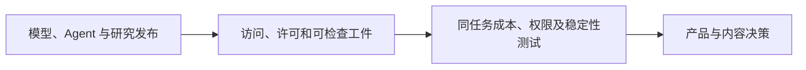

# AI 周报 · 2026-W46（11 月 9–15 日）

[中文（当前）](2026-W46.md) · [English](../en/weekly/2026-W46.md)

- **编制时间：** 2026-11-16；汇总 [11 月 9–15 日日报](../INDEX.md)。部分日报为延迟发布或补录，以下按原始发布日期和交付状态分析，不把补录算新事件。
- **范围限制：** 本周多份为高信号短版，收录数量低于常规目标；以下是已记录事件的趋势判断，不是全行业事件总量或市场份额统计。11 月 12 日发布的 Perplexity Decider v1.3 于[本周一日报](../daily/2026-11/2026-11-16.md)补录，不计入本周日报覆盖率。

## 一周关键结论

1. **基础模型的能力、价格与访问层级必须一起比较。** [Anthropic Fable/Mythos 5.2](../daily/2026-11/2026-11-10.md)共享底层模型而有不同安全限制；[Gemini 4 Carbon、Muse Ember](../daily/2026-11/2026-11-11.md)扩大 API 选择；[Hydrogen](../daily/2026-11/2026-11-13.md)聚焦模型路由。官方榜分和标价都不能代替完整任务质量与成本。
2. **Agent 产品走向可编辑产物与明确权限。** [Claude Sheets、Whiteboards、Data 与 ChatGPT Business Agents](../daily/2026-11/2026-11-11.md)进入工作空间和商家发现；[Gemini Wallet](../daily/2026-11/2026-11-14.md)触及个人消费信息。产品验收应记录可见数据范围、确认步骤和任务后果。
3. **世界模型、机器人控制和游戏开发工具分属不同产线。** [Praxis-1 与 PAN 2](../daily/2026-11/2026-11-12.md)交付权重和代码，但分别面向机器人动作预测与动作条件视频仿真；[Gemini Robotics 2.5/GR00T 2](../daily/2026-11/2026-11-11.md)侧重具身任务；[Flow 创作工具](../daily/2026-11/2026-11-13.md)不等于可玩世界模型。长时一致性、真实任务成功率和成片返工须分别测量。
4. **安全与治理从原则走向操作边界，但仍缺外部效果证据。** [OpenAI Control Room](../daily/2026-11/2026-11-10.md)披露研究推理停止控制，[Anthropic Anvil](../daily/2026-11/2026-11-13.md)披露自动化红队；[NVIDIA 管理层交接](../daily/2026-11/2026-11-14.md)则带来交付连续性问题。厂商声明、内部测试与实际长期结果必须分开。
5. **可检查工件为独立复核提供入口。** [AlphaProof Code Signal](../daily/2026-11/2026-11-11.md)、[Salesforce SOV-Transcribe-1](../daily/2026-11/2026-11-13.md)、[llama.cpp 1.0 与 XYBench](../daily/2026-11/2026-11-14.md)、[SatWeave/PARDIG 数据](../daily/2026-11/2026-11-15.md)分别交付验证产物、权重、工具/基准和数据；公开工件仍需按许可和真实场景复测。

## 趋势演变与关键事件

| 趋势 | 本周证据 | 局限或反向证据 | 下周信号 |
| --- | --- | --- | --- |
| T01/T04 模型与 Agent | Fable/Mythos 5.2、Carbon、Ember、Hydrogen、Claude 工作空间、ChatGPT Business Agents | 同底层模型可有不同访问政策；厂商任务分数与实际完成率不同；部分商家功能限资格及地区 | 同任务成本、失败恢复、权限日志、实际商家转化 |
| T02/T05 世界模型与 AI 游戏 | Praxis-1/PAN 2 工件；Robotics 2.5、GR00T 2；Flow 工具 | 仿真和机器人操作都不证明可玩游戏；厂商演示缺长时独立评测 | 长程状态一致性、实机成功率、互动内容返工时间 |
| T03/T06 多模态与开放工件 | SOV-Transcribe-1 权重、SatWeave/PARDIG 数据、llama.cpp 1.0、A2UI 1.0 | 开放权重不等于无条件开源；公开数据不等于独立效果验证 | 许可证核查、区域误差、兼容性与 UI 安全复测 |
| T07/T08 安全与治理 | Control Room、Anvil、NVIDIA CEO 交接 | 停止延迟与红队能力为厂商披露；人事变化后的业绩未显现 | 外部复测、修复披露、财报与客户交付 |

## 被证伪判断与持续观察

- **不成立：** “同一底层模型意味着同样的访问方式与安全限制”；Fable 与 Mythos 的公开范围不同。
- **不成立：** “机器人视频预测或游戏创作工具已经证明可持续运行的游戏世界”；本周材料分别展示训练工件、控制研究和制作界面。
- **尚未成立：** “厂商基准领先意味着单位完成任务成本最低”；缺相同任务、重试、人工审查与失败率对照。
- **尚未成立：** “公开安全控制与内部红队意味着风险已消除”；停止覆盖范围、误拦和外部复测仍待披露。
- **持续观察：** NVIDIA 交接后的交付；Gemini Wallet 的数据权限；开放工件的许可和独立复现；世界模型长时稳定性；AI 游戏实际生产与用户指标。

## 下一周期检验清单

1. 用同一批真实任务比较模型路由、价格、质量、重试次数与人工接管。
2. 对 Agent 和钱包类入口检查授权粒度、审计记录、撤销机制与地区可用性。
3. 分别测试世界仿真、机器人操作、创作工具和可玩游戏，不混用各自的成功指标。
4. 跟踪安全控制独立复测、公开工件许可、NVIDIA 后续财报与客户交付。
