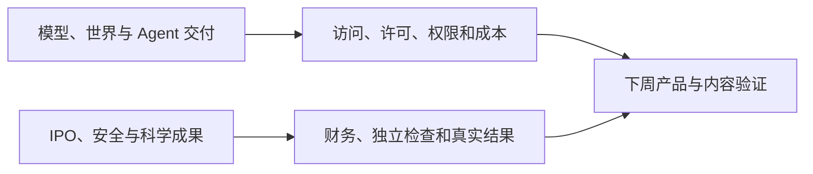

# AI 周报 · 2026-W47（11 月 16–22 日）

[中文（当前）](2026-W47.md) · [English](../en/weekly/2026-W47.md)

- **编制日期：** 2026-11-23；汇总 [11 月 16–22 日日报](../INDEX.md)。按事件原始发布日期判断趋势；11 月 23 日日报对上周黎曼猜想证明补漏，纳入本周回顾，但不计作本周日报当时的收录量。
- **覆盖边界：** 周一与周日为短报，部分研究在次日报补录；本期是已核查事件的趋势归纳，不代表行业发布总量或市场份额。

## 一周关键结论

1. **模型竞争进入分层交付与任务成本比较。** [Qwen4-Max、Hy4 flash](../daily/2026-11/2026-11-17.md)、[GPT-6.2 与微软 MAI](../daily/2026-11/2026-11-18.md)、[Gemini 4 Neon 和 Inkling 2 Mini](../daily/2026-11/2026-11-21.md)覆盖 API、授权方案与开放权重等不同交付形式。厂商榜分、价格和实际任务成功率必须分别核对。
2. **世界模型从演示进入开发者接入，但“可玩”仍是独立命题。** [Project Genie 与 Genie 4 API](../daily/2026-11/2026-11-20.md)增加有限用户与集成入口；[WM^MLLM、WorldRuler](../daily/2026-11/2026-11-21.md)及[FastFrames](../daily/2026-11/2026-11-22.md)探索状态保持、规则与响应延迟。论文、模型工件、API 和游戏体验不能混算。
3. **Agent 进入执行环境与商业动作。** [Gemini Tasks、企业上下文](../daily/2026-11/2026-11-18.md)、[Gemini Mac 与 Tool Retrieval](../daily/2026-11/2026-11-20.md)、[Connected Apps 和实时语音](../daily/2026-11/2026-11-21.md)把权限、工具和交易连接起来；完成率与人工接管成本仍缺独立数据。
4. **资本与安全出现可核查状态变化。** [Anthropic IPO 完成交割](../daily/2026-11/2026-11-21.md)，但资金部署和回报未显现；[GAO 的定向攻击测试](../daily/2026-11/2026-11-19.md)与厂商披露原则提供不同证据层级。
5. **AI 辅助研究的验证链条值得成为内容主线。** [Lean/Mathlib 的黎曼猜想证明核验](../daily/2026-11/2026-11-23.md)是上周发生、今日补录的重大案例；它展示形式化产物和独立检查的重要性，可读论证与长期学术讨论仍在继续。[MedChemBench](../daily/2026-11/2026-11-23.md)则提醒基准分数不能代替真实实验成果。

## 趋势演变与关键事件

| 趋势 | 本周证据 | 限制或反向证据 | 下一周期信号 |
| --- | --- | --- | --- |
| T01/T03 模型与多模态 | Qwen4-Max 正式 API、GPT-6.2、Gemini 4 Neon、Inkling 2 Mini 权重；[日报](../daily/2026-11/2026-11-21.md) | 承诺开放权重不等于交付；开放权重不等于开源；厂商榜分未独立复测 | 同任务质量、延迟、许可和总成本 |
| T02/T05 世界模型与游戏 | Genie 4 有限体验/API，WorldRuler 和 WM^MLLM 论文，FastFrames 工件；[日报](../daily/2026-11/2026-11-22.md) | 24 FPS 输出规格不是生成速度；逐帧延迟不证明长时可玩；MyMems 仍是未来计划 | 长程状态、操作响应、玩家留存与运行费用 |
| T04/T06 Agent 与工作界面 | Gemini Mac、Tool Retrieval、Connected Apps、ChatGPT Space；[日报](../daily/2026-11/2026-11-22.md) | “推出”常限资格或地区；连接数量不等于实际完成交易 | 权限撤销、失败恢复、成交率、编辑返工 |
| T07 安全与 AI 科学 | GAO 特定攻击测试、Anthropic 漏洞披露原则、Lean/Mathlib 形式化核验；[补录](../daily/2026-11/2026-11-23.md) | 样本测试不能外推总风险；政策文本不等于执行效果；形式化证明仍待可读阐释 | 外部复测、披露执行、独立数学说明 |
| T08 资本与算力 | Anthropic IPO 交割、NVIDIA 财报与 Rubin 发货、阿里 AI 云收入；[日报](../daily/2026-11/2026-11-21.md) | 募资额不是回报，财报统计期不同，发货不是客户收益 | 募资用途、客户投产、单位经济性 |

## 被证伪判断与待验证项

- **已被本周证据纠正：** “Anthropic 仅宣布上市、尚未完成交割”在 11 月 20 日后不成立；[发行人公告](../daily/2026-11/2026-11-21.md)确认交易完成。发行总额、公司所得与同步私募须分开。
- **未获证明：** “Genie 4 的 24 FPS 表示实时生成速度”不成立；它是输出规格。交互质量还需要延迟、持续时长和玩家任务测试。
- **未获证明：** “世界模型论文或合作公告意味着已交付可玩 AI 游戏”；WorldRuler、WM^MLLM 与 MyMems 处于不同研究或计划阶段。
- **待验证：** 形式化证明的可读数学阐释；模型同任务成本；Agent 权限与交易完成率；开放权重许可；AI 科学基准能否改善实验决策。

## 下一周期检验清单

1. 以相同任务、硬件和许可条件比较模型、语音及视频生成方案，记录失败重试和人工审核。
2. 对 Genie 4、FastFrames 与规则/状态论文分别测响应、长期一致性和玩家价值，不用单一 FPS 代替体验。
3. 对 Agent 和商业连接复核权限粒度、撤销、审计及交易结果。
4. 跟踪 Lean 证明的学术阐释、独立安全复测、Anthropic 资金用途和实际算力投产。
